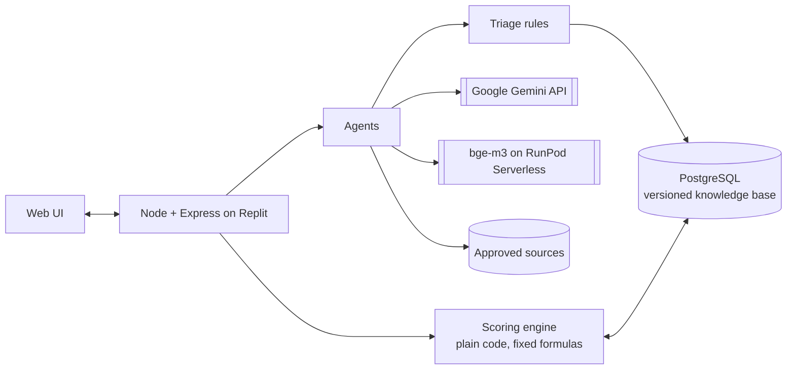

# HalaTuju

**A live map of your career that updates itself as AI changes work.**
*HalaTuju* means "direction" in Malay.

SDC Hackathon 2026 · Domain 1: Aiversecity Future-Ready Workforce · Team _[name]_

| | |
|---|---|
| 🌐 Live demo | _[Replit deployment URL]_ |
| 🎥 Pitch video (5–7 min) | _[YouTube link]_ |
| 📄 PRD · Pitch deck · Tech & Tools Declaration | _[links]_ |
| 🧭 Architecture | [`docs/ARCHITECTURE.md`](docs/ARCHITECTURE.md) |

> **How to read this README.** The **Status** column says how far each feature is proven, and the **Data** column says whether what it shows is real or sample. ✅ **Works**: checked end to end in the running app (live AI and web services, fresh database) on 23 Oct 2026. 🧪 **Built**: in the code and covered by automated tests, not yet re-checked live. 🛠 **Planned**: designed, not built. **Real** data has a cited source; **Sample** data is illustrative and is labelled *Sample* in the app. We don't claim anything marked 🛠 as working.

---

## The problem

Priya Nair (sample persona) has worked in accounts payable at a shared-services centre in Penang for eleven years. Her centre has announced that AI agents will take over month-end close and invoice matching next year. Staff who can move into new roles within six months will be **redeployed, not retrenched**. She has about six hours a week to learn, and her HR team needs to know who can move where.

She needs three answers, and today's tools don't give them:

1. **Which of my skills are still worth something?** AI takes over *tasks*, not whole jobs, and job titles hide which tasks are affected.
2. **Where can I realistically go?** Keyword matching misses real transfers. Her reconciliation work, for example, carries straight into carbon accounting.
3. **Will this advice still be right next month?** One-off assessments go stale while AI moves weekly.

## What HalaTuju does

Upload a CV or LinkedIn PDF. HalaTuju builds your career map: the skills you have, the skills you could learn, and the jobs they lead to, with routes between them. Then it keeps that map current.

**Check any job, not just a demo list.** HalaTuju carries the whole of **ESCO**, the EU's official classification: **3,039 occupations and 13,939 skills** with their 126,051 essential/optional links. For any of them you see your match and skill gap, AI exposure from **ILO WP140** (2,956 occupations), our own model and two more studies, the **O\*NET task list with human ratings** of what AI can and can't speed up (2,471 occupations, 16,411 tasks), the **Malaysian wage and employment trend** for its group (DOSM), and whether its group is on **Malaysia's Critical Occupations List** (TalentCorp MyCOL 2024/2025). Every number names its source.

### Four things that set it apart

**1. A living map, not a dashboard.** A 3D constellation: you at the centre, your skills on the inner ring, skills to learn on the middle ring, jobs on the outer ring. Real route-finding offers **Fastest**, **Balanced** (still good if AI moves fast) and **Safest** routes. Skills that AI has taken over become **closed roads**, and routes go around them.

**2. Knowledge that updates itself, under human control.** An agent called **Road Watch** reads vetted sources every day. Fixed rules apply small, well-sourced changes automatically. Anything big, uncertain or new goes to a person. When a change is approved, affected users' routes are re-checked and visibly **rerouted**, with the source shown.

**3. Routes to a specific employer.** The same job title differs by company. HalaTuju shows your match per employer, using requirements that employers enter themselves (or that an admin extracts from an approved careers page), and adds that employer's extra skills as stops on your route. The demo uses fictional sample employers.

**4. A plan tested against many futures.** HalaTuju answers two different questions and never mixes them:

| Question | What you see | What it means |
|---|---|---|
| **How close are you?** | ▓▓▓▓▓▓░░░░ *about halfway: 2 skills done, 3 close* | Measured today from your skills. You can improve it by learning. |
| **How sturdy is your plan?** | *works in 12 of 18 futures* | Nobody knows how fast AI will change work, so we test your plan against many versions of the future and count how many it survives. |

You can't control the future, but you can choose the plan that survives most of it. HalaTuju also shows *why* a plan fails ("6× not ready before your deadline at a slower study pace", "AI takes over Vendor reconciliation before you reach it") and what would make it sturdier (another route type, or one more study hour a week). See [How sturdy is my plan?](#how-sturdy-is-my-plan-future-stress-test).

---

## Features and status

| Feature | What it does | Status | Data |
|---|---|---|---|
| CV / LinkedIn-PDF intake | Text extraction, personal-detail scrubbing, skills matched to ESCO with bge-m3 embeddings (RunPod Serverless) | 🧪 Built; accuracy evaluation in progress | Real (ESCO) |
| Paste-text intake | Paste CV text instead of uploading a PDF | 🧪 Built | Real (ESCO) |
| Interviewer | Up to 3 follow-up questions where the CV is unclear (fixed question templates, in English and Malay; no AI model) | 🧪 Built | n/a |
| Skill levels with confidence | 1–5 scale with plain descriptions; *From CV / Self-rated / Verified* (a short quiz verifies a skill) | ✅ Works | Quiz questions are Sample |
| Career constellation (3D) | You, your skills, skills to learn, jobs, with your route lit up; closed roads for skills AI has taken over | ✅ Works | Sample catalogue |
| Route options | Fastest / Balanced / Safest via shortest-path routing; alternative routes shown | ✅ Works | Sample catalogue |
| Weekly hours | Weeks are shown at your own study pace (set during intake), not a fixed 6 hours | ✅ Works | n/a |
| Scenarios | Moderate vs Fast AI adoption, 2026–2030 year slider; the "taken over" threshold falls as AI spreads | ✅ Works | Sample |
| Step types | Reuse · Upskill · Evolve · Reskill, each with Learn → Practice → Prove | ✅ Works | Learn = Real courses; Practice/Prove = Sample |
| Human edge | Task split (AI does / AI assists / still needs you) and rising human skills | ✅ Works | Sample |
| Sector exploration | Finance, Sustainability, Tech & data, Operations; the map rebuilds | ✅ Works | Sample |
| Job search | Catalogue jobs added to the map; unknown jobs flagged as low confidence, with nearest catalogue jobs and live ESCO matches | ✅ Works | Real (ESCO lookup) |
| Road Watch (daily agent) | Daily searches of 74 vetted sites (Tavily web search limited to them, RSS, GDELT, Hacker News, arXiv, OpenAlex): 10 skills a day so every map skill is covered every 3 days, plus 10 broad "AI at work" topics. Live run, 23 Oct 2026: 769 articles and 28 searches in 5.5 minutes, 7 new pieces of evidence for review. Quotes checked word for word | ✅ Works | Real |
| Rule-based triage + AI reviewer | A second model checks each claim; fixed rules auto-apply small, well-sourced changes and flag the rest | ✅ Works | Real |
| Admin review queue | Approve / reject flagged changes; confirm emerging skills; spot-checks; run history | ✅ Works | Real + labelled samples |
| Versioned knowledge base | Every change is a new version; any version can be undone | ✅ Works | Real |
| Reroute on approval | Approved change → re-score → the route visibly reroutes (camera flies to the affected skill); saved plans are offered the new route to keep or switch | ✅ Works | Real signal, Sample catalogue |
| Emerging-skill committee | Proposer, skeptic and duplicate check with evidence thresholds; half weight until a person confirms | ✅ Works (live run found no new skill yet; seeded candidates are Sample) | Real + Sample |
| Company-level requirements | Per-employer match % and extra route stops | ✅ Works | Sample (fictional employers) |
| Employer requirements form | Employers enter their own requirements; stored as unverified | ✅ Works | Employer-entered |
| Advisor approval | A plan goes into a learning plan only after an advisor approves it (or asks for changes) | ✅ Works | n/a |
| Accounts and roles | Sign in with email/password or Google (Supabase Auth), or try the demo as Priya with no account. Each account sees only its own profile, plans and confirmed skills; admin and advisor screens need a role; **Delete my data** | 🧪 Built (ownership and role checks tested; live browser sign-in not yet checked) | n/a |
| Deadline tracking | Target date + weekly hours → *Ahead / On track / Behind*, e.g. a six-month redeployment window | ✅ Works | n/a |
| Costed route | Course cost in RM per step and in total, with the HRD Corp-claimable share | ✅ Works (no HRD Corp-claimable course is loaded yet, so that share shows RM 0) | Real (30 course listings with links) |
| SDG-aware ranking | Choose an SDG priority (e.g. climate); jobs re-rank and the trade-off in match % and weeks is shown | ✅ Works | Sample tags on a Sample catalogue |
| "Studies disagree" view | AI exposure from ILO WP140, the Anthropic Economic Index and Eloundou et al., side by side | ✅ Works (shown next to our values; scores still use the catalogue) | Real |
| HR redeployment view | For an employer's team: who can move to which open role, at what match, by when, and at what total cost | ✅ Works | Sample (fictional team) |
| Bahasa Melayu interface | BM toggle for all interface text | ✅ Works (job, skill and source text stays in English) | n/a |
| AI-exposure estimator (self-trained) | A model trained on published human ratings of task exposure; scores any new task. Evaluated on held-out occupations | ✅ Works (shown next to catalogue values; final training run on RunPod still to do) | Real labels |
| Future stress test | Your plan is replayed in 18 possible futures; shows how many it survives, why it fails, and what would make it sturdier | ✅ Works | Mixed: ranges Real, catalogue Sample |
| Check any job (full ESCO) | Search all 3,039 ESCO occupations; match % and skill gap from each job's essential skills; confirm skills you have ("I have this") and the match updates | ✅ Works | Real (ESCO v1.2.1) |
| AI exposure for every job and skill | ILO WP140 for each occupation's group; our model's estimate for all 13,939 skills (embedded with bge-m3 on RunPod); GPTs-are-GPTs and Anthropic Economic Index for the closest US occupation | ✅ Works | Real (model scores are labelled estimates) |
| Task list for any job | The closest O\*NET occupation's tasks (via the official ESCO–O\*NET crosswalk), each with the human rating of whether AI could halve its time | ✅ Works | Real |
| Malaysian labour data | Median wage and number of wage earners for the job's MASCO major group, 2021–2025 | ✅ Works | Real (DOSM; group level) |
| Critical in Malaysia | Flags jobs whose 4-digit group is on MyCOL 2024/2025 (66 groups, 692 ESCO occupations) | ✅ Works | Real (TalentCorp/ILMIA; group level) |

---

## How it works



**Design rule:** agents read, ask and explain; **the scoring engine does the maths.** Every number on screen comes from a fixed formula over database records that carry a source. Agents may only output IDs that exist in the database.

| Agent | Job |
|---|---|
| Interviewer | Turns a CV into a confirmed skill profile; asks about gaps (fixed question templates, no AI model) |
| Road Watch | Finds new AI-capability, adoption and demand signals, skill by skill and by topic |
| AI reviewer | A second model checks each claim against its evidence quote |
| Emerging-skill committee | Proposes, challenges and de-duplicates new skills |
| Career planner / explainer | Explains routes, citing records only |
| Fact checker | Removes any claim without a source |

**Core formulas** (full list in [`docs/ARCHITECTURE.md`](docs/ARCHITECTURE.md#7-formulas-and-parameters-single-source-of-truth)):
- **Match %** = Σ(skill weight × coverage) ÷ Σ weight. Coverage = your level ÷ level needed (max 1); a skill you can bridge to from one you have counts 0.4.
- **Level needed:** which skills a job needs comes from the job's requirements; how well you need them is one rule for every job: a skill counts as yours at level 3 of 5 (you can do it on your own). We don't estimate a level per job; ESCO doesn't publish proficiency levels. A skill you rate 1 or 2 still gives partial credit (1/3 or 2/3) and adds a level-up step to your plan. The one exception is an employer's own requirements, which keep the level the employer entered.
- **Routes:** Dijkstra over skill bridges. Edge cost = weeks of learning plus a penalty that depends on the route type (traffic from AI exposure, AI risk, or worst-case exposure in the Fast AI 2030 scenario).
- **Taken over** = AI exposure above a threshold that falls over time, *and* demand falling. These skills become closed roads.

### Triage rules (deterministic)

| Outcome | When |
|---|---|
| Rejected automatically | No source, untrusted source, quote not found word for word on the page, duplicate, or source older than 180 days |
| Applied automatically | ≥ 2 independent sources, the AI reviewer agrees (confidence ≥ 0.8), the change is small (exposure ±0.05 or demand ±5 points at most), and it changes no one's route or skill zone |
| Sent to a person | Anything else: big change, single source, reviewer unsure or unavailable, unknown source date, would reroute users, or a new skill |

A fixed 5% of automatic changes (chosen by hash, so it can't be gamed) is also queued for a person to spot-check. Accuracy of automatic changes: not yet measured.

**Example from a live run (23 Oct 2026):** Road Watch found Microsoft's Dynamics 365 page (22 Oct 2026) saying its "Account Reconciliation Agent can help identify exceptions between subledgers and the general ledger". The quote was verified on the page, the reviewer agreed, and with a single source it went to a person. When approved, *Vendor reconciliation* becomes a closed road in the 2030 view, and Priya's route to ESG & Carbon Reporting Analyst reroutes from *Vendor reconciliation → GHG emissions accounting* to *Audit trail documentation → Sustainability disclosure*. (At the 2026 view, single small signals like this one don't change routes yet.)

### How sturdy is my plan? (future stress test)

> ✅ Built (`stressTest` in [`shared/engine.js`](shared/engine.js), shown on the Path tab, tests in [`tests/engine.test.ts`](tests/engine.test.ts)).

**The idea in one line:** the match bar shows how close you are today; the stress test counts how many possible futures your plan survives.

**1. What changes from one future to the next**

| Assumption | Range | Where the range comes from |
|---|---|---|
| How fast AI arrives | slow · moderate · fast | Moderate and Fast are our two scenarios. **Slow is our assumption:** half of Moderate's change by 2030 |
| How much AI can do each skill | our estimate −0.085 or +0.085 | Half the average gap (0.17) between ILO WP140 and the Anthropic Economic Index across the 13 jobs where we have both ([`db/seed/studies.json`](db/seed/studies.json)) |
| How many hours a week you really study | your plan · 75% · 50% | real life: busy weeks happen |

That gives a grid of **3 × 2 × 3 = 18 futures**, shown as 18 squares; hover a square to see that future (e.g. *"Fast AI · high estimate · 3 h a week"*) and which check failed.

**2. Three yes/no checks in every future** (the engine replays your route with that future's numbers)

1. **Is the road still open?** No skill on your route is taken over by AI by the time you reach it.
2. **Are you ready in time?** All your steps, at that future's study pace, fit before your target date (or the end of 2030 if you set none).
3. **Is the job still worth having?** Demand for the job is not falling when you arrive, nor at the end of 2030.

All three yes = the plan **works** in that future. The result is a count, e.g. *"works in 12 of 18 futures"*.

**3. Patterns and what to do about them.** Failures are grouped by cause (*"6× not ready before your deadline at a slower study pace"*). The test is then re-run with one change at a time (each other route type, and one more study hour a week), and any change that survives more futures is shown.

**What we see with the current data:** most routes in the catalogue take 4–15 weeks, so they finish in 2027, before the engine's AI takeovers (mostly 2029–30). Most plans therefore survive all 18 futures, and the failures that do appear come from tight deadlines at a slower study pace (Priya's Data Analyst route with a six-month deadline: 12 of 18). Routes that start late or pass through a skill AI is about to take over fail the "road open" check, and the test then suggests the Balanced or Safest route.

**What it is, and what it isn't**
- ✅ A **stress test** of your plan: how many of these possible futures it survives.
- ❌ Not a probability that you'll be hired. ❌ Not a new version of the match %. ❌ Not a prediction of which future will happen.
- Even a fully prepared person with a sturdy plan isn't guaranteed a job: hiring also depends on competition, interviews and the economy, which we don't model. We help you pick the plan that works in the most futures, and we reroute you when real signals show which future is arriving.

**Method:** this follows *Robust Decision Making* (RAND) and the wider *Decision Making under Deep Uncertainty* approach: when nobody knows the true odds, choose the plan that holds up across the most plausible futures instead of betting on one forecast. The same idea is behind "your plan succeeds in X of Y scenarios" in retirement planning and schedule-risk analysis in project management. The ranges are only as good as their sources: the exposure range is sourced, the slow-AI speed is our assumption, and the catalogue values it runs on are sample data (labelled in the app).

---

## Data and source policy

| Source | Used for | Mode |
|---|---|---|
| **ESCO v1.2.1** (European Commission) | All 3,039 occupations and 13,939 skills with their essential/optional links ("check any job"); names, descriptions and codes for the 29-skill catalogue. The catalogue's own job requirements are sample | Reuse, with attribution (CC BY 4.0) |
| **ESCO–O\*NET crosswalk** (ESCO Secretariat with USDOL/ETA) | Links 2,607 ESCO occupations to their closest O\*NET occupation | Reuse, with attribution |
| **TalentCorp & ILMIA, MyCOL 2024/2025** | The 66 critical occupation groups in Malaysia (facts copied from the published table, checked against OCR) | Facts and link only |
| **O\*NET** (USDOL/ETA) | Occupation codes, and task text for training the exposure model (the catalogue's own task lists are sample) | Reuse, with attribution |
| **ILO WP140**, **Anthropic Economic Index**, **Eloundou et al.** | AI exposure per job, shown side by side ("Studies disagree"), and the stress test's exposure range | Reuse, with citation |
| **"GPTs are GPTs"** task labels (Eloundou et al. 2024, MIT) | Training labels for the self-trained exposure model | Reuse, with citation |
| **Course provider listings** | 30 real courses with price, hours and link, for costed routes | Facts and link only |
| **DOSM / OpenDOSM** | Median wage and wage earners by MASCO major group, 2021–2025, shown for every ESCO job's group | Reuse (open government data, CC BY 4.0) |
| Tavily web search (trusted domains only), RSS feeds, GDELT, Hacker News | AI-capability, adoption and demand news for Road Watch | Read and extract |
| arXiv, OpenAlex | AI-capability signals | Read and extract |
| Approved company careers pages | Company-specific requirements | Read and extract (facts, a short quote and the link only) |
| Job boards (JobStreet, LinkedIn, Indeed and similar) | "See openings" | **Link only.** Their terms forbid automated access, so our agents never open them |

**Rules for every fetch:**
- Approved domains only.
- Obey robots.txt and identify the bot.
- No logins, paywalls or workarounds.
- Store extracted facts, a short evidence quote and the link, never full copies of pages.
- Scrub personal details.
- Rate-limit and cache.

Page text is treated as **data, never as instructions** (protection against prompt injection). No single page can change a user's route on its own.

**Sample data:** where real data is not yet loaded, values are labelled *Sample* in the UI. Sample today: the demo persona (Priya Nair), the job and skill catalogue's exposure and demand outlook, task splits, skill bridges and job requirements, posting shares, Practice/Prove tasks, the employers and the HR team. Real today: the full ESCO taxonomy and the catalogue's ESCO mappings, the exposure studies (ILO WP140 for every ESCO occupation group; GPTs-are-GPTs and the Anthropic Economic Index through the crosswalk), O\*NET tasks with human ratings, DOSM wages, MyCOL, course listings, Road Watch signals and the exposure model's training labels.

---

## Domain 1 must-haves

| Must-have | Where |
|---|---|
| Skills profile intake | CV/LinkedIn upload, interviewer, confirm-and-rate |
| AI-trend signal layer (updatable, dated) | Road Watch, dated signals, versioned knowledge base |
| Future-role matching + skills gap | Match % per job and per employer; skills you have vs. need |
| Personalised reskilling pathway | Routes fitted to weekly hours; Reuse / Upskill / Evolve / Reskill steps |
| SDG mapping | Every job (16) and skill (29) tagged with an SDG and a one-line reason, checked by a test; SDG-aware ranking |
| More than one future scenario | Moderate vs Fast AI, year slider, Balanced route, and the future stress test (each plan replayed in 18 futures) |

**SDGs:** 8 Decent Work (primary: redeployment instead of retrenchment, productivity through technology), plus 9 Industry & innovation (data and AI skills), 12 Responsible production and 13 Climate action (green-job routes) and 16 Strong institutions (controls, audit and tax compliance). The product as a whole serves SDG 4 target 4.4 (adults with skills for employment).

## Responsible AI

- **People decide.** No plan changes without the user's or an advisor's approval; big knowledge changes need a person.
- **No invented facts.** Agents use database IDs only; unsourced claims are removed.
- **Fairness by design.** Age, gender, race and religion are never collected or used.
- **Privacy.** Personal details are scrubbed before any AI call, and CV files are never stored. Each account sees only its own profile and plans, and **Delete my data** removes the profile and everything linked to it. The demo uses a synthetic persona only.
- **Reversible.** Every knowledge change is versioned and can be undone.

---

## Business model (planned analysis)

> 🛠 Figures below are to be filled from cited public sources. No number is estimated without a source.

**Who pays:** employers and institutions, not workers. The worker app stays free.

| Customer | Pays for | Why |
|---|---|---|
| Shared-services and finance operations employers | HR redeployment view + employer requirements, per seat or per redeployment programme | Redeploying is usually cheaper than retrenching and rehiring, and training may be HRD Corp-claimable |
| Universities, TVET centres, career services | Advisor dashboards for students and graduates | Employability outcomes |
| Government and agency programmes (later) | Aggregate, anonymised skill-shift insight | Workforce planning |

**Market sizing (to complete):**

| | Definition | Source to use |
|---|---|---|
| **TAM** | Malaysian workers in occupations with high AI exposure | DOSM Labour Force Survey (employment by occupation group) × ILO WP140 exposure shares |
| **SAM** | Finance, admin and clerical staff in Malaysian shared-services and outsourcing centres | MDEC / industry reports on Malaysia's GBS sector _[cite]_ |
| **SOM** | Seats reachable in 3 years through _[n]_ pilot employers and _[n]_ institutions | Our pilot plan |

**Break-even (to complete):** monthly costs (hosting, AI model usage per user, RunPod embeddings, support) ÷ contribution per seat → seats needed to break even, with cost per user taken from measured usage in the prototype.

## Tech stack and sponsor tools

| Area | Choice |
|---|---|
| App and hosting | **Replit** (Node 20, TypeScript, Express 5; `.replit` runs `npm start` with PostgreSQL 16) |
| AI models | **Google Gemini API**: gemini-3.5-flash-lite (main), gemini-3.1-flash-lite (reviewer) |
| Embeddings (GPU) | **BAAI/bge-m3 on RunPod Serverless** (worker-infinity-embedding); a local Infinity server or Gemini embeddings as fallbacks |
| Web search | Tavily (Road Watch only, limited to trusted domains; ~30 searches a day fits the free tier) |
| Database | PostgreSQL; embedded PGlite when no `DATABASE_URL` is set |
| Backend libraries | zod, multer, unpdf (PDF text), fast-xml-parser |
| Frontend | Vanilla JS, 3d-force-graph (three.js), GSAP, Lucide icons, Geist font |

### Sponsor tools

**Replit.** The app is set up to build and deploy on Replit (`.replit`: Node 20, PostgreSQL 16, `npm start`). The in-app AI agents (Road Watch, AI reviewer, emerging-skill committee, explainer) call the **Google Gemini API**.
Proof: deployment URL _[link]_, project history, `submission/Replit_POU.pdf`.

**RunPod.** With `EMBED_PROVIDER=runpod` (the deployed setting), the **BAAI/bge-m3** embedding model runs on **RunPod Serverless** and:
1. matches CV and LinkedIn text to ESCO skills,
2. removes duplicate Road Watch signals,
3. merges synonyms when new skills emerge (e.g. "vibe coding" and "AI-assisted coding"), and
4. embeds new tasks for the self-trained exposure model (checked live on 23 Oct 2026).

The exposure model has so far been trained on a local GPU, which the organisers allow for testing. The final training run on a RunPod GPU pod is still to do (see [Train the AI-exposure model](#train-the-ai-exposure-model)).

Proof: endpoint ID _[id]_, GPU type _[type]_, runtime screenshot in `submission/Runpod_POU.pdf`. Both are also listed in the Tech & Tools Declaration _[link]_.

## Run it

```bash
npm install
cp .env.example .env    # GEMINI_API_KEY is required; everything else is optional (see below)
npm run db:setup        # schema + seed; add --reset to wipe a local database first
npm run dev             # http://localhost:3000
npm test                # 343 tests: engine, stress test, triage, Road Watch sources, PII scrubbing, fairness, prompt injection, API, HR, web client
```

Environment (all in `.env.example`):
- **AI:** `GEMINI_API_KEY` (required), `GEMINI_API_KEY_2`, `GEMINI_MODEL`, `GEMINI_REVIEWER_MODEL`.
- **Database:** `DATABASE_URL` for PostgreSQL (production: the Supabase pooler connection string); leave it empty to use an embedded PGlite database in `./data`.
- **Accounts:** `SUPABASE_URL` and `SUPABASE_ANON_KEY` switch on sign-in (email/password and Google, via Supabase Auth); leave them empty for an open demo without accounts. `ADMIN_EMAILS` and `ADVISOR_EMAILS` (comma-separated) give staff roles. Google sign-in also needs the Google provider enabled in the Supabase dashboard, and the app's `/app` URL added to Auth → URL Configuration → Redirect URLs.
- **Embeddings:** `EMBED_PROVIDER` (`runpod` / `local` / `gemini` / `none`), `RUNPOD_API_KEY`, `RUNPOD_EMBED_ENDPOINT_ID`, `LOCAL_EMBED_URL`, `LOCAL_EMBED_MODEL`.
- **Road Watch web search:** `TAVILY_API_KEY` (free tier is enough) or `BRAVE_API_KEY`.
- **Other:** `DEMO_MODE` (replay the last recorded Road Watch run if a live source fails, labelled "replayed"), `ADMIN_TOKEN` (header `x-admin-token` opens staff routes for scripts), `SCOUT_SCHEDULE`, `SCOUT_INTERVAL_HOURS`, `PORT`.

The UI prototype runs on its own: open [`prototype/halatuju-app.html`](prototype/halatuju-app.html) in a browser (internet needed for its libraries).

## Train the AI-exposure model

> **Status:** trained and evaluated on a local GPU (RTX 4070 Laptop, 23 Oct 2026); the app serves it at `/api/exposure/*` and shows it next to the catalogue values (it does not drive the scores yet). **The final training run on RunPod is still to do.** Scripts live in `ml/`; sources and licences are in [`ml/SOURCES.md`](ml/SOURCES.md).

**What it is:** a small model that predicts *how much of a task AI can do* (0–1) from the task's text. Each task is turned into an embedding with **BAAI/bge-m3**, and a **ridge regression** is trained on human ratings of task exposure. The trained weights are exported as a small JSON file, so the app scores a new task with one dot product. No GPU is needed for the model itself, but each new task needs a bge-m3 embedding (RunPod Serverless, or a local embedding server).

**Results so far** (local run; split by occupation, so test occupations were never seen in training):

| Held-out set | Model | Always predict the average | Copy the nearest training task | GPT-4's own labels (reference) |
|---|---|---|---|---|
| Per task (n = 3,959) | r 0.671 · ρ 0.689 · MAE 0.203 | MAE 0.328 | r 0.565 · ρ 0.591 · **MAE 0.176** | r 0.587 · ρ 0.629 · MAE 0.189 |
| Per occupation (n = 185) | **r 0.918 · ρ 0.916 · MAE 0.065** | MAE 0.170 | r 0.881 · ρ 0.880 · MAE 0.070 | r 0.853 · ρ 0.879 · MAE 0.089 |

The model ranks tasks and occupations best (highest r and ρ), and is the most accurate per occupation. Per single task, copying the nearest training task has a lower average error (MAE 0.176 vs 0.203).

**Independent check against ILO WP140.** We scored all 13,939 ESCO skills with the model (bge-m3 embeddings on RunPod Serverless, 486 s) and averaged each occupation's essential-skill scores. Across the 2,956 occupations ILO also scores, the two agree at **Pearson r = 0.79, Spearman ρ = 0.80**. ILO's method (expert and AI scoring of ISCO tasks) and data are independent of the model's training labels.

**Rule:** the hackathon requires GPU training and fine-tuning to run on **RunPod**. The organisers confirmed that **local testing on our own GPU is acceptable, as long as the final training runs on RunPod**. Keep a screenshot of that confirmation (Discord) in `submission/`, and mention it in the Tech & Tools Declaration. Develop and test locally (CPU or local GPU), then do one final run on RunPod.

### 1. Data
- **Labels:** human exposure ratings (E0/E1/E2) for 19,265 O\*NET task statements from *"GPTs are GPTs"* (Eloundou et al., *Science* 2024; MIT licence), pinned to a commit and checksum in `ml/SOURCES.md`. Target β = E1 + 0.5·E2. GPT-4's labels from the same file are used only as a comparison.
- **Task text:** the O\*NET task statements in that file (CC BY 4.0).
- `ml/prepare_data.py` writes `ml/data/train.csv` (task text, score, occupation code).

### 2. Develop and test locally (free)
```bash
cd ml
python -m venv .venv && source .venv/bin/activate   # Windows: .venv\Scripts\activate
pip install -r requirements.txt                       # sentence-transformers, scikit-learn, pandas
python prepare_data.py
python embed.py   --sample 300                        # bge-m3 on a small sample; uses the local GPU if available, else CPU
python train.py   --sample
python evaluate.py --sample
```
- A local GPU (e.g. RTX 4070, 8 GB) is fine for **testing**, as confirmed by the organisers. bge-m3 fits comfortably; if memory runs short, lower the batch size in `embed.py`.
- To force CPU only: `export CUDA_VISIBLE_DEVICES=""` (Windows PowerShell: `$env:CUDA_VISIBLE_DEVICES=""`).
- Get the whole pipeline and the evaluation working here before spending any credit. **The final training run and the published model must come from RunPod** (step 3).

### 3. Final run on RunPod (about 30–60 minutes, about US$1)
1. In the RunPod console, deploy a **GPU pod**: RTX 4090 (Community Cloud) or A40, using the **RunPod PyTorch** template, with about 30 GB of container disk. A network volume isn't needed.
2. Open the pod's terminal or Jupyter, then:
   ```bash
   git clone <repo-url> && cd <repo>/ml
   pip install -r requirements.txt
   python prepare_data.py && python embed.py && python train.py && python evaluate.py
   ```
3. **Take the proof screenshots** while the pod is running: pod ID, GPU type, and the runtime or billing view. Save them into `submission/Runpod_POU.pdf`.
4. Copy the outputs back: `ml/artifacts/exposure_model.json` (weights) and `ml/artifacts/eval.json` (metrics). Commit both; they are small.
5. **Terminate the pod immediately.** Stopping it isn't enough if a disk is still attached.

### 4. Evaluate honestly
- Split the data **by occupation**, so no occupation's tasks appear in both training and test data. This stops the model from simply memorising jobs.
- Report **Pearson r, Spearman ρ and mean absolute error** on the held-out tasks, against two baselines: always predicting the average, and copying the nearest neighbour.
- `ml/evaluate.py` writes all of these to `ml/artifacts/eval.json`, with where it ran (machine, GPU, time). The numbers in the results table above are copied from that file; after the RunPod run, replace them with the new ones. Never round up and never estimate.

### 5. Embedding endpoint for the app (RunPod Serverless)
- Worker: `runpod/worker-infinity-embedding`, with `MODEL_NAMES=BAAI/bge-m3`.
- **Minimum workers = 0** (it scales to zero, so you pay only while it's working); maximum workers 1–2; FlashBoot on, if offered.
- Put the endpoint ID in Replit Secrets as `RUNPOD_EMBED_ENDPOINT_ID`, with `RUNPOD_API_KEY`.
- Call `/api/health` about 2 minutes before recording, to warm it up. If the endpoint is cold or down, the app falls back to basic keyword matching and labels it.

### Credit guardrails (US$25 per team)
| Do | Don't |
|---|---|
| Terminate pods as soon as a run ends | Leave a pod running overnight (US$8–17 per night) |
| Keep serverless minimum workers at 0 | Set "active workers" above 0 (they bill around the clock) |
| Delete unused volumes and storage | Keep anything running "just in case" through judging (25–28 Oct) |

Expected total spend: about US$3–8, covering development, the demo and judging.

## Repository layout

```
server/                   Express API: agents/ (scout = Road Watch, reviewer, committee, CV, interviewer, explainer),
                          routes/, services/ (planning, ranking, rescore, HR, scheduler), sources/ (fetch policy, search)
shared/engine.js          scoring engine and stress test, used by both server and browser
web/                      browser app (vanilla JS, 3D map, en/ms translations)
db/                       schema, migrations and seed data (db/seed/README.md says what is real or sample)
ml/                       AI-exposure model: data prep, embedding, training, evaluation, artifacts
scripts/                  database seed and data builders
tests/                    automated tests (vitest)
docs/                     ARCHITECTURE, API, DATA_SOURCES, PITCH
proposal/  prototype/     product proposal; early UI prototypes (sample data)
competitors/              competitor notes
.github/workflows/ci.yml  type-check and tests on every push
```

---

## Quality

| Check | What it covers | Status |
|---|---|---|
| Automated tests (`npm test`) | Scoring engine, stress test, SDG coverage, full ESCO data and "check any job", O\*NET/DOSM/MyCOL layers, triage rules, Road Watch sources, personal-detail scrubbing, fairness, prompt injection, API shapes, source policy, HR, web client. 343 tests (23 Oct 2026); network and AI are mocked | ✅ |
| Continuous integration | Type-check and tests on Node 20 and 22, on every push and pull request (`.github/workflows/ci.yml`); no linter yet | ✅ |
| Fairness check | The same CV with a different name, gender, age or religion gives identical results (`tests/fairness.test.ts`) | ✅ |
| CV-reading benchmark | 14 messy synthetic CVs (broken PDF text, typos, Bahasa Melayu, keyword stuffing, out-of-catalogue jobs), answer key written blind. First run: skills found **90%**, skills correct **88.5%**, levels in range **94%**, job mapped **79%**; no-AI baseline 78% / 63% / 45% / 71%. Method, failures and caveats: [`eval/RESULTS.md`](eval/RESULTS.md) | ✅ |
| Prompt-injection check | Hostile page text cannot change extraction, invent IDs or skip triage (`tests/injection.test.ts`) | ✅ |
| Confidence and "Why this number?" | Figures show their basis, sources and dates; explanations cite records, and a fact checker drops uncited sentences | ✅ |
| Health and demo safety | `/api/health` (database, AI, embeddings, scheduler); replayed Road Watch runs are labelled "replayed" | ✅ |
| Live end-to-end check | Road Watch → review → approve → reroute in a real browser, plus every other non-CV feature through the API on a fresh database (23 Oct 2026) | ✅ |

## Known limitations

- The job and skill catalogue (exposure and demand outlook, task splits, requirements, skill bridges) is sample data; the UI labels it. The real exposure studies and the self-trained model are shown next to it but don't drive the scores yet.
- "Check any job": your match counts skills you confirmed ("I have this") or that map exactly from your profile; a closely related catalogue skill counts 40% only above a strict similarity of 0.8, so matches start low until you confirm skills.
- O\*NET tasks and the two US studies come from the *closest* US occupation; about half the links are "broad" (the US occupation is wider), and the panel says which.
- DOSM figures and the MyCOL flag are for the whole occupation group (e.g. "Professionals", "Accountants and Auditors"), not the single ESCO job. MASCO codes added for Malaysia (e.g. 2531 Cyber Security Professionals) have no ESCO equivalent.
- Model scores for ESCO skills are estimates from skill titles; the model was trained on O\*NET task statements, so knowledge items (nouns) are further from its training data.
- The demo's employers and HR team are fictional. Careers-page extraction works but no real employer is loaded yet. Job boards are link-only.
- No HRD Corp-claimable course is loaded yet, so the claimable share shows RM 0.
- The "would reroute N users" count in the review queue checks only the 2026 view, while the map reroutes at whatever year you are viewing.
- The emerging-skill committee counts mentions in trusted news and research, not job postings, so a new skill needs several weeks of runs to reach its thresholds.
- In Malay, interface text is translated; job and skill names and source quotes stay in English.
- Skill levels are self-rated or taken from the CV until a skill is verified by a check.
- Forecasts are scenarios, not predictions about any one person.

## Credits and licences

- **This project:** Apache License 2.0 ([`LICENSE`](LICENSE)).
- **ESCO:** This service uses the ESCO classification of the European Commission. Modifications have been made.
- **O\*NET:** Includes information from the O\*NET Database by the U.S. Department of Labor, Employment and Training Administration (USDOL/ETA), used under CC BY 4.0. We have modified some of this information; USDOL/ETA has not approved, endorsed or tested these modifications.
- **ILO:** Gmyrek, P. et al. (2025). *Generative AI and Jobs: A Refined Global Index of Occupational Exposure.* ILO Working Paper 140. CC BY 4.0.
- **"GPTs are GPTs":** Eloundou, T., Manning, S., Mishkin, P. & Rock, D. (2024). *GPTs are GPTs: Labor market impact potential of LLMs.* Science 384(6702). Task labels from `openai/GPTs-are-GPTs`, MIT licence.
- **Anthropic Economic Index:** Massenkoff, M. & McCrory, P. (2026). *Labor market impacts of AI: A new measure and early evidence*, and the Economic Index usage data (Hugging Face `Anthropic/EconomicIndex`; data CC BY, code MIT). We selected rows and mapped them to our catalogue.
- **DOSM:** Department of Statistics Malaysia via data.gov.my, CC BY 4.0.
- **ESCO–O\*NET crosswalk:** ESCO Secretariat in collaboration with the U.S. Department of Labor/ETA, v1 (Sep 2022).
- **MyCOL:** TalentCorp Malaysia and ILMIA (Critical Skills Monitoring Committee), *MyMahir Malaysia Critical Occupations List 2024/2025*. Occupation codes and titles only.
- **Models and libraries:**
  - Google Gemini API (in-app agents)
  - BAAI/bge-m3 (MIT)
  - RunPod worker-infinity-embedding
  - 3d-force-graph
  - GSAP
  - Lucide
  - Geist font
- **Each component remains under its own licence.**

## AI tools used to build this project

Declared in full in the Tech & Tools Declaration. The hackathon rules require every AI tool used to be listed.

| Tool | Used for |
|---|---|
| Claude Code (Anthropic) | Writing and reviewing code and tests, debugging, documentation |
| Google Gemini API (gemini-3.5-flash-lite, gemini-3.1-flash-lite) | In-app agents: Road Watch, AI reviewer, emerging-skill committee, explainer |
| _[any other AI tool the team used]_ | _[what for]_ |

## Team

| Name | Role |
|---|---|
| _[name]_ | _[role]_ |
