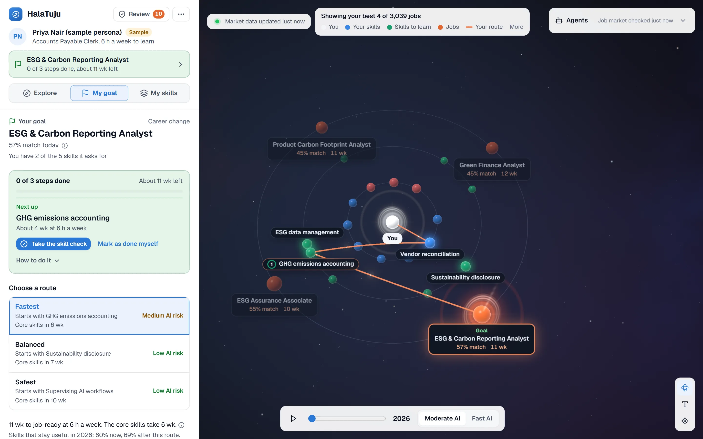
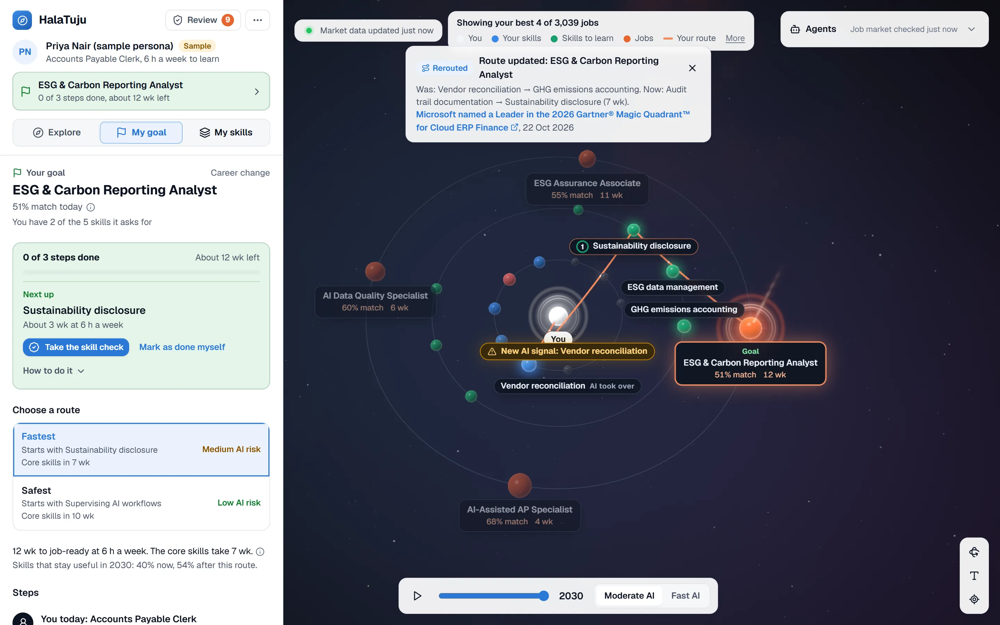
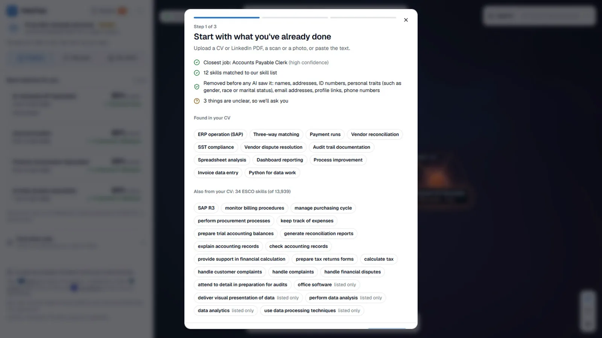
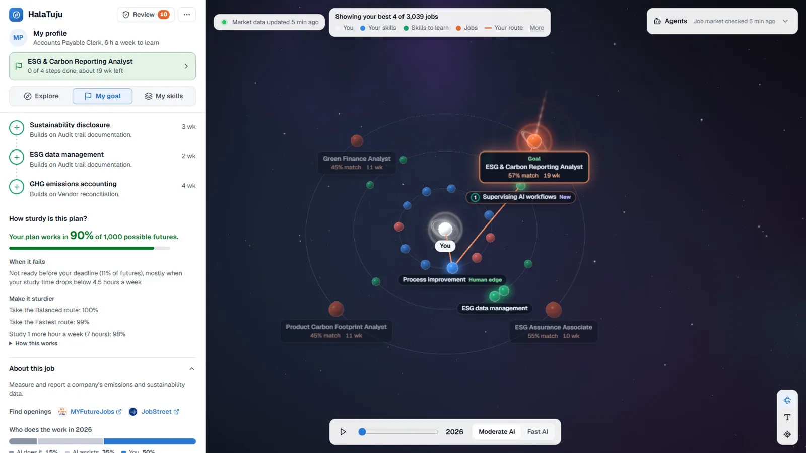
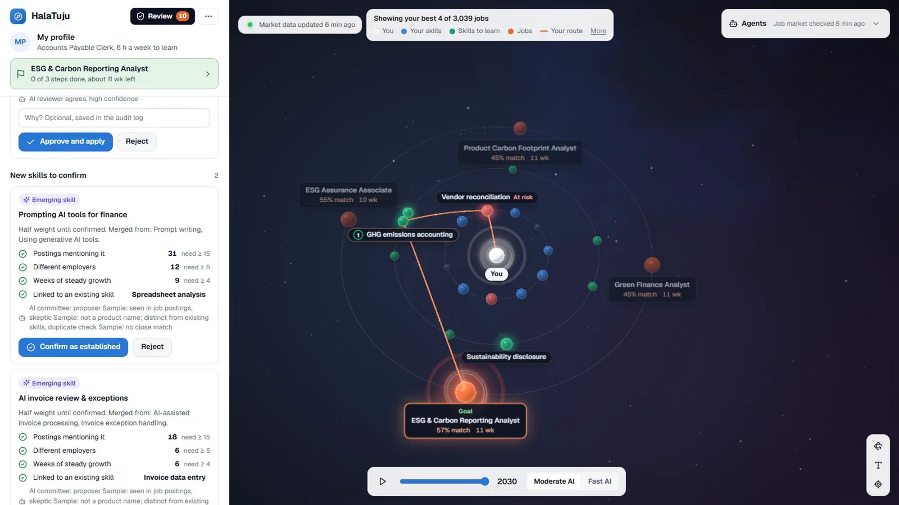
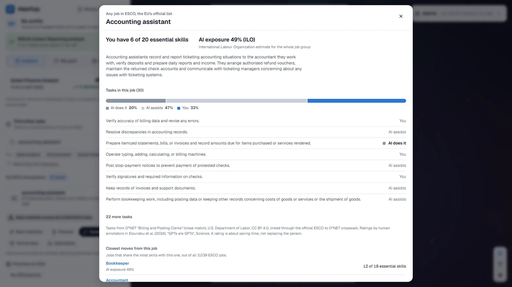
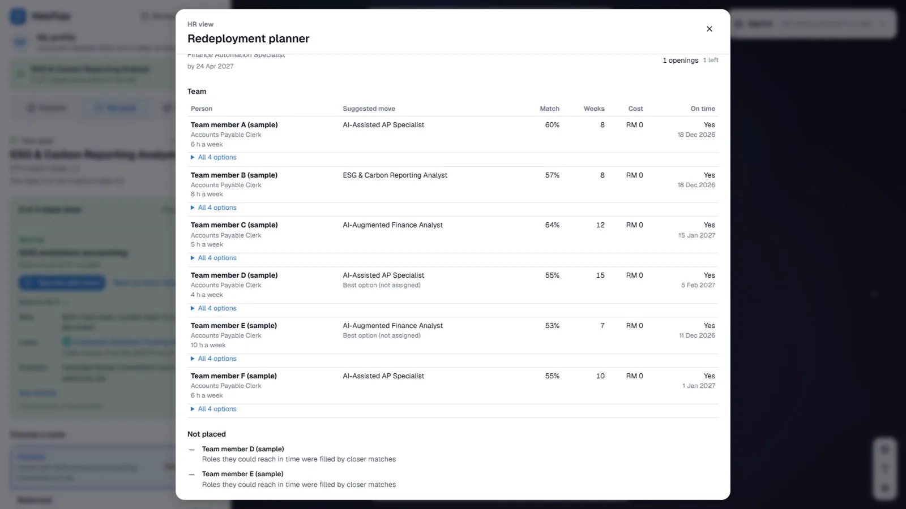

# HalaTuju

**A GPS for your career: when AI closes a road, it reroutes you.**
Upload a CV and HalaTuju maps the skills you have, the jobs they lead to and a week-by-week route there. A researcher agent reads the job market every day, a person approves anything that changes a route, and your route visibly reroutes, with the source attached. *HalaTuju* means "direction" in Malay.

[](https://halatuju.replit.app) [](https://youtu.be/shITdy-TYSg) [](https://github.com/shenenleow10521/SdcHackathon/actions/workflows/ci.yml) [](LICENSE)



| 3,039 jobs · 13,939 skills | r = 0.92 | 97% | 99.4% | 1,000 futures | 74 sites, daily |
|:---:|:---:|:---:|:---:|:---:|:---:|
| the full ESCO taxonomy, searchable | our AI-exposure model vs experts, on 185 jobs it never saw | current job read right from 36 unseen CVs | planted personal details removed before any AI reads the CV | every plan is stress-tested | the Job market researcher keeps the map current |

**Try it:** open [halatuju.replit.app](https://halatuju.replit.app), choose **Open the app**, then **Skip, use the sample** to walk Priya's route, or upload your own CV as a guest. No account needed.

## Team information

| Field | Details |
|---|---|
| **Team name** | Dsaise |
| **Team domain** | Domain 1: Aiversecity Future-Ready Workforce |
| **SDG track** | **SDG 8** Decent Work and Economic Growth (targets 8.5, 8.2: redeployment instead of retrenchment), with **SDG 4** (target 4.4: skills for employment). Every job and skill on the map links to a UN goal |
| **Team leader** | Leow Shen En |
| **University** | Universiti Malaya |
| **Number of members** | 5 |

## Links

| Resource | Link |
|---|---|
| GitHub repository | https://github.com/shenenleow10521/SdcHackathon |
| Replit project | _[Replit project URL]_ |
| Live demo | https://halatuju.replit.app |
| RunPod endpoint | `https://api.runpod.ai/v2/a7ipau1nmqogxs` (bge-m3 embeddings; needs our API key, see [How we use RunPod](#how-we-use-runpod-required)) |
| Slide deck | [`submission/SDC2026_Dsaise_PitchDeck.pdf`](submission/SDC2026_Dsaise_PitchDeck.pdf) |
| Demo video | https://youtu.be/shITdy-TYSg |
| Preliminary submission (official template) | [`submission/SDC2026_Dsaise_Preliminary.pdf`](submission/SDC2026_Dsaise_Preliminary.pdf) |
| Tech & Tools Declaration (official template) | [`submission/SDC2026_Dsaise_TechDeclaration.pdf`](submission/SDC2026_Dsaise_TechDeclaration.pdf) |
| Replit and RunPod proof of use | [Replit](submission/SDC2026_Dsaise_Replit_POU.pdf) · [RunPod](submission/SDC2026_Dsaise_Runpod_POU.pdf) |

---

## Overview

### Problem

AI is reshaping jobs one task at a time.

- **620,000 Malaysian jobs** will be highly impacted by AI and digitalisation within 3 to 5 years (TalentCorp impact study, 2024).
- **1 in 4 workers** worldwide has a job that AI can partly do; most of these jobs will change rather than vanish (ILO Working Paper 140, 2025).
- **57%** of AI use at work helps a person do a task; the other 43% does the task alone (Anthropic Economic Index, 2025).

Meet Priya Nair (our sample persona). She has processed invoices at a shared-services centre in Penang for eleven years. Her employer is handing invoice matching and month-end close to AI agents next year, and staff who can move into a new role within six months will be **redeployed instead of retrenched**. She has six hours a week to learn. She needs three answers that today's tools don't give her:

1. **Which of my skills still count?** AI takes over tasks, and job titles hide which tasks.
2. **Where can I realistically go?** Keyword matching misses real transfers: her reconciliation work carries straight into carbon accounting.
3. **Will my plan still be right next month?** One-off assessments go stale while AI moves weekly.

Her HR team has the mirror problem: who can move to which open role, by when, at what training cost. Tools like MyMahir, MYFutureJobs and LinkedIn Career Explorer compare skills or suggest courses; none of them states a dated, step-by-step plan that updates when AI changes the work.

### Solution

| 1. Upload a CV | 2. See your skills | 3. Pick a route | 4. Stay on track |
|---|---|---|---|
| PDF, LinkedIn export, scan, photo or pasted text. Personal details are removed **before any AI reads it**; skills appear in about 15 seconds. | Which skills still count, which AI is taking over, and how that changes from 2026 to 2030. | Fastest, Balanced or Safest route to a job, fitted to your weekly hours, with real courses, RM cost and a 1,000-future stress test. | A daily researcher agent reads 74 trusted sites. A person approves anything that changes a route, and your route reroutes in front of you. |

**When the market moves, so does the route.** On 22 Oct 2026 Microsoft wrote that its Account Reconciliation Agent "can help identify exceptions between subledgers and the general ledger". The Job market researcher found it, checked the quote word for word on the page, and sent it to a person. One click on **Approve**: *Vendor reconciliation* becomes a closed road, and Priya's route bends through *Audit trail documentation → Sustainability disclosure*, with the source attached.

| Before the signal | After a person approves it |
|---|---|
|  |  |

**Design rule: AI reads and explains; fixed formulas set every number.** Agents may only output IDs that exist in the database, every figure on screen comes from a formula over sourced records, and every change to the knowledge base is versioned and can be undone.

<details>
<summary><b>What only HalaTuju does</b> (eight things you can check in the live app)</summary>

| | What you see | The number behind it |
|---|---|---|
| **1. The reroute** | Dated evidence, a verified quote, a person's approval, then the camera flies to the affected skill and the route bends, with the source attached | Knowledge base v1 → v2 and the reroute in 0.1 s (demo dry run, 24 Oct 2026); every version can be undone |
| **2. Our own AI-exposure model, trained on RunPod** | A score for how much of any task AI can do, shown next to three published studies | On **185 occupations it never saw**: **r 0.919, MAE 0.065**, ahead of copying the nearest training task (r 0.880) and GPT-4's own labels (r 0.853). Against the ILO's independent index across 2,956 occupations: r 0.79 |
| **3. The whole ESCO taxonomy** | "Check any job": match %, skill gap, AI exposure, O\*NET tasks with human ratings, Malaysian wages | **3,039 occupations, 13,939 skills**, 126,051 essential/optional links (ESCO v1.2.1) |
| **4. Your plan in 1,000 futures** | *"Your plan works in 90% of 1,000 possible futures"*, why it fails, and what would make it sturdier | Seeded Monte Carlo over AI speed, our model's measured error, study hours and step length; about 5 ms per plan |
| **5. A blind-annotated CV benchmark** | Skills, levels and the CV line that proves each one | 36 held-out CVs: current job **97.2%**, ESCO skills shown correct **71.7%** (blind judge), personal details removed **99.4%** after fixes (82.6% blind first run). [`eval/RESULTS.md`](eval/RESULTS.md) |
| **6. Emerging skills ESCO doesn't have** | A committee that proposes, challenges and de-duplicates new skills against all of ESCO | ESCO has no equivalent for any of our 5 AI-era skills; 3 real runs put 6 candidates on watch, 3 hold up by hand. [`eval/EMERGING.md`](eval/EMERGING.md) |
| **7. Local OCR before any AI** | Scans and phone photos of CVs are read on our own server; unsure text goes back to the user first | Up to 3 pages; the scanned test CV leaks no personal detail |
| **8. Malaysian grounding** | "Critical in Malaysia" flags, DOSM wages, requirement labels taken from ESCO | **10 of the 15 destination jobs** are on MyCOL 2024/2025 |

</details>

### Key features

Grouped by priority: the first group is the demo path. **Status:** ✅ **Works**, checked end to end in the running app on 23–24 Oct 2026 · 🧪 **Built**, in the code and covered by tests, not yet re-checked live. **Data:** *Real* has a cited source; *Sample* is illustrative and labelled *Sample* in the app.

#### 1. The core path: CV → map → route → reroute

| Feature | What it does | Status · Data |
|---|---|---|
| **CV reading** | PDF, LinkedIn export, scan or photo (local OCR, English + Malay) or pasted text → personal details removed → Gemini and bge-m3 (RunPod) match skills to ESCO → up to 3 follow-up questions | 🧪 Benchmarked on 50 synthetic CVs · Real (ESCO) |
| **3D career map** | You, your skills, skills to learn and jobs; skills AI has taken over become closed roads | ✅ · Sample catalogue |
| **Three routes** | Fastest / Balanced / Safest, shortest-path routing priced in weeks at your own pace and in RM, each step linked to a real course | ✅ · Real courses, Sample catalogue |
| **1,000-future stress test** | Replays your plan in 1,000 futures; shows the share it works in, why it fails, and the change that makes it sturdier | ✅ · Ranges Real, catalogue Sample |
| **Reroute on approval** | An approved signal re-scores plans and the route visibly reroutes; saved plans are offered *keep or switch* | ✅ · Real signal, Sample catalogue |

| CV reading: personal details removed first | Stress test: 90% of 1,000 futures |
|---|---|
|  |  |

#### 2. Keeping the map current, with a person in charge

| Feature | What it does | Status · Data |
|---|---|---|
| **Job market researcher** (daily agent) | Searches 74 vetted sites (Tavily limited to them, RSS, GDELT, Hacker News, arXiv, OpenAlex), 10 skills a day plus 10 broad topics. Live run, 23 Oct 2026: 769 articles and 28 searches in 5.5 min, 7 findings for review | ✅ · Real |
| **Quote check + AI reviewer + fixed triage** | The quote must appear word for word on the page; a second model checks the claim; fixed rules apply small multi-source changes and send the rest to a person | ✅ · Real |
| **Review queue** | Approve or reject flagged changes, with the reason saved in the audit log; spot-checks; run history | ✅ · Real + labelled samples |
| **Versioned knowledge base** | Every change is a new version; any version can be undone | ✅ · Real |
| **Emerging-skill committee** | Proposer, skeptic and a duplicate check against all 13,939 ESCO skills; a new skill counts half until a person confirms it | ✅ · Real + Sample |



#### 3. Depth for any of 3,039 jobs

| Feature | What it does | Status · Data |
|---|---|---|
| **Check any job** | Match % and skill gap for any ESCO occupation; confirm skills you have and the match updates | ✅ · Real (ESCO v1.2.1) |
| **AI exposure, four sources** | ILO WP140, the Anthropic Economic Index, GPTs-are-GPTs and our own model side by side ("Studies disagree") | ✅ · Real (model scores labelled as estimates) |
| **Task list** | The closest O\*NET occupation's tasks, each with the human rating of whether AI could halve its time | ✅ · Real |
| **Malaysian context** | DOSM median wage and wage earners (2021–2025) and MyCOL "critical in Malaysia" flag, by occupation group | ✅ · Real (group level) |
| **Self-trained exposure model** | Scores any new task; trained on RunPod, evaluated on held-out occupations | ✅ · Real labels |



#### 4. For employers and advisors

| Feature | What it does | Status · Data |
|---|---|---|
| **HR redeployment planner** | Who in a team can move to which open role, at what match, by when and at what total cost | ✅ · Sample (fictional team) |
| **Employer requirements** | Employers add the skills they need; each worker's match and route update; per-employer match % | ✅ · Employer-entered / Sample |
| **Advisor approval** | A plan becomes a learning plan only after an advisor signs off or asks for changes | ✅ |



<details>
<summary><b>5. Everyday details</b> (14 more features)</summary>

| Feature | What it does | Status · Data |
|---|---|---|
| Skill levels with confidence | 1–5 with plain descriptions; *From CV / Self-rated / Verified* (a short quiz); a skill only listed in a skills section is capped at level 2 | ✅ · Quiz questions Sample |
| Time machine | Year slider 2026–2030 and Steady vs Fast AI spread; the "taken over" threshold falls as AI spreads | ✅ · Sample |
| Step types | Reuse · Upskill · Evolve · Reskill, each with Learn → Practice → Prove | ✅ · Learn Real, Practice/Prove Sample |
| Human edge | Task split (AI does / AI assists / still needs you) and rising human skills | ✅ · Sample |
| Weekly hours | Weeks shown at your own study pace | ✅ |
| Deadline tracking | Target date + weekly hours → *Ahead / On track / Behind* | ✅ |
| Costed route | Course cost in RM per step and in total, with the HRD Corp-claimable share | ✅ (no claimable course loaded yet, so RM 0) · Real (30 courses) |
| SDG-aware ranking | Pick a goal (e.g. climate); jobs re-rank and the trade-off in match % and weeks is shown | ✅ · Sample tags |
| Sector exploration | Finance, Sustainability, Tech & data, Operations; the map rebuilds | ✅ · Sample |
| Job search | Catalogue jobs added to the map; unknown jobs flagged, with nearest catalogue jobs and ESCO matches | ✅ · Real (ESCO lookup) |
| Find openings | Links to MYFutureJobs and JobStreet for the target job (links only; we never scrape job boards) | ✅ |
| Bahasa Melayu | BM toggle for all interface text and the follow-up questions | ✅ (job, skill and source text stays in English) |
| Accounts and roles | Guest CV upload in a private signed browser session, or sign in with Replit-managed Clerk; accounts see only their own data; **Delete my data**; admin and advisor roles | 🧪 (ownership, guest and role checks tested) |
| Health and demo safety | `/api/health`; labelled fallbacks ("basic", "replayed") when an AI service is down | ✅ |

</details>

### Tech stack

| Layer | Technology |
|---|---|
| Frontend | Vanilla JS, 3d-force-graph (three.js), GSAP, Lucide icons, Geist font; English and Bahasa Melayu |
| Backend | Node 22, TypeScript, Express 5; zod, multer, unpdf, tesseract.js (local OCR), fast-xml-parser |
| Database | Replit PostgreSQL 16 (versioned knowledge base); embedded PGlite for local runs and tests |
| Accounts | Replit-managed Clerk; guests use a signed browser cookie |
| AI | **Google Gemini API** (gemini-3.5-flash-lite main, gemini-3.1-flash-lite reviewer); **BAAI/bge-m3** on RunPod Serverless; our ridge exposure model |
| AI / Compute | **RunPod**: Serverless embeddings (endpoint `a7ipau1nmqogxs`) and a GPU pod for the final model training |
| Web search | Tavily, limited to trusted domains |
| Hosting / Dev | **Replit** Deployments (Reserved VM) |
| Tests and CI | Vitest (418 tests), GitHub Actions on Node 22 and 24 |

### Domain 1 must-haves

| Must-have | Where in HalaTuju |
|---|---|
| 1. Skills profile intake | CV / LinkedIn PDF, scan or photo (local OCR), pasted text; follow-up questions; confirm and rate levels |
| 2. AI-trend signal layer (updatable, dated) | Daily Job market researcher on 74 vetted sites; every signal dated, quoted and checked; versioned knowledge base |
| 3. Future-role matching + skills gap | Match % and skill gap per job, per employer, and for any of 3,039 ESCO jobs |
| 4. Personalised reskilling pathway | Fastest / Balanced / Safest routes at your weekly hours, with real courses and RM cost |
| 5. SDG mapping | Every job and skill tagged with a UN goal and a one-line reason (checked by a test); SDG-aware ranking |
| 6. More than one future scenario | Steady vs Fast AI spread, 2026–2030 slider, and each plan replayed in 1,000 futures |

**Humans stay in control:** no plan changes without the worker's or an advisor's approval; any change that would reroute someone needs a person; saved plans are offered a new route to *keep or switch*.

### Hardest risk and our fallback

| Risk | What could go wrong | Fallback (built) |
|---|---|---|
| **A wrong AI signal reroutes people** (the hardest one) | A misread article changes thousands of plans | Trusted domains only, quote checked word for word, a second AI reviewer, deterministic triage, a person approves anything that changes a route, and every version can be undone |
| AI service down or out of quota | CV reading or agents stop | CV reading falls back to keyword matching, labelled "basic"; the researcher replays its last recorded run, labelled "replayed"; explanations fall back to fixed templates |
| RunPod cold or down | Embeddings unavailable | Fails over to a local bge-m3 server, then Gemini embeddings, then keyword matching (labelled) |
| Personal data reaches the AI | Privacy breach | Scrubber removes 99.4% of planted details on held-out CVs; scans go through local OCR first; CV files are never stored |
| Exposure estimates are wrong | Plans look safer than they are | The model's measured error feeds the stress test; four sources shown side by side |
| Sample data mistaken for real | Over-trust | Every sample value is labelled *Sample*; "Check any job" runs on real ESCO data |

---

## Project structure

```
server/                   Express API: agents/ (scout = Job market researcher, reviewer, committee, CV, interviewer, explainer),
                          routes/, services/ (planning, ranking, rescore, HR, scheduler), sources/ (fetch policy, search), lib/ (OCR, PDF, embeddings)
shared/engine.js          scoring engine and stress test, used by both server and browser
web/                      browser app (vanilla JS, 3D map, en/ms translations) and landing page
db/                       schema, migrations and seed data (db/seed/README.md says what is real or sample)
ml/                       AI-exposure model: data prep, embedding, training, evaluation, artifacts (incl. the RunPod run log)
eval/                     CV benchmark (RESULTS.md), emerging-skill benchmark (EMERGING.md), result files
scripts/                  database seed, data builders, benchmarks, API smoke test
tests/                    automated tests (vitest)
demo/                     demo CV and reset/start/prime scripts
docs/                     architecture, API, data sources, screenshots, system diagram, organiser rules notes
submission/               SDC2026_Dsaise_*.pdf: preliminary submission, tech declaration, Replit and RunPod proof, pitch deck
proposal/  prototype/     first proposal (22 Oct) and early UI prototypes
.github/workflows/ci.yml  type-check and tests on every push
```

### Architecture


| Agent | Job | Checked by |
|---|---|---|
| CV reader | Splits the CV into phrases and picks ESCO skills and the current job | The scrubber runs first; only database IDs are accepted |
| Interviewer | Asks up to 3 follow-up questions where the CV is unclear | Fixed question templates, no AI model |
| Job market researcher | Finds new AI-capability, adoption and demand signals, skill by skill (`scout` in the code) | Quote check, AI reviewer, fixed triage, a person |
| AI reviewer | A second model checks each claim against its quote | Fixed triage rules |
| Emerging-skill committee | Proposes, challenges and de-duplicates new skills against all of ESCO | Evidence thresholds and a person |
| Explainer | Explains routes in plain words, citing records only | A fact checker drops uncited sentences |

More: [`docs/ARCHITECTURE.md`](docs/ARCHITECTURE.md), [`docs/API.md`](docs/API.md), [`docs/DATA_SOURCES.md`](docs/DATA_SOURCES.md).

<details>
<summary><b>How it works: core formulas, triage rules and the stress test</b></summary>

#### Core formulas

Full list in [`docs/ARCHITECTURE.md`](docs/ARCHITECTURE.md#7-formulas-and-parameters-single-source-of-truth).

- **Match %** = Σ(skill weight × coverage) ÷ Σ weight. Coverage = your level ÷ level needed (max 1); a skill you can bridge to from one you have counts 0.4.
- **Level needed:** a skill counts as yours at **level 3 of 5** (you can do it on your own), one rule for every job, because ESCO doesn't publish proficiency levels. Levels 1 and 2 give partial credit and add a level-up step. Employers' own requirements keep the level they entered.
- **Skill labels and weights** come from ESCO when the knowledge base is built (`server/lib/esco-labels.ts`): *Essential (ESCO)* weight 2, *Optional (ESCO)* weight 1, *Added by HalaTuju* weight 1, *New skill, not in ESCO yet* weight 1. Of the 66 catalogue requirements: 10 essential, 9 optional, 34 added by us, 13 not in ESCO.
- **Routes:** Dijkstra over skill bridges. Edge cost = weeks of learning plus a penalty that depends on the route type (AI exposure, AI risk, or worst-case exposure in the Fast 2030 scenario for Balanced).
- **Taken over** = AI exposure above a threshold that falls over time, *and* demand falling. These skills become closed roads.

#### Triage rules (deterministic)

| Outcome | When |
|---|---|
| Rejected automatically | No source, untrusted source, quote not found word for word, duplicate, or source older than 180 days |
| Applied automatically | ≥ 2 independent sources, the AI reviewer agrees (confidence ≥ 0.8), the change is small (exposure ±0.05 or demand ±5 points at most), and it changes no one's route or skill zone |
| Sent to a person | Anything else: big change, single source, reviewer unsure or unavailable, unknown date, would reroute users, or a new skill |

A fixed 5% of automatic changes (chosen by hash, so it can't be gamed) is also queued for a person to spot-check.

#### The 1,000-future stress test

`stressTest` in [`shared/engine.js`](shared/engine.js); tests in [`tests/engine.test.ts`](tests/engine.test.ts).

| Random in each future | Range | Where the range comes from |
|---|---|---|
| How fast AI arrives | Slow to Fast, most likely Steady (triangular) | Steady and Fast are our two scenarios; Slow (half of Steady's change by 2030) is our assumption |
| Error in our exposure estimate | Normal, SD 0.081, added to each skill's exposure | Our model's measured error on 185 held-out occupations (MAE 0.065, [`ml/artifacts/eval.json`](ml/artifacts/eval.json)) |
| Hours you really study | Your hours × 0.5 to 1.5 (triangular) | Our assumption |
| Weeks each step takes | Our estimate × 0.8 to 1.2, per step | Our assumption |

A plan **works** in a future when (1) no skill on the route is taken over before you reach it, (2) all steps fit before your deadline, and (3) demand for the job isn't falling when you arrive. Failing futures are grouped by cause, and the test is re-run with one change at a time (another route type, one more study hour) to show what makes the plan sturdier. The generator is seeded from your skills, job, year, scenario and deadline, so the same plan always gets the same number. At 1,000 runs the rate is accurate to about ±2 points at 95% confidence; the whole test takes about 5 ms. It is a stress test of the plan, not a probability of being hired. Method: *Robust Decision Making* (RAND).

</details>

---

## How to run

### Option 1: on Replit (recommended)

1. Import this repository (**Create Repl → Import from GitHub**) or open the Replit project above.
2. In **Secrets**, add the variables from [`.env.example`](.env.example): at least `GEMINI_API_KEY`; for the full system also `RUNPOD_API_KEY`, `RUNPOD_EMBED_ENDPOINT_ID`, `EMBED_PROVIDER=runpod`, `TAVILY_API_KEY`, `SESSION_SECRET` and `ADMIN_TOKEN`. Add a PostgreSQL database from the **Database** tool (Replit sets `DATABASE_URL`).
3. Click **Run**. On first boot the server creates the schema and loads the seed data. Deploy as a **Reserved VM** so the daily Job market researcher keeps running.

### Option 2: locally (Node 22 or newer)

```bash
npm install
cp .env.example .env    # GEMINI_API_KEY is required; everything else is optional
npm run db:setup        # schema + seed; add --reset to wipe a local database first
npm run dev             # http://localhost:3000
```

### Run tests

```bash
npm test                # 418 tests: engine, stress test, triage, sources, PII scrubbing, OCR, fairness, prompt injection, API, accounts, HR, web client
npm run typecheck
```

<details>
<summary>Environment variables, smoke test and model training</summary>

- **AI:** `GEMINI_API_KEY` (required), `GEMINI_API_KEY_2`, `GEMINI_MODEL`, `GEMINI_REVIEWER_MODEL`.
- **Database:** `DATABASE_URL` for PostgreSQL; empty = embedded PGlite in `./data`.
- **Accounts:** Replit-managed Clerk (`CLERK_SECRET_KEY`, `CLERK_PUBLISHABLE_KEY`, provisioned by Replit); `SESSION_SECRET` signs guest cookies; without Clerk keys the app runs as an open demo. `ADMIN_EMAILS` and `ADVISOR_EMAILS` give staff roles.
- **Embeddings:** `EMBED_PROVIDER` (`runpod` / `local` / `gemini` / `none`), `RUNPOD_API_KEY`, `RUNPOD_EMBED_ENDPOINT_ID`, `LOCAL_EMBED_URL`.
- **Web search:** `TAVILY_API_KEY` (free tier is enough) or `BRAVE_API_KEY`.
- **Other:** `DEMO_MODE` (replay the last researcher run if a live source fails, labelled "replayed"), `ADMIN_TOKEN` (header `x-admin-token` opens staff routes), `SCOUT_SCHEDULE`, `SCOUT_INTERVAL_HOURS`, `PORT`.

The tests use an in-memory database with network and AI calls mocked; set `TEST_DATABASE_URL` to run them on real PostgreSQL. `npx tsx scripts/smoke-api.ts <url>` checks every non-CV API feature against a running server. The demo kit is in [`demo/`](demo/).

**Train the AI-exposure model** (scripts in `ml/`, sources in [`ml/SOURCES.md`](ml/SOURCES.md)):

```bash
cd ml && python -m venv .venv && source .venv/bin/activate && pip install -r requirements.txt
python prepare_data.py && python embed.py --sample 300 && python train.py --sample && python evaluate.py --sample   # local test
python runpod_train.py launch    # final run on a RunPod GPU pod; then: status, fetch, terminate
```

</details>

---

## How we use Replit *(required)*

- **Hosting:** the live app runs on Replit Deployments (Reserved VM, 0.5 vCPU / 2 GiB, Asia) at [halatuju.replit.app](https://halatuju.replit.app).
- **Database:** Replit PostgreSQL 16 is the app's only database: the versioned knowledge base, profiles and plans.
- **Sign-in:** Replit-managed Clerk, with guest access for anyone who doesn't want an account.
- **Secrets:** every API key lives in Replit Secrets, never in the code.
- **Development:** Replit Agent built the Clerk migration on a branch; the team reviewed it, fixed it and merged it after the 418 tests passed.
- **Agents in production:** the Job market researcher, AI reviewer, emerging-skill committee and explainer run on the Replit server.

📄 Proof of use: [`submission/SDC2026_Dsaise_Replit_POU.pdf`](submission/SDC2026_Dsaise_Replit_POU.pdf) (deployment, project history, usage and the live site)

## How we use RunPod *(required)*

- **Serverless inference:** **BAAI/bge-m3** runs on RunPod Serverless endpoint `a7ipau1nmqogxs` (0 minimum workers, 1 maximum, scales to zero) and (1) matches CV text to the 13,939 ESCO skills, (2) removes duplicate researcher signals, (3) checks new skill candidates against ESCO, and (4) embeds new tasks for the exposure model. It embedded all 13,939 ESCO skills once in 486 s.
- **GPU training:** the exposure model's final training ran on a **RunPod GPU pod** (NVIDIA GeForce RTX 4090, Secure Cloud, pod `38jijj8fe5dazu`, 23 Oct 2026 18:20–18:23 UTC, 2.5 minutes, about US$0.04); embedding all 19,265 tasks took 3.9 s. Log: [`ml/artifacts/runpod_run.log`](ml/artifacts/runpod_run.log).

```bash
curl -X POST https://api.runpod.ai/v2/$RUNPOD_EMBED_ENDPOINT_ID/openai/v1/embeddings \
  -H "Authorization: Bearer $RUNPOD_API_KEY" \
  -H "Content-Type: application/json" \
  -d '{"model": "BAAI/bge-m3", "input": ["Reconcile vendor statements against the ledger"]}'
```

📄 Proof of use: [`submission/SDC2026_Dsaise_Runpod_POU.pdf`](submission/SDC2026_Dsaise_Runpod_POU.pdf) (endpoint and pod IDs, GPU types, runtime, logs, cost)

---

## Evidence

Every headline number is copied from a result file in this repo.

| Claim | Result | Source |
|---|---|---|
| Exposure model vs expert ratings, 185 unseen occupations | **r 0.919, MAE 0.065** (nearest-neighbour baseline r 0.880, GPT-4's labels r 0.853) | [`ml/artifacts/eval.json`](ml/artifacts/eval.json) |
| Independent check against the ILO index, 2,956 occupations | **r 0.79** (Spearman 0.80) | `_meta.iloAgreement` in [`db/seed/esco_skill_scores.json.gz`](db/seed/esco_skill_scores.json.gz) |
| Current job identified, 36 unseen CVs | **97.2%** (35/36, 95% CI 85.8–99.5) | [`eval/RESULTS.md`](eval/RESULTS.md) |
| ESCO skills shown that are correct (blind judge) | **71.7%** (511/713) | [`eval/RESULTS.md`](eval/RESULTS.md) |
| Personal details removed before any AI call | **99.4%** (154/155) after fixes; **82.6%** on the blind first run | [`eval/RESULTS.md`](eval/RESULTS.md) |
| Emerging skills ESCO doesn't have | 6 candidates on watch after 3 runs, 3 hold up by hand | [`eval/EMERGING.md`](eval/EMERGING.md) |

<details>
<summary>Details and weak spots we report</summary>

**Exposure model.** Each task is embedded with bge-m3 and a ridge regression is trained on human ratings from *"GPTs are GPTs"* (19,265 O\*NET tasks), split **by occupation** so test occupations are never seen in training. Per single task the model ranks best (r 0.671) but copying the nearest training task has a lower average error (MAE 0.176 vs 0.203), so HalaTuju uses the model at occupation and skill level, where it wins.

| Held-out set | Our model | Always the average | Nearest training task | GPT-4's labels |
|---|---|---|---|---|
| Per task (n = 3,959) | r 0.671 · ρ 0.689 · MAE 0.203 | MAE 0.328 | r 0.565 · **MAE 0.176** | r 0.587 · MAE 0.189 |
| Per occupation (n = 185) | **r 0.919 · ρ 0.916 · MAE 0.065** | MAE 0.170 | r 0.880 · MAE 0.071 | r 0.853 · MAE 0.089 |

**CV benchmark.** 50 synthetic Malaysian CVs and LinkedIn exports (messy PDF text, OCR typos, Bahasa Melayu, keyword stuffing), with answer keys from an independent annotator agent that never saw our code. On the 36 held-out CVs, the annotator's skills were found 71.0% strict and 79.4% lenient. The precision judge was six Claude agents working blind on shuffled lists with decoys, because the free Gemini quota ran out. Known gaps: "SQL Accounting" (software) read as the SQL language in 5 CVs. Full results: [`eval/RESULTS.md`](eval/RESULTS.md).

**Emerging skills.** The first live committee run kept 0 of 4 phrases, which exposed a page-selection problem. After the fix, 3 real runs put 6 candidates on watch; 3 hold up by hand. The 3 wrong ones have 1 mention each, so the thresholds (15 mentions, 5 organisations, 4 weeks) keep them out. [`eval/EMERGING.md`](eval/EMERGING.md).

**Quality.** 418 automated tests in 24 files and a type-check on every push (Node 22 and 24); a fairness test (the same CV with a different name, gender, age or religion gives identical results); a prompt-injection test (hostile page text can't change extraction, invent IDs or skip triage); a live end-to-end check of researcher → review → approve → reroute on a fresh database (23–24 Oct 2026).

</details>

## Business model

**Free for workers, paid by employers.** One clerk with 11 years' service costs **RM 22,800** in statutory severance; six months of HalaTuju Enterprise costs **RM 150**. One redeployment pays for about 150 workers.

| Plan | Price | Who it's for |
|---|---|---|
| Personal | Free | Map, routes and stress test, private to the worker |
| Personal Plus | RM 9.90 a month | Certificates and advisor sessions |
| Enterprise (main revenue) | RM 25 per worker a month, paid by the employer | HR view, internal redeployment, help for leavers; staff opt in |
| Public partners | Annual licence | PERKESO, TalentCorp, universities |

**Market (Malaysia, at RM 300 per worker a year):** TAM **RM 726M** (2.42M workers in high- and medium-impact jobs) · SAM **RM 186M** (620,000 highly impacted workers) · SOM **RM 3M** (10,000 seats by year 3: 20 employers × 500 staff, starting in Penang and KL shared-services centres). **Break-even at about 1,000 seats** (fixed cost RM 24,452 a month ÷ RM 24.50 contribution per seat). Sources: TalentCorp AI, digital and green economy impact study (2024), GBS Malaysia Mid-Term Report (2025), DOSM; prices are our pilot assumptions. Details: slides 22–23 and 30 of the [pitch deck](submission/SDC2026_Dsaise_PitchDeck.pdf).

## Challenges and learnings

- **A benchmark is only useful if it can embarrass you.** The blind first privacy run scored 82.6% (the LinkedIn tier 55.2%); the fixes it forced took it to 99.4%. We report both.
- **ESCO has no words for the AI era.** No ESCO skill covers prompting AI tools, supervising AI workflows or GHG accounting, so we label those "not in ESCO yet" and built a committee to find new ones from evidence.
- **Page selection, not the AI, was the committee's bottleneck.** The first run read 8 off-topic pages; ranking pages by relevance produced real candidates.
- **GPU environments break on versions.** Two RunPod pods failed on torch/transformers mismatches before the third ran; all three cost about US$0.07.
- **Our per-task model error is worse than a nearest-neighbour baseline.** We use the model where it wins and say so.

## Future improvements

- [ ] **Finals:** track all 13,939 skills daily (29 today), import HR data from employers, and secure a letter of intent from one pilot employer.
- [ ] **Pilot, H1 2027:** Penang shared-services centres (about 90 companies), with letters to InvestPenang and PSDC; a consent-based pilot with real CVs.
- [ ] Drive the catalogue's exposure scores from our model and the published studies (today they are shown side by side).
- [ ] Licensed Malaysian job-ad data and Bahasa Melayu news for the researcher and the emerging-skill committee.
- [ ] Let guests carry their profile into a new account across devices.

<details>
<summary>Known limitations</summary>

- The 16-job catalogue's exposure and demand outlook, task splits, requirements and skill bridges are sample data, labelled in the app; "Check any job" uses real ESCO data.
- O\*NET tasks and the two US studies come from the *closest* US occupation; DOSM and MyCOL figures are for the whole occupation group.
- Model scores for ESCO skills are estimates from skill titles; the model was trained on O\*NET task statements.
- The demo's employers and HR team are fictional; job boards are link-only; no HRD Corp-claimable course is loaded yet.
- The CV benchmark is synthetic and small (36 held-out CVs), and its judge is an AI model.
- In Malay, interface text is translated; job and skill names and source quotes stay in English.
- Forecasts are scenarios, not predictions about any one person.

</details>

<details>
<summary>Data and source policy, responsible AI, build log, credits and AI tools</summary>

#### Data and source policy

| Source | Used for | Mode |
|---|---|---|
| **ESCO v1.2.1** (European Commission) | All 3,039 occupations and 13,939 skills; catalogue requirement labels and weights | Reuse with attribution (CC BY 4.0) |
| **ESCO–O\*NET crosswalk** | Links 2,607 ESCO occupations to their closest O\*NET occupation | Reuse with attribution |
| **O\*NET** (USDOL/ETA) | Task lists with human ratings; training text for the exposure model | Reuse with attribution (CC BY 4.0) |
| **ILO WP140**, **Anthropic Economic Index**, **Eloundou et al.** | AI exposure per job, side by side | Reuse with citation |
| **TalentCorp & ILMIA, MyCOL 2024/2025** | The 66 critical occupation groups in Malaysia | Facts and link only |
| **DOSM / OpenDOSM** | Median wage and wage earners by MASCO group, 2021–2025 | Open government data (CC BY 4.0) |
| **Course provider listings** | 30 real courses with price, hours and link | Facts and link only |
| Tavily (trusted domains only), RSS, GDELT, Hacker News, arXiv, OpenAlex | Signals for the Job market researcher | Read and extract |
| Job boards (JobStreet, LinkedIn, Indeed) | "Find openings" | **Link only**: their terms forbid automated access |

Every fetch: approved domains only; obey robots.txt; no logins or paywalls; store facts, a short quote and the link, never full pages; scrub personal details; page text is treated as **data, never as instructions**.

#### Responsible AI

- **People decide.** No plan changes without the worker's or an advisor's approval; big knowledge changes need a person.
- **No invented facts.** Agents output database IDs only; unsourced claims are removed.
- **Fairness by design.** Age, gender, race and religion are never collected or used, and a test checks they don't change any result.
- **Privacy.** Personal details are scrubbed before any AI call, scans are read by local OCR first, CV files are never stored, and each account or guest browser sees only its own profile; **Delete my data** removes it.
- **Reversible.** Every knowledge change is versioned and can be undone.

#### Build log

The build started at the problem-statement release on **19 Oct 2026, 8 PM MYT** and was committed in batches; these dated records show the day-by-day work (times MYT):

| When | What | Evidence |
|---|---|---|
| 21 Oct | Organiser materials read; requirements and rubric written up | [`docs/SDC_Hackathon_2026_Prelim_Requirements.md`](docs/SDC_Hackathon_2026_Prelim_Requirements.md) |
| 22 Oct | Proposal draft; four HTML prototypes of the map, route and reroute | `proposal/`, `prototype/` |
| 23 Oct 00:58–02:30 | First commits; a teammate's landing page merged as PR #1 | git history |
| 23 Oct 03:17 | First exposure-model runs on a local RTX 4070 | `ml/artifacts/eval_sample300.json`, `eval_local.json` |
| 23 Oct 03:35 | First recorded live Job market researcher run | `db/seed/replay_run.json` |
| 23 Oct 14:04–22:10 | CV benchmark runs, 14 then 50 CVs | `eval/results/cv-*.json` |
| 23 Oct 16:15 | All 13,939 ESCO skills embedded on RunPod Serverless | `db/seed/esco_skill_scores.json.gz` |
| 24 Oct 02:20–02:23 | Final exposure-model training on a RunPod RTX 4090 pod | `ml/artifacts/runpod_run.json` |
| 24 Oct 02:42–04:17 | CV reader fixes and rerun; ESCO labels, MyCOL/DOSM, local OCR, committee fix, 1,000-future stress test | git history, CI runs |
| 24 Oct, day | Replit deployment, Clerk sign-in with guest sessions, submission documents | git history |

#### Credits and licences

- **This project:** Apache License 2.0 ([`LICENSE`](LICENSE)).
- **ESCO:** This service uses the ESCO classification of the European Commission. Modifications have been made.
- **O\*NET:** Includes information from the O\*NET Database by the U.S. Department of Labor, Employment and Training Administration (USDOL/ETA), used under CC BY 4.0. We have modified some of this information; USDOL/ETA has not approved, endorsed or tested these modifications.
- **ILO:** Gmyrek, P. et al. (2025). *Generative AI and Jobs: A Refined Global Index of Occupational Exposure.* ILO Working Paper 140. CC BY 4.0.
- **"GPTs are GPTs":** Eloundou, T., Manning, S., Mishkin, P. & Rock, D. (2024). *Science* 384(6702). Task labels from `openai/GPTs-are-GPTs`, MIT licence.
- **Anthropic Economic Index:** Massenkoff, M. & McCrory, P. (2026), and the Economic Index usage data (Hugging Face `Anthropic/EconomicIndex`; data CC BY, code MIT).
- **DOSM:** Department of Statistics Malaysia via data.gov.my, CC BY 4.0.
- **MyCOL:** TalentCorp Malaysia and ILMIA, *MyMahir Malaysia Critical Occupations List 2024/2025*. Occupation codes and titles only.
- **Models and libraries:** Google Gemini API; BAAI/bge-m3 (MIT); RunPod worker-infinity-embedding; tesseract.js and Tesseract language data (Apache-2.0); Clerk SDK (MIT); 3d-force-graph (MIT); GSAP; Lucide (ISC); Geist font (SIL OFL).

#### AI tools used to build this project

Declared in full in the [Tech & Tools Declaration](submission/SDC2026_Dsaise_TechDeclaration.pdf), section 4.3.

| Tool | Used for |
|---|---|
| Claude Code (Anthropic) | Code, tests, debugging, data scripts and documentation; Claude agents wrote the synthetic benchmark CVs and acted as the blind judge |
| Replit Agent | The Clerk sign-in migration and Replit configuration, reviewed and tested by the team |
| OpenAI Codex | Reviewing the project and completing the declarations |
| Google Gemini API | In-app agents (CV reader, Job market researcher, reviewer, committee, explainer); one discarded benchmark judge run |
| faster-whisper | Transcribing the organisers' tutorial video |

</details>

---

## Team

| Name | Role | GitHub |
|---|---|---|
| Leow Shen En | Team leader | [@shenenleow10521](https://github.com/shenenleow10521) |
| Choong Zhuo Lin | Technical lead | [@25006675-png](https://github.com/25006675-png) |
| Tan Wei Feng | Presenter and documentation | [@25005492-JACK](https://github.com/25005492-JACK) |
| Lim Jie Shin | Research and data | [@jieshin27](https://github.com/jieshin27) |
| Esther Kong Yuan Er | UI/UX design | _[@username]_ |

## Submission checklist

- [x] Team name, domain (Domain 1 / Domain 2) and SDG track filled in
- [x] Slide deck link added
- [x] Demo video link added
- [x] Replit used, with proof of use in `submission/`
- [x] RunPod used, with proof of use in `submission/`
- [x] Preliminary submission completed (`SDC2026_Dsaise_Preliminary.pdf`)
- [x] Technology declaration completed (`SDC2026_Dsaise_TechDeclaration.pdf`)
- [x] Submission files renamed with our team name
- [x] "How to Run" steps verified
- [x] No API keys or secrets committed to the repository

## License

This project is licensed under the [Apache License 2.0](LICENSE).
