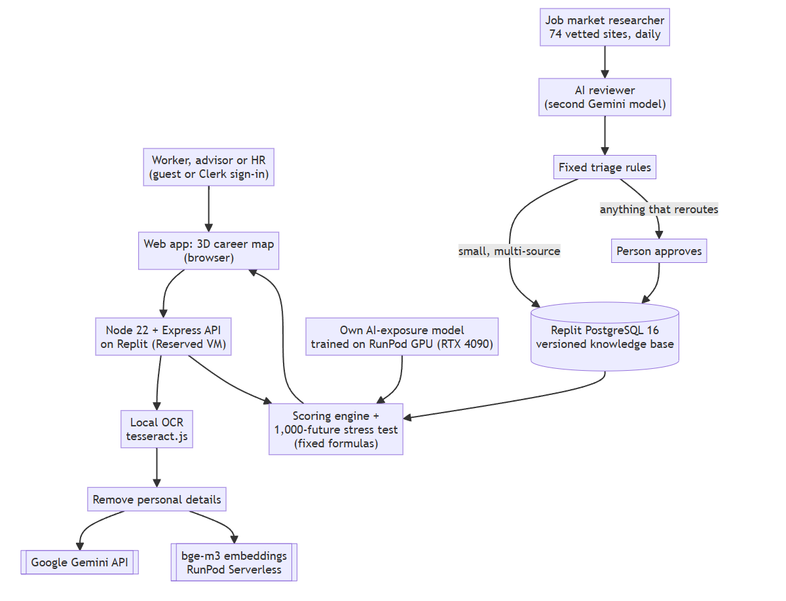
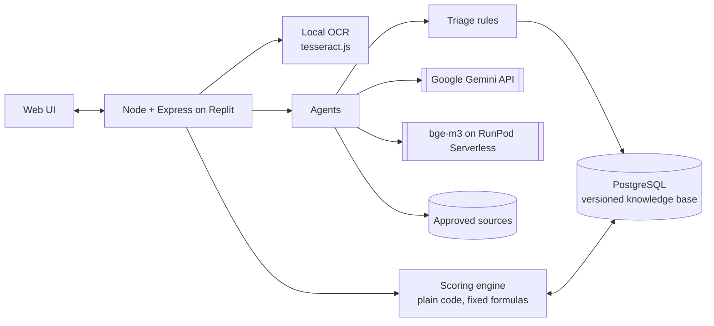

# HalaTuju

**A live map of your career that updates itself as AI changes work. When a person approves new evidence about AI, your route visibly reroutes.**
*HalaTuju* means "direction" in Malay.

## Team information

| Field | Details |
|---|---|
| **Team name** | Dsaise |
| **Team domain** | Domain 1: Aiversecity Future-Ready Workforce |
| **SDG track** | **SDG 8** Decent Work and Economic Growth (primary: redeployment instead of retrenchment), with SDG 4 (target 4.4), 9, 12, 13 and 16 |
| **Team leader** | Leow Shen En |
| **University** | Universiti Malaya |
| **Number of members** | 5 |

## Links

| Resource | Link |
|---|---|
| GitHub repository | https://github.com/shenenleow10521/SdcHackathon |
| Replit project | _[Replit project URL]_ |
| Live demo (Replit) | https://halatuju.replit.app |
| RunPod endpoint (bge-m3 embeddings) | `https://api.runpod.ai/v2/a7ipau1nmqogxs` (needs our API key; see [How we use RunPod](#how-we-use-runpod-required)) |
| Slide deck | [`submission/SDC2026_Dsaise_PitchDeck.pdf`](submission/SDC2026_Dsaise_PitchDeck.pdf) · HTML (download and open in a browser): [`submission/SDC2026_Dsaise_PitchDeck.html`](submission/SDC2026_Dsaise_PitchDeck.html) |
| Pitch video (5–7 min, YouTube) | _[YouTube link]_ |
| Preliminary submission (PRD, official template) | [`submission/SDC2026_Dsaise_Preliminary.pdf`](submission/SDC2026_Dsaise_Preliminary.pdf) |
| Tech & Tools Declaration (official template) | [`submission/SDC2026_Dsaise_TechDeclaration.pdf`](submission/SDC2026_Dsaise_TechDeclaration.pdf) |
| Replit and RunPod proof of use | [Replit PDF](submission/SDC2026_Dsaise_Replit_POU.pdf) · [RunPod PDF](submission/SDC2026_Dsaise_Runpod_POU.pdf) |

> **How to read this README.** The **Status** column says how far each feature is proven, and the **Data** column says whether what it shows is real or sample. ✅ **Works**: checked end to end in the running app (live AI and web services, fresh database) on 23–24 Oct 2026. 🧪 **Built**: in the code and covered by automated tests, not yet re-checked live. 🛠 **Planned**: designed, not built. **Real** data has a cited source; **Sample** data is illustrative and is labelled *Sample* in the app. We don't claim anything marked 🛠 as working.

---

## Overview

### Problem

Priya Nair (sample persona) has worked in accounts payable at a shared-services centre in Penang for eleven years. Her centre has announced that AI agents will take over month-end close and invoice matching next year. Staff who can move into new roles within six months will be **redeployed, not retrenched**. She has about six hours a week to learn, and her HR team needs to know who can move where.

She needs three answers, and today's tools don't give them:

1. **Which of my skills are still worth something?** AI takes over *tasks*, not whole jobs, and job titles hide which tasks are affected.
2. **Where can I realistically go?** Keyword matching misses real transfers. Her reconciliation work, for example, carries straight into carbon accounting.
3. **Will this advice still be right next month?** One-off assessments go stale while AI moves weekly.

### Solution

Upload a CV or LinkedIn PDF (or a scan or photo). HalaTuju builds your career map: the skills you have, the skills you could learn, and the jobs they lead to, with routes between them. Then it keeps that map current: an agent reads vetted sources every day, fixed rules apply small well-sourced changes, anything big goes to a person, and an approved change reroutes affected plans in front of you.

**Design rule:** agents read, ask and explain; **the scoring engine does the maths.** Every number on screen comes from a fixed formula over database records that carry a source. Agents may only output IDs that exist in the database.

HalaTuju answers two different questions and never mixes them:

| Question | What you see | What it means |
|---|---|---|
| **How close are you?** | ▓▓▓▓▓▓░░░░ *about halfway: 2 skills done, 3 close* | Measured today from your skills. You can improve it by learning. |
| **How sturdy is your plan?** | *Your plan works in 88% of 1,000 possible futures* | Nobody knows how fast AI will change work, so we simulate 1,000 versions of the future and count the share your plan works in. |

### What only HalaTuju does

| | What you see | The number behind it |
|---|---|---|
| **1. The reroute** | The Job market researcher finds dated evidence (e.g. Microsoft's Account Reconciliation Agent, 22 Oct 2026), checks the quote word for word on the page, and sends it to a person. They click **Approve**, the camera flies to *Vendor reconciliation*, it becomes a closed road, and Priya's route to ESG & Carbon Reporting Analyst bends through *Audit trail documentation → Sustainability disclosure*, with the source attached. | Knowledge base v1 → v2 and the reroute in 0.1 s (demo dry run, 24 Oct 2026). Every change is versioned and can be undone |
| **2. Our own AI-exposure model, trained on RunPod** | A score for how much of any task AI can do, shown next to three published studies. | Final training on a RunPod RTX 4090 pod (`38jijj8fe5dazu`). On **185 occupations it never saw**: **r 0.919, MAE 0.065**, ahead of copying the nearest training task (r 0.880, MAE 0.071) and GPT-4's own labels (r 0.853, MAE 0.089). Per single task it ranks best (r 0.671) but its error is higher than nearest-neighbour (MAE 0.203 vs 0.176). Against the ILO's independent index across 2,956 occupations: r 0.79 |
| **3. The whole ESCO taxonomy** | "Check any job": match %, skill gap, AI exposure, O\*NET tasks with human ratings, Malaysian wages, and a career network between jobs. | **3,039 occupations, 13,939 skills**, 126,051 essential/optional links (ESCO v1.2.1) |
| **4. Your plan in 1,000 futures** | *"Your plan works in 100% of 1,000 possible futures"*, why it fails when it does, and what would make it sturdier. | Seeded Monte Carlo: AI speed (Slow to Fast), our model's measured error (SD 0.081), study hours ×0.5–1.5, step length ×0.8–1.2. About 5 ms per plan |
| **5. A blind-annotated CV benchmark** | CV upload with skills, levels and the CV line that proves each one. | On **36 held-out CVs**: current job **97.2%** (95% CI 85.8–99.5), ESCO skills shown correct **71.7%** (68.3–74.9, blind judge), annotator's skills found **71.0%** strict (64.9–76.4) / 79.4% lenient, personal details removed **99.4%** after fixes (82.6% on the blind first run). [`eval/RESULTS.md`](eval/RESULTS.md) |
| **6. Emerging skills ESCO doesn't have** | An emerging-skill committee that proposes, challenges and de-duplicates new skills against all of ESCO, and builds evidence across daily runs. | ESCO has no equivalent for any of our 5 AI-era skills. After the fix, 3 real runs put 6 candidates on the watching list; **3 hold up by hand**. [`eval/EMERGING.md`](eval/EMERGING.md) |
| **7. Local OCR before any AI** | Scanned PDFs and phone photos of CVs are read on our own server (tesseract.js, English + Malay). Unsure text goes back to the user before any AI sees it. | Up to 3 pages; the scanned test CV leaks no personal detail |
| **8. Malaysian and ESCO grounding** | "Critical in Malaysia" flags, DOSM wages, and requirement labels taken from ESCO, not set by hand. | **10 of the 15 destination jobs** are on MyCOL 2024/2025. Of the 66 catalogue requirements: **10 essential (ESCO, weight 2), 9 optional (ESCO, weight 1), 34 added by HalaTuju (weight 1), 13 not in ESCO yet (weight 1)**. A skill counts as yours at **level 3 of 5** |

### Key features and status

| Feature | What it does | Status | Data |
|---|---|---|---|
| CV / LinkedIn-PDF intake | Text extraction, personal-detail scrubbing, skills matched to ESCO with bge-m3 embeddings (RunPod Serverless) | 🧪 Built; benchmarked on 50 synthetic CVs ([`eval/RESULTS.md`](eval/RESULTS.md)) | Real (ESCO) |
| Paste-text intake | Paste CV text instead of uploading a PDF | 🧪 Built | Real (ESCO) |
| Scan and photo intake | Scanned PDFs and JPG/PNG photos (up to 3 pages) read by local OCR on our server (tesseract.js, English + Malay); unsure text goes back to the user to check before any AI sees it | 🧪 Built | Real (ESCO) |
| Interviewer | Up to 3 follow-up questions where the CV is unclear (fixed question templates, in English and Malay; no AI model) | 🧪 Built | n/a |
| Skill levels with confidence | 1–5 scale with plain descriptions; *From CV / Self-rated / Verified* (a short quiz verifies a skill); a skill only listed in a skills section is capped at level 2 and marked "not sure" | ✅ Works | Quiz questions are Sample |
| Career constellation (3D) | You, your skills, skills to learn, jobs, with your route lit up; closed roads for skills AI has taken over | ✅ Works | Sample catalogue |
| Route options | Fastest / Balanced / Safest via shortest-path routing; alternative routes shown | ✅ Works | Sample catalogue |
| Weekly hours | Weeks are shown at your own study pace (set during intake), not a fixed 6 hours | ✅ Works | n/a |
| Scenarios | Steady vs Fast AI spread (how fast AI takes over tasks), 2026–2030 year slider; the "taken over" threshold falls as AI spreads | ✅ Works | Sample |
| Step types | Reuse · Upskill · Evolve · Reskill, each with Learn → Practice → Prove | ✅ Works | Learn = Real courses; Practice/Prove = Sample |
| Human edge | Task split (AI does / AI assists / still needs you) and rising human skills | ✅ Works | Sample |
| Sector exploration | Finance, Sustainability, Tech & data, Operations; the map rebuilds | ✅ Works | Sample |
| Job search | Catalogue jobs added to the map; unknown jobs flagged as low confidence, with nearest catalogue jobs and live ESCO matches | ✅ Works | Real (ESCO lookup) |
| Job market researcher (daily agent) | Daily searches of 74 vetted sites (Tavily web search limited to them, RSS, GDELT, Hacker News, arXiv, OpenAlex): 10 skills a day so every map skill is covered every 3 days, plus 10 broad "AI at work" topics. Live run, 23 Oct 2026: 769 articles and 28 searches in 5.5 minutes, 7 new pieces of evidence for review. Quotes checked word for word | ✅ Works | Real |
| Rule-based triage + AI reviewer | A second model checks each claim; fixed rules auto-apply small, well-sourced changes and flag the rest | ✅ Works | Real |
| Admin review queue | Approve / reject flagged changes; emerging-skill candidates with their evidence count; spot-checks; run history | ✅ Works | Real + labelled samples |
| Versioned knowledge base | Every change is a new version; any version can be undone | ✅ Works | Real |
| Reroute on approval | Approved change → re-score → the route visibly reroutes (camera flies to the affected skill); saved plans are offered the new route to keep or switch | ✅ Works | Real signal, Sample catalogue |
| Emerging-skill committee | Proposer, skeptic and a duplicate check against all 13,939 ESCO skills; evidence builds across daily runs; thresholds 15 mentions, 5 organisations, 4 weeks; half weight until a person confirms | ✅ Works (3 real runs, 6 watching, 3 hold up by hand; none near the thresholds yet) | Real + Sample |
| Company-level requirements | Per-employer match % and extra route stops | ✅ Works | Sample (fictional employers) |
| Employer requirements form | Employers enter their own requirements; stored as unverified | ✅ Works | Employer-entered |
| Advisor approval | A plan goes into a learning plan only after an advisor approves it (or asks for changes) | ✅ Works | n/a |
| Accounts and roles | Sign in or create an account with Replit-managed Clerk, upload a CV as a guest, or try the demo as Priya. Guest profiles are scoped to a signed browser session; accounts can access only their own profiles; admin and advisor screens need a role; **Delete my data** | 🧪 Built (ownership, guest and role checks tested; live browser sign-in not yet checked) | n/a |
| Deadline tracking | Target date + weekly hours → *Ahead / On track / Behind*, e.g. a six-month redeployment window | ✅ Works | n/a |
| Costed route | Course cost in RM per step and in total, with the HRD Corp-claimable share | ✅ Works (no HRD Corp-claimable course is loaded yet, so that share shows RM 0) | Real (30 course listings with links) |
| SDG-aware ranking | Choose an SDG priority (e.g. climate); jobs re-rank and the trade-off in match % and weeks is shown | ✅ Works | Sample tags on a Sample catalogue |
| "Studies disagree" view | AI exposure from ILO WP140, the Anthropic Economic Index and Eloundou et al., side by side | ✅ Works (shown next to our values; scores still use the catalogue) | Real |
| HR redeployment view | For an employer's team: who can move to which open role, at what match, by when, and at what total cost | ✅ Works | Sample (fictional team) |
| Bahasa Melayu interface | BM toggle for all interface text | ✅ Works (job, skill and source text stays in English) | n/a |
| AI-exposure estimator (self-trained) | A model trained on published human ratings of task exposure; scores any new task. Evaluated on held-out occupations | ✅ Works (shown next to catalogue values; final training run on a RunPod RTX 4090 pod) | Real labels |
| Future stress test | Your plan is replayed in 1,000 simulated futures; shows the share it works in, why it fails, and what would make it sturdier | ✅ Works | Mixed: ranges Real, catalogue Sample |
| Check any job (full ESCO) | Search all 3,039 ESCO occupations; match % and skill gap from each job's essential skills; confirm skills you have ("I have this") and the match updates | ✅ Works | Real (ESCO v1.2.1) |
| AI exposure for every job and skill | ILO WP140 for each occupation's group; our model's estimate for all 13,939 skills (embedded with bge-m3 on RunPod); GPTs-are-GPTs and Anthropic Economic Index for the closest US occupation | ✅ Works | Real (model scores are labelled estimates) |
| Task list for any job | The closest O\*NET occupation's tasks (via the official ESCO–O\*NET crosswalk), each with the human rating of whether AI could halve its time | ✅ Works | Real |
| Malaysian labour data | Median wage and number of wage earners for the job's MASCO major group, 2021–2025, for ESCO and catalogue jobs | ✅ Works | Real (DOSM; group level) |
| Critical in Malaysia | Flags jobs whose 4-digit group is on MyCOL 2024/2025 (66 groups, 692 ESCO occupations; 10 of the 15 destination jobs) | ✅ Works | Real (TalentCorp/ILMIA; group level) |

### Tech stack

| Layer | Technology |
|---|---|
| Frontend | Vanilla JS, 3d-force-graph (three.js), GSAP, Lucide icons, Geist font; English and Bahasa Melayu |
| Backend | Node 22, TypeScript, Express 5; zod, multer, unpdf (PDF text), tesseract.js (local OCR, eng + msa data vendored in `server/lib/tessdata`), fast-xml-parser |
| Database | Replit PostgreSQL 16 in the live app; embedded PGlite when no `DATABASE_URL` is set (local runs, tests) |
| Accounts | Replit-managed Clerk (`@clerk/express`, `@clerk/clerk-js`); guests upload a CV without an account, tied to a signed browser cookie |
| AI models | **Google Gemini API**: gemini-3.5-flash-lite (main), gemini-3.1-flash-lite (reviewer); our ridge exposure model (JSON weights, one dot product per task) |
| AI / Compute | **RunPod**: Serverless bge-m3 embeddings (endpoint `a7ipau1nmqogxs`); GPU pod for the final model training run |
| Web search | Tavily (Job market researcher and committee only, trusted domains) |
| Hosting / Dev | **Replit** (`.replit`: Node 22, PostgreSQL 16, `npm start`, VM deployment) |
| Tests and CI | Vitest (418 tests), GitHub Actions on Node 22 and 24 |

### Domain 1 must-haves

| Must-have | Where |
|---|---|
| 1. Skills profile intake | CV/LinkedIn PDF, scan or photo (local OCR), pasted text; interviewer; confirm and rate levels |
| 2. AI-trend signal layer (updatable, dated) | Job market researcher (daily, 74 vetted sites), dated sources with checked quotes, versioned knowledge base |
| 3. Future-role matching + skills gap | Match % per job, per employer and for any of 3,039 ESCO jobs; skills you have vs. need |
| 4. Personalised reskilling pathway | Fastest / Balanced / Safest routes fitted to your weekly hours; Reuse / Upskill / Evolve / Reskill steps with real courses and RM cost |
| 5. SDG mapping | Every job (16) and skill (29) tagged with an SDG and a one-line reason, checked by a test; SDG-aware ranking |
| 6. More than one future scenario | Steady vs Fast AI spread, 2026–2030 year slider, the Balanced route, and the stress test (each plan replayed in 1,000 simulated futures) |

**Humans stay in control:** no plan changes without the user's or an advisor's approval; big knowledge changes need a person; saved plans are offered a new route to *keep or switch*.

### Hardest risk and our fallback

| Risk | What could go wrong | Fallback (built) |
|---|---|---|
| **A wrong AI signal reroutes people** (the hardest one) | A misread article changes thousands of plans | Trusted domains only, quote checked word for word, a second AI reviewer, deterministic triage, a person approves anything that changes a route, every version can be undone, and no single page can change a route on its own |
| AI service down or out of quota | CV reading or agents stop | CV reading falls back to keyword matching, labelled "basic"; the Job market researcher replays its last recorded run, labelled "replayed" (`DEMO_MODE`); the explainer falls back to fixed templates |
| RunPod cold or down | Embeddings unavailable | Fails over to a local bge-m3 server or Gemini embeddings, else keyword matching (labelled); `demo/prime.sh` warms the worker |
| Personal data reaches the AI | Privacy breach | Scrubber removes 99.4% of planted details on held-out CVs; scans are read by local OCR first; CV files are never stored |
| Exposure estimates are wrong | Plans look safer than they are | The model's measured error is fed into the stress test; four sources shown side by side ("Studies disagree") |
| Sample catalogue mistaken for real data | Over-trust | Every sample value is labelled *Sample* in the app; "Check any job" runs on the real ESCO data |

---

## Project structure

```
server/                   Express API: agents/ (scout = Job market researcher, reviewer, committee, CV, interviewer, explainer),
                          routes/, services/ (planning, ranking, rescore, HR, scheduler), sources/ (fetch policy, search), lib/ (OCR, PDF, embeddings)
shared/engine.js          scoring engine and stress test, used by both server and browser
web/                      browser app (vanilla JS, 3D map, en/ms translations) and landing page
db/                       schema, migrations and seed data (db/seed/README.md says what is real or sample)
ml/                       AI-exposure model: data prep, embedding, training, evaluation, artifacts (incl. the RunPod run log)
eval/                     CV benchmark (cv/, RESULTS.md), emerging-skill benchmark (EMERGING.md), result files
scripts/                  database seed, data builders, benchmarks, API smoke test
tests/                    automated tests (vitest)
demo/                     demo CV and reset/start/prime scripts
docs/                     ARCHITECTURE, API, DATA_SOURCES, DEMO, PITCH, SUBMISSION_CHECKLIST, organiser rules notes
submission/               the four SDC2026_Dsaise_*.pdf files, their answers in Markdown, the pitch deck
proposal/  prototype/     first proposal (22 Oct) and early UI prototypes (sample data)
.github/workflows/ci.yml  type-check and tests on every push
```

### Architecture





| Agent | Job |
|---|---|
| Interviewer | Turns a CV into a confirmed skill profile; asks about gaps (fixed question templates, no AI model) |
| Job market researcher | Finds new AI-capability, adoption and demand signals, skill by skill and by topic (`scout` in the code) |
| AI reviewer | A second model checks each claim against its evidence quote |
| Emerging-skill committee | Proposes, challenges and de-duplicates new skills against our catalogue and all of ESCO |
| Career planner / explainer | Explains routes, citing records only |
| Fact checker | Removes any claim without a source |

More detail: [`docs/ARCHITECTURE.md`](docs/ARCHITECTURE.md), [`docs/API.md`](docs/API.md), [`docs/DATA_SOURCES.md`](docs/DATA_SOURCES.md).

## How it works

### Core formulas

Full list in [`docs/ARCHITECTURE.md`](docs/ARCHITECTURE.md#7-formulas-and-parameters-single-source-of-truth).
- **Match %** = Σ(skill weight × coverage) ÷ Σ weight. Coverage = your level ÷ level needed (max 1); a skill you can bridge to from one you have counts 0.4.
- **Level needed:** which skills a job needs comes from the job's requirements; how well you need them is one rule for every job: a skill counts as yours at **level 3 of 5** (you can do it on your own). We don't estimate a level per job; ESCO doesn't publish proficiency levels. A skill you rate 1 or 2 still gives partial credit (1/3 or 2/3) and adds a level-up step to your plan. The one exception is an employer's own requirements, which keep the level the employer entered.
- **Skill labels and weights:** each skill a catalogue job asks for is checked against the job's ESCO occupation when the knowledge base is built (`server/lib/esco-labels.ts`), not set by hand. *Essential (ESCO)*: ESCO lists it as essential for that job (weight 2). *Optional (ESCO)*: ESCO lists it as optional (weight 1). *Added by HalaTuju*: the skill is in ESCO but ESCO doesn't list it for that job; we added it (weight 1). *New skill, not in ESCO yet*: no ESCO equivalent, such as prompting AI tools for finance or GHG emissions accounting (weight 1). Our own additions never outweigh ESCO's essential skills. Of the 66 catalogue requirements: 10 essential, 9 optional, 34 added by us, 13 not in ESCO. Skills added later by the emerging-skill committee and an employer's own requirements keep their own weights.
- **Routes:** Dijkstra over skill bridges. Edge cost = weeks of learning plus a penalty that depends on the route type (traffic from AI exposure, AI risk, or worst-case exposure in the Fast AI 2030 scenario for Balanced).
- **Taken over** = AI exposure above a threshold that falls over time, *and* demand falling. These skills become closed roads.

### Triage rules (deterministic)

| Outcome | When |
|---|---|
| Rejected automatically | No source, untrusted source, quote not found word for word on the page, duplicate, or source older than 180 days |
| Applied automatically | ≥ 2 independent sources, the AI reviewer agrees (confidence ≥ 0.8), the change is small (exposure ±0.05 or demand ±5 points at most), and it changes no one's route or skill zone |
| Sent to a person | Anything else: big change, single source, reviewer unsure or unavailable, unknown source date, would reroute users, or a new skill |

A fixed 5% of automatic changes (chosen by hash, so it can't be gamed) is also queued for a person to spot-check. Accuracy of automatic changes: not yet measured.

**Example from a live run (23 Oct 2026):** the Job market researcher found Microsoft's Dynamics 365 page (22 Oct 2026) saying its "Account Reconciliation Agent can help identify exceptions between subledgers and the general ledger". The quote was verified on the page, the reviewer agreed, and with a single source it went to a person. When approved, *Vendor reconciliation* becomes a closed road in the 2030 view, and Priya's route to ESG & Carbon Reporting Analyst reroutes from *Vendor reconciliation → GHG emissions accounting* to *Audit trail documentation → Sustainability disclosure*. (At the 2026 view, single small signals like this one don't change routes yet.)

### How sturdy is my plan? (future stress test)

> ✅ Built (`stressTest` in [`shared/engine.js`](shared/engine.js), with every range in `MONTE_CARLO` in the same file; shown on the My goal tab; tests in [`tests/engine.test.ts`](tests/engine.test.ts)).

The match bar shows how close you are today; the stress test runs your plan through 1,000 simulated futures and reports the share it works in: *"Your plan works in 88% of 1,000 possible futures."*

**1. What is random in each future**

| Input | Range | Where the range comes from |
|---|---|---|
| How fast AI arrives | Anywhere from Slow to Fast, most likely Moderate (triangular) | Moderate and Fast are our two scenarios. **Slow is our assumption:** half of Moderate's change by 2030. Speeds in between blend the two nearest scenarios |
| Error in our AI-exposure estimate | Added to each skill's exposure: normal, SD 0.081 on the 0 to 1 scale, then clamped | Our exposure model's measured error on 185 held-out occupations it never saw: MAE 0.065 ([`ml/artifacts/eval.json`](ml/artifacts/eval.json), `perOccupation.model.mae`); for normal errors SD = MAE × 1.2533. Half of the variance is shared by all skills in a future, half is each skill's own (our assumption: when the model is off, it tends to be off the same way for related skills) |
| Hours you really study each week | Your hours × 0.5 to 1.5, most likely 1 (triangular) | Our assumption: busy weeks and keen weeks |
| Weeks each step takes | Our estimate × 0.8 to 1.2 (uniform), drawn per step | Our assumption: courses and people vary by about a fifth |
| Your deadline | Fixed | Your target date, or the end of 2030 if you set none |

**2. Three yes/no checks in every future** (the engine replays your route with that future's numbers)

1. **Is the road still open?** No skill on your route is taken over by AI by the time you reach it.
2. **Are you ready in time?** All your steps, at that future's study pace and step lengths, fit before your deadline.
3. **Is the job still worth having?** Demand for the job is not falling when you arrive, nor at the end of 2030.

All three yes = the plan **works** in that future. The result is the share of futures it works in.

**3. Why it fails, and what would make it sturdier.** Each failing future is counted once, under its first failed check, so the shares add up to the failure rate. For each cause seen in at least 10 futures, HalaTuju names the random inputs that stand out among those failures (their average sits at least half a standard deviation away from the average over all futures), for example *"Not ready before your deadline (12% of futures), mostly when your study time drops below 5 hours a week"*. The top three are shown. The test is then re-run with one change at a time (each other route type, and one more study hour a week) in the same 1,000 futures, and any change that raises the rate is shown: *"Take the Balanced route: 100%"*, *"Study 1 more hour a week (7 hours): 96%"*.

**Same plan, same number.** The random numbers come from a seeded generator (mulberry32). The seed is built from your skills and levels, the job, the year and scenario on screen, and your deadline. Today's date, route type and study hours are left out of the seed on purpose: the number does not reshuffle from one day to the next, and a tip's number is exactly what you see after making that change. Each draw is tied to its run and to what it is for (one skill's error, one step's length), so two routes that share a step also share its luck, and the comparison between them is fair.

**Precision and speed.** At 1,000 runs (configurable: `MONTE_CARLO.runs`, or `runs` per call) the rate is accurate to about ±2 percentage points at 95% confidence for plans near 85 to 90% (±3 near 50%; the margin is 1.96 × √(p(1 − p) / 1,000)). That covers the sampling only: the ranges above matter more than the run count. The whole test, tips included, takes about 5 ms in Node (10,000 runs: about 12 ms), so the browser runs it directly and keeps the result per plan.

**What we see with the current data:** most routes in the catalogue take 4 to 15 weeks, so they finish in 2027, before the engine's AI takeovers (mostly 2029 to 2030). For Priya (6 hours a week, deadline 24 Apr 2027, 2026 view, Steady AI spread), the ESG & Carbon Reporting Analyst plan works in **100%** of futures on the Fastest and Balanced routes; the Safest route works in 88% and fails mostly when her study time drops below 5 hours a week (12% of futures). Routes that start late or pass through a skill AI is about to take over fail the "road open" check, and the test then suggests the Balanced or Safest route.

**What the number means:** the share of 1,000 simulated futures the plan works in. It is a stress test of the plan, not a probability of being hired, not a new version of the match %, and not a forecast: hiring also depends on competition, interviews and the economy, which we don't model. **Method:** *Robust Decision Making* (RAND) and *Decision Making under Deep Uncertainty*: when nobody knows the true odds, choose the plan that holds up across the most plausible futures. The exposure error is measured; the slow-AI speed and the study-time and step-length ranges are our assumptions; the catalogue values it runs on are sample data (labelled in the app).

---

## How to run

### Option 1: on Replit

1. Import this repository (**Create Repl → Import from GitHub**) or open the Replit project above.
2. In **Secrets**, add the variables from [`.env.example`](.env.example): at least `GEMINI_API_KEY`; for the full system also `RUNPOD_API_KEY`, `RUNPOD_EMBED_ENDPOINT_ID`, `EMBED_PROVIDER=runpod` and `TAVILY_API_KEY`.
3. Click **Run** (`npm start`). On first boot the server creates the schema and seeds an empty database. Deploy as a **Reserved VM** (the daily Job market researcher needs an always-on server).

### Option 2: locally (Node 22 or newer)

```bash
npm install
cp .env.example .env    # GEMINI_API_KEY is required; everything else is optional (see below)
npm run db:setup        # schema + seed; add --reset to wipe a local database first
npm run dev             # http://localhost:3000
```

### Run tests

```bash
npm test                # 418 tests (24 Oct 2026): engine, stress test, triage, Job market researcher sources, PII scrubbing, OCR, fairness, prompt injection, API, accounts, HR, web client
npm run typecheck
```

The tests use an in-memory database; network and AI calls are mocked. To run them on real PostgreSQL, set `TEST_DATABASE_URL` (each test file gets its own throwaway `test_*` schema). On 24 Oct 2026 the suite as it was then (385 tests) passed on PostgreSQL 17.11, the version Supabase runs. `npx tsx scripts/smoke-api.ts <url>` checks every non-CV API feature against a running server; add `--write` only on a fresh database. It passed 54/54 with `--write` on a fresh PostgreSQL database and 34/34 read-only against Supabase.

Environment (all in `.env.example`):
- **AI:** `GEMINI_API_KEY` (required), `GEMINI_API_KEY_2`, `GEMINI_MODEL`, `GEMINI_REVIEWER_MODEL`.
- **Database:** `DATABASE_URL` for PostgreSQL; leave it empty to use an embedded PGlite database in `./data`.
- **Accounts:** Replit-managed Clerk provides sign-up, sign-in and browser sessions (`CLERK_SECRET_KEY`, `CLERK_PUBLISHABLE_KEY`, provisioned by Replit). `SESSION_SECRET` signs guest-profile cookies. Without Clerk keys the app runs as an open demo. `ADMIN_EMAILS` and `ADVISOR_EMAILS` (comma-separated) give staff roles.
- **Embeddings:** `EMBED_PROVIDER` (`runpod` / `local` / `gemini` / `none`), `RUNPOD_API_KEY`, `RUNPOD_EMBED_ENDPOINT_ID`, `LOCAL_EMBED_URL`, `LOCAL_EMBED_MODEL`.
- **Job market researcher web search:** `TAVILY_API_KEY` (free tier is enough) or `BRAVE_API_KEY`; `COMMITTEE_QUERIES_PER_RUN` (default 3).
- **Other:** `DEMO_MODE` (replay the last recorded Job market researcher run if a live source fails, labelled "replayed"), `ADMIN_TOKEN` (header `x-admin-token` opens staff routes for scripts), `SCOUT_SCHEDULE`, `SCOUT_INTERVAL_HOURS`, `PORT`.

The demo kit (crafted CV, reset/start/prime scripts, click-by-click script) is in [`demo/`](demo/) and [`docs/DEMO.md`](docs/DEMO.md). The early UI prototype runs on its own: open [`prototype/halatuju-app.html`](prototype/halatuju-app.html) in a browser.

## Train the AI-exposure model

Scripts live in `ml/`; sources and licences are in [`ml/SOURCES.md`](ml/SOURCES.md). The app serves the model at `/api/exposure/*` and shows it next to the catalogue values (it does not drive the scores yet).

**Data.** Human exposure ratings (E0/E1/E2) for 19,265 O\*NET task statements from *"GPTs are GPTs"* (MIT licence), pinned to a commit and checksum in `ml/SOURCES.md`. Target β = E1 + 0.5·E2. GPT-4's labels from the same file are used only as a comparison. `ml/prepare_data.py` writes `ml/data/train.csv`.

**Develop and test locally (free).**
```bash
cd ml
python -m venv .venv && source .venv/bin/activate   # Windows: .venv\Scripts\activate
pip install -r requirements.txt                       # sentence-transformers, scikit-learn, pandas
python prepare_data.py
python embed.py   --sample 300                        # bge-m3 on a small sample; local GPU if available, else CPU
python train.py   --sample
python evaluate.py --sample
```

**Final run on RunPod (a few minutes, a few US cents).** The hackathon requires GPU training to run on RunPod; the organisers confirmed that local testing on our own GPU is acceptable as long as the final training runs on RunPod. `ml/runpod_train.py` does the whole run with the RunPod API (key `RUNPOD_API_KEY` in `.env`):
```bash
python ml/runpod_train.py launch      # one GPU pod (RTX 4090 / A5000 / L4 / A40 / A4500); RUNPOD_CLOUD=SECURE if Community Cloud is sold out
python ml/runpod_train.py status      # pod state and pipeline log
python ml/runpod_train.py fetch       # copies exposure_model.json, eval.json, split.json and runpod_run.log into ml/artifacts/
python ml/runpod_train.py terminate   # always run this; stopping isn't enough
```

**Evaluate honestly.** Split by occupation; report Pearson r, Spearman ρ and MAE against two baselines (the average, the nearest neighbour) and GPT-4's labels. `ml/evaluate.py` writes them to `ml/artifacts/eval.json` with where it ran (machine, GPU, time). The results table above is copied from that file.

**Credit guardrails (US$25 per team).** Terminate pods as soon as a run ends; keep serverless minimum workers at 0; delete unused volumes. Spend so far: about US$4 of the US$25 (account balance US$20.96 on 24 Oct 2026, 04:30 MYT).

---

## How we use Replit *(required)*

- **Hosting:** the app is deployed with Replit Deployments (VM target, `.replit` runs `npm start` with Replit PostgreSQL 16, the app's only database) at the Live demo link above.
- **Secrets:** `GEMINI_API_KEY`, `RUNPOD_API_KEY`, `RUNPOD_EMBED_ENDPOINT_ID`, `TAVILY_API_KEY` and the database URL are Replit Secrets, never in the code.
- **Agents in production:** the Job market researcher, AI reviewer, emerging-skill committee and explainer run on the Replit server and call the Google Gemini API.

📄 Proof of use: [`submission/SDC2026_Dsaise_Replit_POU.pdf`](submission/SDC2026_Dsaise_Replit_POU.pdf) (deployment, project history, usage and the live site)

## How we use RunPod *(required)*

- **Serverless inference (runtime):** with `EMBED_PROVIDER=runpod` (the deployed setting), **BAAI/bge-m3** runs on RunPod Serverless endpoint `a7ipau1nmqogxs` (`runpod/worker-infinity-embedding`, 0 minimum workers, 1 maximum) and (1) matches CV text to the 13,939 ESCO skills, (2) removes duplicate Job market researcher signals, (3) checks new skill candidates against ESCO and merges synonyms, and (4) embeds new tasks for the exposure model. It also embedded all 13,939 ESCO skills once for the model's scores (486 s).
- **GPU training:** the exposure model's final training run happened on a **RunPod GPU pod** (NVIDIA GeForce RTX 4090, Secure Cloud, pod `38jijj8fe5dazu`, 23 Oct 2026 18:20–18:23 UTC, 2.5 minutes, about US$0.04); embedding all 19,265 tasks took 3.9 s. Log: [`ml/artifacts/runpod_run.log`](ml/artifacts/runpod_run.log), details: [`ml/artifacts/runpod_run.json`](ml/artifacts/runpod_run.json). Earlier development runs used a local GPU, which the organisers allow for testing.

Example request (the app's own call, OpenAI-compatible):

```bash
curl -X POST https://api.runpod.ai/v2/$RUNPOD_EMBED_ENDPOINT_ID/openai/v1/embeddings \
  -H "Authorization: Bearer $RUNPOD_API_KEY" \
  -H "Content-Type: application/json" \
  -d '{"model": "BAAI/bge-m3", "input": ["Reconcile vendor statements against the ledger"]}'
```

📄 Proof of use: [`submission/SDC2026_Dsaise_Runpod_POU.pdf`](submission/SDC2026_Dsaise_Runpod_POU.pdf) (endpoint and pod IDs, GPU types, runtime, logs, cost)

---

## Challenges and learnings

- **A benchmark is only useful if it can embarrass you.** The blind first privacy run scored 82.6% on held-out CVs, and the LinkedIn tier 55.2%; the fixes it forced took it to 99.4%. We report both.
- **ESCO has no words for the AI era.** No ESCO skill covers prompting, supervising AI workflows, GHG accounting or three-way matching, so we label those requirements "not in ESCO yet" and built a committee to find new ones from evidence.
- **Page selection, not the AI, was the committee's bottleneck.** The first run read 8 off-topic pages; ranking pages by relevance produced real candidates.
- **GPU environments break on versions.** Two RunPod pods failed (torch/transformers mismatches) before the third ran; all three cost about US$0.07 together.
- **Our per-task model error is worse than a nearest-neighbour baseline.** We use the model where it wins (per occupation and per skill) and say so.

## Future improvements and known limitations

- The job and skill catalogue (exposure and demand outlook, task splits, requirements, skill bridges) is sample data; the UI labels it. The real exposure studies and the self-trained model are shown next to it but don't drive the scores yet. **Next:** drive catalogue exposure from the model and the studies.
- "Check any job": your match counts skills you confirmed ("I have this") or that map exactly from your profile; a closely related catalogue skill counts 40% only above a strict similarity of 0.8, so matches start low until you confirm skills.
- O\*NET tasks and the two US studies come from the *closest* US occupation; about half the links are "broad", and the panel says which.
- DOSM figures and the MyCOL flag are for the whole occupation group, not the single ESCO job.
- Model scores for ESCO skills are estimates from skill titles; the model was trained on O\*NET task statements.
- The demo's employers and HR team are fictional. Careers-page extraction works but no real employer is loaded yet. Job boards are link-only.
- No HRD Corp-claimable course is loaded yet, so the claimable share shows RM 0.
- The "would reroute N users" count in the review queue checks only the 2026 view, while the map reroutes at whatever year you are viewing.
- The emerging-skill committee counts mentions in trusted news and research, not job postings, so a new skill needs weeks of daily runs to reach its thresholds; about half the watching candidates hold up by hand. **Next:** licensed Malaysian job-ad data and Bahasa Melayu news.
- The CV benchmark is synthetic (no real personal data is allowed), small (36 held-out CVs), and its judge is an AI model; the privacy number is no longer blind on the held-out set.
- In Malay, interface text is translated; job and skill names and source quotes stay in English.
- Forecasts are scenarios, not predictions about any one person.

---

## Evidence

### AI-exposure model (self-trained, final run on RunPod)

A small model that predicts *how much of a task AI can do* (0–1) from the task's text: each task is embedded with **BAAI/bge-m3** and a **ridge regression** is trained on human ratings from *"GPTs are GPTs"* (Eloundou et al., *Science* 2024; 19,265 O\*NET tasks). Split **by occupation**, so test occupations were never seen in training. Numbers copied from [`ml/artifacts/eval.json`](ml/artifacts/eval.json) (RunPod run; the local development run on the same split matched to 3 decimals, except per-occupation r 0.918 there).

| Held-out set | Our model | Always predict the average | Copy the nearest training task | GPT-4's own labels (reference) |
|---|---|---|---|---|
| Per task (n = 3,959) | r 0.671 · ρ 0.689 · MAE 0.203 | MAE 0.328 | r 0.565 · ρ 0.590 · **MAE 0.176** | r 0.587 · ρ 0.629 · MAE 0.189 |
| Per occupation (n = 185) | **r 0.919 · ρ 0.916 · MAE 0.065** | MAE 0.170 | r 0.880 · ρ 0.879 · MAE 0.071 | r 0.853 · ρ 0.879 · MAE 0.089 |

The model ranks tasks and occupations best (highest r and ρ) and is the most accurate per occupation. **Per single task, copying the nearest training task has a lower average error (MAE 0.176 vs 0.203).** HalaTuju uses the model at occupation and skill level, where it wins.

**Independent check against ILO WP140.** We scored all 13,939 ESCO skills with the model (bge-m3 embeddings on RunPod Serverless, 486 s) and averaged each occupation's essential-skill scores. Across the 2,956 occupations ILO also scores, the two agree at **Pearson r = 0.79, Spearman ρ = 0.80**. ILO's method and data are independent of the model's training labels.

### CV-reading benchmark

50 synthetic Malaysian CVs and LinkedIn exports (messy PDF text, OCR typos, Bahasa Melayu, keyword stuffing), with answer keys written by an independent annotator agent that never saw our code, prompts or outputs. Headline on the **36 held-out CVs** (c15–c50), 95% Wilson intervals:

| Measure | Result |
|---|---|
| Current job identified | **97.2%** (35/36) · 85.8–99.5 |
| ESCO skills shown that are correct (blind judge) | **71.7%** (511/713) · 68.3–74.9 |
| Annotator's skills found, strict | **71.0%** (169/238) · 64.9–76.4 |
| Annotator's skills found, lenient (close ESCO neighbour, rule fixed in advance) | 79.4% (189/238) · 73.8–84.1 |
| Personal details removed (after fixes, not blind) | **99.4%** (154/155) · 96.4–99.9 |
| Personal details removed, blind first run | 82.6% (128/155) · 75.8–87.7 |

The precision judge was six Claude agents working blind on shuffled lists with decoys (they rejected 98.5% of random decoys and 92.8% of look-alikes), because the free Gemini keys ran out of daily quota after a few CVs; those Gemini verdicts were thrown away. Failures, per-tier results and caveats: [`eval/RESULTS.md`](eval/RESULTS.md).

### Emerging skills

ESCO v1.2.1 has **no equivalent for any of our 5 AI-era skills** (best bge-m3 cosine 0.51–0.60; duplicate threshold 0.85). The first live committee run found 4 skill phrases with verified quotes and kept 0, which exposed a page-selection problem. After the fix (relevance-ranked pages, duplicate check against all of ESCO, evidence that builds across runs), **3 real runs** put **6 candidates on the watching list**, and **3 hold up by hand** (*integrate LLMs into finance workflows*, *evaluating AI-related risks*, and plausibly *evaluating AI financial models*). The 3 wrong ones each have 1 mention, so the thresholds (15 mentions, 5 organisations, 4 weeks) keep them out, and a person reviews anything that passes. Full funnel, hand checks and cost: [`eval/EMERGING.md`](eval/EMERGING.md).

## Data and source policy

| Source | Used for | Mode |
|---|---|---|
| **ESCO v1.2.1** (European Commission) | All 3,039 occupations and 13,939 skills with their essential/optional links ("check any job"); names, descriptions and codes for the 29-skill catalogue; requirement labels and weights for catalogue jobs | Reuse, with attribution (EU reuse policy, CC BY 4.0) |
| **ESCO–O\*NET crosswalk** (ESCO Secretariat with USDOL/ETA) | Links 2,607 ESCO occupations to their closest O\*NET occupation | Reuse, with attribution |
| **TalentCorp & ILMIA, MyCOL 2024/2025** | The 66 critical occupation groups in Malaysia (facts copied from the published table, checked against OCR) | Facts and link only |
| **O\*NET** (USDOL/ETA) | Occupation codes, task lists with human ratings, and task text for training the exposure model | Reuse, with attribution (CC BY 4.0) |
| **ILO WP140**, **Anthropic Economic Index**, **Eloundou et al.** | AI exposure per job, shown side by side ("Studies disagree") | Reuse, with citation |
| **"GPTs are GPTs"** task labels (Eloundou et al. 2024, MIT) | Training labels for the self-trained exposure model | Reuse, with citation |
| **Course provider listings** | 30 real courses with price, hours and link, for costed routes | Facts and link only |
| **DOSM / OpenDOSM** | Median wage and wage earners by MASCO major group, 2021–2025 | Reuse (open government data, CC BY 4.0) |
| Tavily web search (trusted domains only), RSS feeds, GDELT, Hacker News | AI-capability, adoption and demand news for the Job market researcher | Read and extract |
| arXiv, OpenAlex | AI-capability signals | Read and extract |
| Approved company careers pages | Company-specific requirements | Read and extract (facts, a short quote and the link only) |
| Job boards (JobStreet, LinkedIn, Indeed and similar) | "See openings" | **Link only.** Their terms forbid automated access, so our agents never open them |

**Rules for every fetch:** approved domains only; obey robots.txt and identify the bot; no logins, paywalls or workarounds; store extracted facts, a short evidence quote and the link, never full copies of pages; scrub personal details; rate-limit and cache. Page text is treated as **data, never as instructions** (protection against prompt injection).

**Sample data:** where real data is not yet loaded, values are labelled *Sample* in the UI. Sample today: the demo persona (Priya Nair), the job and skill catalogue's exposure and demand outlook, task splits, skill bridges and job requirements, posting shares, Practice/Prove tasks, the employers and the HR team. Real today: the full ESCO taxonomy and the catalogue's ESCO mappings and requirement labels, the exposure studies, O\*NET tasks with human ratings, DOSM wages, MyCOL, course listings, Job market researcher signals and the exposure model's training labels.

## Responsible AI

- **People decide.** No plan changes without the user's or an advisor's approval; big knowledge changes need a person.
- **No invented facts.** Agents use database IDs only; unsourced claims are removed.
- **Fairness by design.** Age, gender, race and religion are never collected or used; a test checks that the same CV with a different name, gender, age or religion gives identical results.
- **Privacy.** Personal details are scrubbed before any AI call, scans are read by local OCR first, and CV files are never stored. Each account, and each guest browser, sees only its own profile and plans, and **Delete my data** removes the profile and everything linked to it. The demo uses a synthetic persona only.
- **Reversible.** Every knowledge change is versioned and can be undone.

## Quality

| Check | What it covers | Status |
|---|---|---|
| Automated tests (`npm test`) | 418 tests in 24 files (24 Oct 2026): scoring engine, stress test, SDG coverage, full ESCO data and "check any job", O\*NET/DOSM/MyCOL layers, ESCO requirement labels, triage rules, Job market researcher sources, emerging-skill committee, personal-detail scrubbing, OCR routing, fairness, prompt injection, API shapes, source policy, HR, web client. Network and AI are mocked | ✅ |
| Continuous integration | Type-check and tests on Node 22 and 24, on every push and pull request (`.github/workflows/ci.yml`); no linter yet | ✅ |
| Fairness check | The same CV with a different name, gender, age or religion gives identical results (`tests/fairness.test.ts`) | ✅ |
| CV-reading benchmark | 50 synthetic CVs, 36 held out; see [Evidence](#cv-reading-benchmark) and [`eval/RESULTS.md`](eval/RESULTS.md) | 🧪 |
| Emerging-skill benchmark | 1 original run + 3 runs after the fix, every candidate checked by hand ([`eval/EMERGING.md`](eval/EMERGING.md)) | 🧪 |
| Prompt-injection check | Hostile page text cannot change extraction, invent IDs or skip triage (`tests/injection.test.ts`) | ✅ |
| Confidence and "Why this number?" | Figures show their basis, sources and dates; explanations cite records, and a fact checker drops uncited sentences | ✅ |
| Health and demo safety | `/api/health` (database, AI, embeddings, scheduler); replayed Job market researcher runs are labelled "replayed" | ✅ |
| Live end-to-end check | Job market researcher → review → approve → reroute in a real browser, plus every other non-CV feature through the API on a fresh database (23 Oct 2026); demo dry run on a fresh database (24 Oct 2026) | ✅ |

## Build log

The build started at the problem-statement release on **19 Oct 2026, 8 PM MYT**. The work happened over several days and was committed in batches, so the commit times alone don't show the day-by-day work. These dated records do (times MYT; result file names are in UTC):

| When (MYT) | What | Evidence |
|---|---|---|
| 21 Oct | Organiser materials read; requirements and rubric written up | [`docs/SDC_Hackathon_2026_Prelim_Requirements.md`](docs/SDC_Hackathon_2026_Prelim_Requirements.md) ("analysed 2026-10-21") |
| 22 Oct | Proposal draft v0.1; four HTML prototypes of the map, route and reroute | `proposal/HalaTuju_Proposal.md` (dated 22 Oct), `prototype/` |
| 23 Oct 00:58–02:30 | First commits: prototypes, proposal, architecture, Apache licence; a teammate's landing page merged as PR #1 | git history (`24f139e`, `ff8aaf8`, `485d9bd`, `cf93854`) |
| 23 Oct 03:17 | First exposure-model runs on a local RTX 4070 (300-task sample, then full data) | `ml/artifacts/eval_sample300.json`, `eval_local.json` (run times inside) |
| 23 Oct 03:35 | First recorded live Job market researcher run (replayed on a fresh install) | `db/seed/replay_run.json` (`recordedAt` 2026-10-22T19:35Z) |
| 23 Oct 14:04–14:11 | First CV benchmark runs, 14 CVs (no-AI baseline and full system) | `eval/results/cv-basic-2026-10-23-06-04.json` … `cv-full-2026-10-23-06-11.json` |
| 23 Oct 16:15 | All 13,939 ESCO skills embedded on RunPod Serverless and scored by the exposure model (486 s) | `db/seed/esco_skill_scores.json.gz` (`generated` 2026-10-23T08:15Z) |
| 23 Oct 22:10 | First full run on 50 CVs | `eval/results/cv-full-2026-10-23-14-10.json` |
| 24 Oct 02:11 | Original emerging-skill benchmark | `eval/results/emerging-run-latest.json` and `.log` |
| 24 Oct 02:17–02:18 | Server, engine, web app, ML pipeline, benchmarks and tests (built on 23 Oct) committed in 9 commits | git history (`b6140b5` … `5916ccd`) |
| 24 Oct 02:20–02:23 | Final exposure-model training on a RunPod RTX 4090 pod | `ml/artifacts/runpod_run.json`, `runpod_run.log` |
| 24 Oct 02:42–03:04 | CV reader fixes, then the 50-CV rerun | `eval/results/cv-full-2026-10-23-18-42.json`, `-18-53.json`, `-19-04.json` |
| 24 Oct 03:34–04:17 | ESCO requirement labels, MyCOL/DOSM for catalogue jobs, local OCR, CV reader, blind ESCO judge, committee fix, 1,000-future stress test (it was 18 fixed futures on 23 Oct) | git history; CI runs from 03:35 (`gh run list`) |
| 24 Oct 03:59–04:10 | Three emerging-skill runs after the fix | `eval/results/emerging-run-after-fix-{1,2,3}.json` |
| 24 Oct 04:30 | Node 22 fix for PDF reading on Replit and in CI; submission documents | this README, `submission/` |

## Business model (planned analysis)

> 🛠 Figures below are to be filled from cited public sources. No number is estimated without a source.

**Who pays:** employers and institutions, not workers. The worker app stays free.

| Customer | Pays for | Why |
|---|---|---|
| Shared-services and finance operations employers | HR redeployment view + employer requirements, per seat or per redeployment programme | Redeploying is usually cheaper than retrenching and rehiring, and training may be HRD Corp-claimable |
| Universities, TVET centres, career services | Advisor dashboards for students and graduates | Employability outcomes |
| Government and agency programmes (later) | Aggregate, anonymised skill-shift insight | Workforce planning |

**Market sizing (to complete):** TAM = Malaysian workers in occupations with high AI exposure (DOSM Labour Force Survey × ILO WP140 exposure shares); SAM = finance, admin and clerical staff in Malaysian shared-services centres (MDEC / GBS reports _[cite]_); SOM = seats reachable in 3 years through _[n]_ pilot employers and _[n]_ institutions. **Break-even (to complete):** monthly costs (hosting, AI usage per user, RunPod embeddings, support) ÷ contribution per seat, with cost per user taken from measured usage.

## Credits and licences

- **This project:** Apache License 2.0 ([`LICENSE`](LICENSE)).
- **ESCO:** This service uses the ESCO classification of the European Commission. Modifications have been made.
- **O\*NET:** Includes information from the O\*NET Database by the U.S. Department of Labor, Employment and Training Administration (USDOL/ETA), used under CC BY 4.0. We have modified some of this information; USDOL/ETA has not approved, endorsed or tested these modifications.
- **ILO:** Gmyrek, P. et al. (2025). *Generative AI and Jobs: A Refined Global Index of Occupational Exposure.* ILO Working Paper 140. CC BY 4.0.
- **"GPTs are GPTs":** Eloundou, T., Manning, S., Mishkin, P. & Rock, D. (2024). *GPTs are GPTs: Labor market impact potential of LLMs.* Science 384(6702). Task labels from `openai/GPTs-are-GPTs`, MIT licence.
- **Anthropic Economic Index:** Massenkoff, M. & McCrory, P. (2026). *Labor market impacts of AI: A new measure and early evidence*, and the Economic Index usage data (Hugging Face `Anthropic/EconomicIndex`; data CC BY, code MIT). We selected rows and mapped them to our catalogue.
- **DOSM:** Department of Statistics Malaysia via data.gov.my, CC BY 4.0.
- **ESCO–O\*NET crosswalk:** ESCO Secretariat in collaboration with the U.S. Department of Labor/ETA, v1 (Sep 2022).
- **MyCOL:** TalentCorp Malaysia and ILMIA (Critical Skills Monitoring Committee), *MyMahir Malaysia Critical Occupations List 2024/2025*. Occupation codes and titles only.
- **Models and libraries:** Google Gemini API (in-app agents); BAAI/bge-m3 (MIT); RunPod worker-infinity-embedding; tesseract.js and Tesseract language data (Apache-2.0); 3d-force-graph (MIT); GSAP; Lucide (ISC); Geist font (SIL OFL). Each component remains under its own licence.

## AI tools used to build this project

Declared in full in the [Tech & Tools Declaration](submission/SDC2026_Dsaise_TechDeclaration.pdf). The hackathon rules require every AI tool used to be listed.

| Tool | Used for |
|---|---|
| Claude Code (Anthropic) | Writing and reviewing code and tests, debugging, data scripts, documentation; writing the synthetic benchmark CVs and answer keys (a separate annotator agent), and the blind benchmark judge (Claude agents) |
| Google Gemini API (gemini-3.5-flash-lite, gemini-3.1-flash-lite) | In-app agents: CV reader, Job market researcher, AI reviewer, emerging-skill committee, explainer |
| _[any other AI tool the team used]_ | _[what for]_ |

---

## Team

| Name | Role | GitHub |
|---|---|---|
| Leow Shen En | Team leader | [@shenenleow10521](https://github.com/shenenleow10521) |
| _[name]_ | _[role]_ | _[@username]_ |

## Submission checklist

The organisers' checklist. The full rubric audit, with evidence for every compulsory item, is in [`docs/SUBMISSION_CHECKLIST.md`](docs/SUBMISSION_CHECKLIST.md).

- [x] Team name, domain (Domain 1 / Domain 2) and SDG track filled in
- [x] Slide deck link added
- [ ] Demo video link added
- [x] Replit used, with proof of use in `submission/`
- [x] RunPod used, with proof of use in `submission/`
- [x] Preliminary submission completed (`SDC2026_Dsaise_Preliminary.pdf`)
- [x] Technology declaration completed (`SDC2026_Dsaise_TechDeclaration.pdf`)
- [x] Submission files renamed with your team name (replace `TeamName`)
- [x] "How to Run" steps verified
- [x] No API keys or secrets committed to the repository

## License

This project is licensed under the [Apache License 2.0](LICENSE).
