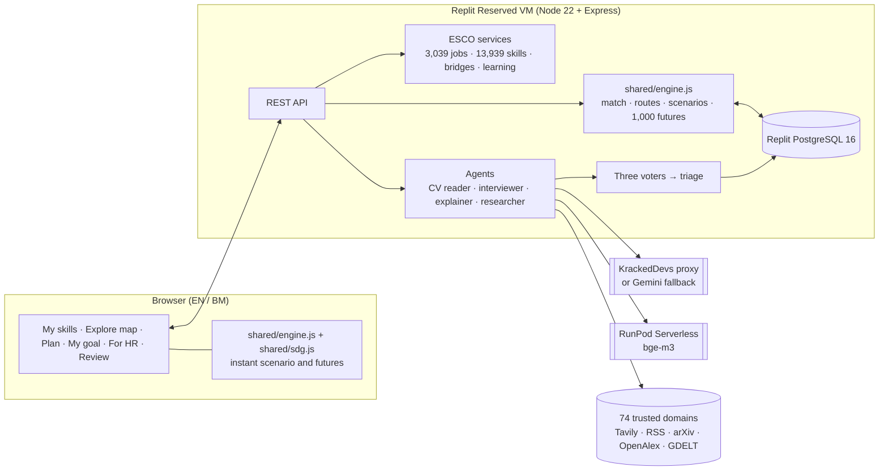
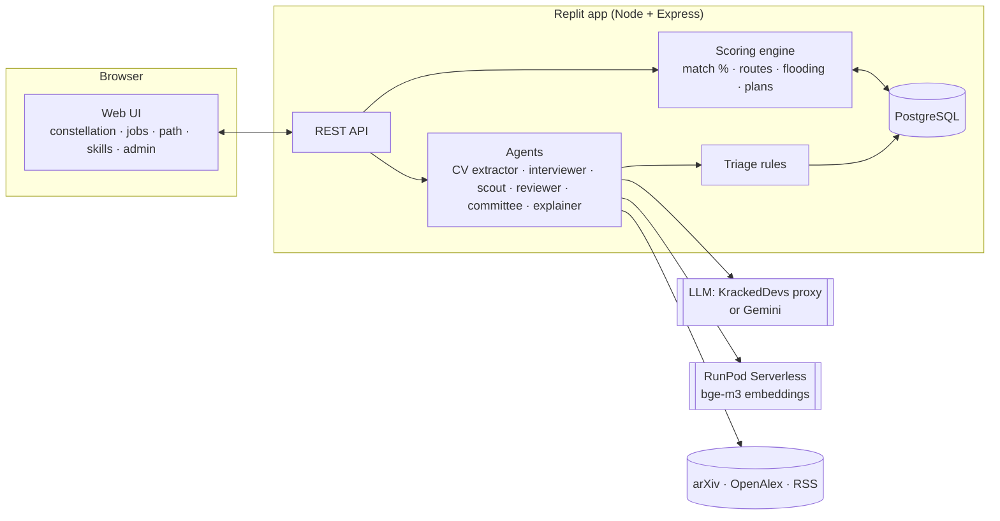

# HalaTuju: Technical Architecture

> **Audience:** the HalaTuju team, judges reading the code, and any AI assistant helping build it.
> **Status:** v2, 31 Oct 2026 (final round). Section 0 describes the final build. Sections 1–15 are the v1 design from 23 Oct, corrected where the build differs; sections 13–15 are kept as the history of the prelim plan.
> **Related:** [`README.md`](../README.md) (product), [`API.md`](API.md) (endpoints), [`DATA_SOURCES.md`](DATA_SOURCES.md) (data and licences).

---

## 0. Final build (31 Oct 2026)

What changed after the preliminary round, and where it lives in the code.

| Area | Prelim (25 Oct) | Final | Code |
|---|---|---|---|
| Product order | Move first: where can I go? | **Stay first, then move**: which of my skills AI takes, how to stay AI-ready, then where to go | `web/js/features/stay.js`, `server/services/outlook.ts` |
| Skill outlook | Matched skills and gaps | Every confirmed skill grouped as at risk, AI-assisted or still yours, with one action each | `server/services/outlook.ts`, `web/js/panels/skills.js` |
| Routes | 16 catalogue jobs | Any of 3,039 ESCO occupations: key steps, AI-era skills with sources, cross-field bridges reviewed before use, practice tasks, hand-checked learning links | `server/services/esco-plan.ts`, `bridges.ts`, `bridge-review.ts`, `ai-skills.ts`, `learning.ts` |
| Map | Distance = similarity | Distance = months to job-ready (3/6/12/24-month rings); size = match; "You are here" route view | `web/js/graph3d.js`, `web/js/features/views.js` |
| Scenarios | Steady / Fast toggle on screen (Slow existed only inside the engine) | **Slow / Steady / Fast** on screen, from one AI-speed parameter (`PARAMS.slowFactor`, `moderateTide`), shown as Today vs 2030 side by side, with what shifts spelled out; futures chart from the user's point of view (when they are job-ready) | `shared/engine.js`, `web/js/features/futures.js`, `web/js/panels/path.js` |
| SDG mapping | Hand tags on 29 skills and 16 jobs | Every job and skill tagged with a goal and a one-line reason (hand-written for the catalogue, rule-based for all ESCO jobs and skills); path contribution in Plan; optional SDG-aware ranking (+10 points, rule shown on screen) | `shared/sdg.js`, `web/js/features/sdg.js`, `server/services/ranking.ts` |
| Evidence review | One AI reviewer plus fixed rules | Three voters (evidence checker, skill matcher, sceptic) on models from two vendors; vote stored per signal; split votes go to a person (§3.3) | `server/agents/voters.ts`, `server/triage.ts` |
| Progress | Saved plan | My goal: Stay AI-ready and Your move tracks, weekly check-ins, proof of each skill, skills record; opt-in team progress for HR | `server/services/goal.ts`, `server/routes/goal.ts`, `web/js/features/goal-ui.js`, `team-progress.js` |
| Thin profiles | CV or pasted text | Plus a no-CV task quiz (4,017 O\*NET tasks) | `server/services/quiz.ts` |
| LLM provider | Gemini | KrackedDevs proxy (OpenAI-compatible; main `gpt-5.5`, reviewer `DeepSeek-V4-Pro`, voters `gpt-5.5` / `gpt-6-sol` / `DeepSeek-V4-Pro`) when `KRACKEDDEVS_API_KEY` is set; otherwise Gemini (`gemini-3.5-flash-lite` / `gemini-3.1-flash-lite`) | `server/lib/llm.ts` |



**Design rule (unchanged):** agents do the reading and talking; fixed formulas do the maths. LLMs return database IDs, never free-text jobs, courses or numbers.

### Models used in the app

| Model | Provider | Role in the app | When it runs |
|---|---|---|---|
| `gpt-5.5` | OpenAI, via the KrackedDevs proxy | Main model: CV reading (phrases, then skills and current job), interviewer questions, explanations, researcher extraction; **evidence-checker voter** | When `KRACKEDDEVS_API_KEY` is set |
| `gpt-6-sol` | via the KrackedDevs proxy | **Skill-matcher voter** | When `KRACKEDDEVS_API_KEY` is set |
| `DeepSeek-V4-Pro` | DeepSeek, via the KrackedDevs proxy | Reviewer model (claim review, emerging-skill sceptic); **sceptic voter** | When `KRACKEDDEVS_API_KEY` is set |
| `gemini-3.5-flash-lite` / `gemini-3.1-flash-lite` | Google Gemini API | Main and reviewer models (the voters spread over both) | Instead of the KrackedDevs models when its key is not set |
| `BAAI/bge-m3` (1,024-d) | RunPod Serverless (`worker-infinity-embedding`) | Embeddings: CV phrases against 13,939 ESCO skills, duplicate checks, skill network | Always, if RunPod is configured; a local bge-m3 server is the failover |
| `gemini-embedding-001` | Google Gemini API | Embedding fallback | Only when no bge-m3 is available; labelled keyword matching after that |
| HalaTuju exposure model (bge-m3 + ridge) | Our own, trained on a RunPod RTX 4090 pod (`ml/`, `ml/artifacts/exposure_model.json`) | AI-exposure score for every ESCO skill (r = 0.79 against ILO WP140) | Pre-computed (`db/seed/esco_skill_scores.json.gz`) |
| Tesseract `eng` + `msa` | tesseract.js, local | OCR for scanned CVs, before any text leaves the server | On upload of an image or scanned PDF |

The three voters use models from two vendors (OpenAI and DeepSeek), so the vote is not one model voting three times. If a model fails or is rate-limited, the call moves to the other model of the same provider (main ↔ reviewer); if no vote can happen, the signal goes to a person. Model names are set in `server/lib/llm.ts` and can be changed with environment variables (`.env.example`).

**Tests:** 543 automated tests in 36 files (31 Oct 2026, 11:30 MYT); CI on every push.

---

## 1. Decisions

| Area | Decision | Why |
|---|---|---|
| Hosting | **Replit** (deploy from Replit) | Compulsory. Likely the "API Premium sponsor" on the submit form (confirm on Discord) |
| LLM | v1 plan was Replit AI Integrations. **Built:** Google Gemini (prelim), then the **KrackedDevs proxy** (GPT + DeepSeek) with Gemini as fallback (final) | Gemini free-tier quotas; the KrackedDevs proxy gives the vote panel models from two vendors |
| Embeddings (GPU) | **BAAI/bge-m3** (MIT) on **RunPod Serverless** with the official `worker-infinity-embedding` worker | Real semantic matching; satisfies RunPod's "GPU work goes through RunPod" rule; scales to zero |
| Backend | **Node 22 + TypeScript + Express** | The prototype's scoring and routing code is already JavaScript and is reused as-is |
| Database | **Replit PostgreSQL** (`DATABASE_URL`). If unavailable, SQLite file | Durable profiles, signals, review queue |
| Frontend | The existing prototype UI (vanilla JS + 3d-force-graph + GSAP + Lucide), with hard-coded data replaced by API calls | Already built and tested |
| Skill data | **ESCO** (essential/optional skills per job) + **O\*NET** (tasks, importance) | Free to reuse with credit (see §12) |
| Trend sources | **arXiv API, OpenAlex, curated RSS feeds** (AI lab/vendor blogs) | Free, legal, no scraping |
| Job-board data | **Not used.** JobStreet's and LinkedIn's terms forbid scraping or copying content | Use framework weights; posting shares stay labelled "sample" until a licensed source exists |
| Accounts | v1 plan: one demo user. **Built:** Replit-managed Clerk sign-in plus guest sessions (signed cookie); staff roles for review and HR | Judges can try it without an account; "no real personal data" rule |

---

## 2. System overview



**Quality plan:** see §14. **Design rule:** *agents do the reading and talking; the scoring engine does the maths.* Every number on screen comes from the engine (plain code, fixed formulas) using database records that have a source. LLMs may only output IDs that exist in the database.

---

## 3. Components

### 3.1 Scoring engine (`server/engine/`)
Port the `LOGIC` section of `prototype/halatuju-app.html` into `scoring.ts`, unchanged apart from types. It runs on an in-memory **graph snapshot** loaded from the DB for the current knowledge-base version.

| Function | Purpose |
|---|---|
| `exposure(id, year, scenario)` / `demand(...)` | Interpolate 2026 → 2030 values, plus approved signal deltas |
| `taken(id)` | AI has taken the skill over: exposure ≥ 0.85 − 0.2 × tide, and demand < 0. The skill becomes a closed road |
| `impact(id)` | Declining / Changing / Durable / Rising human skill |
| `match(job)` | Σ(weight × coverage) ÷ Σ weight. Coverage = level ÷ needed (max 1); a skill you lack but can bridge to = 0.4; unconfirmed emerging skills count at half weight |
| `shortestPath(job, mode)` | Dijkstra over skill edges, ordered by relatedness; modes `closest` (Easiest start, default) and `safest`; old names `fastest`/`noregret` map to them (cost formulas in §7) |
| `planFor(job, mode)` | Route (key skills) + every missing skill with its hours → weeks to job-ready |
| `saferAlternative(job)` | The safest route when it differs from the default: what it avoids and why, what it adds, the time difference |
| `rankScore(job)` | 0.6 × match + 0.4 × outlook (for "Best matches") |
| `futureScore()` | Share of the user's skills that are safe in the selected year/scenario |
| `stressTest(graph, profile, job, mode)` | Monte Carlo: replays the plan in 1,000 seeded random futures (AI speed, exposure error, study hours, step lengths; ranges in `MONTE_CARLO`) and returns the share where the route stays open, you are ready by the deadline and the job is still in demand, plus failure patterns and sturdier alternatives |

Pure functions, no I/O. **Unit-test these first** (`tests/engine.test.ts`), using the prototype's known outputs as expected values. For example, at 2026 moderate the ESG Fastest route is `recon → ghg → esgRole`, 6 weeks; after the reconciliation signal it becomes `audit → disc → esgRole`, 7 weeks.

### 3.2 Agents (`server/agents/`)

| Agent | Trigger | Uses | Output (validated with zod) | Guardrails |
|---|---|---|---|---|
| **CV extractor** | `POST /api/profile/upload` | pdf-parse → PII scrub → LLM → embeddings | `{ currentOccupationId, skills: [{ skillId, level, evidence }] }` | LLM picks only from the top-5 embedding candidates per phrase; unknown IDs are rejected |
| **Interviewer** | After upload | LLM + profile gaps | ≤ 3 questions, each `{ id, text, options[] }`; answers become level/hour updates | Questions come only from low-confidence skills |
| **Explainer** | Plan/drawer requests | LLM | Short "why" text that cites record IDs | Fact checker removes any sentence citing an unknown ID |
| **Market scout** (shown in the app as "Job market researcher") | `POST /api/scout/run` (on demand; daily job later) | arXiv, OpenAlex, RSS → LLM extraction → embeddings for dedupe | Signal candidates (see §5) | Exact quote required; source URL required |
| **Three voters** (`agents/voters.ts`) | Each signal that passed the fixed gate | Three LLM calls with three different jobs (evidence checker, skill matcher, sceptic). KrackedDevs: `gpt-5.5`, `gpt-6-sol`, `DeepSeek-V4-Pro` (two vendors); Gemini fallback: spread over both Gemini models | `{ vote: include\|exclude, confidence: 0–1, reason }` each, stored with the model that answered | See the claim (written by code), the quote and the page text around it, as data; their votes are inputs to the triage rule |
| **Emerging-skill committee** | Weekly / on demand | Proposer → skeptic → duplicate check (LLM + embeddings) | `emerging_candidates` rows | Evidence thresholds (§5.3); provisional until a person confirms |

**LLM wrapper** (`server/lib/llm.ts`): one function `complete({ system, user, schema, role?, voter? })` for every agent. Two providers behind it: the KrackedDevs proxy (OpenAI-compatible, used when `KRACKEDDEVS_API_KEY` is set) and Google Gemini. Output is forced to JSON with the zod schema and validated again. Rate limits and server errors rotate to the next key, then to the fallback model. Personal details are scrubbed again before text leaves the server. Every response is cached in `llm_cache`, keyed by a hash of model, prompt and schema.

**Embedding wrapper** (`server/lib/embed.ts`): `embed(texts: string[]) → number[][]`, calling the RunPod endpoint (`RUNPOD_API_KEY`, `RUNPOD_EMBED_ENDPOINT_ID`). Check the worker README for the exact request format; it documents an OpenAI-compatible route. Skill embeddings are **precomputed once** (`scripts/embed-skills.ts`) and stored with each skill. Cosine similarity runs in Node, which is fine for a few thousand skills.

### 3.3 Triage (`server/triage.ts`)
A fixed gate, then a vote of three agents. People stay in control: a split vote always goes to a person, and everyone whose saved plan would change is asked "keep my route or switch".

```
GATE    (not a vote; failing it means REJECT, with no vote)
        source URL on the trust list | quote found word for word in the fetched page
        | not a duplicate of a signal from the last 30 days | source not older than 180 days
VOTE    evidence checker, skill matcher and sceptic each say include or exclude
        3 of 3 or 2 of 3 include -> AUTO    applied now, labelled "approved by agent vote (2 of 3)", undoable
        1 of 3 include           -> FLAG    a person decides; the three reasons are attached
        0 of 3 include           -> REJECT  logged with the three reasons
FLAG    also when the vote could not happen (no key, quota, timeout): nothing is applied without votes
        and when the source has no date
```
There is no limit on the size of a vote-approved change. Applying it works exactly like a human approval: new `kb_version`, re-score every profile, and saved plans whose best route changes get a "keep or switch" offer. Undo is the same as for any version.

Independent sources are counted by organisation (`domainKey`); a near-identical quote on another site counts as the same source. The count is shown to the sceptic and the review screen, but it is not part of the rule.

Spot check: 5% of AUTO items (by hash) are marked `needs_spotcheck = true` for a person to look at. The votes are stored per signal (`signals.votes`, migration 72) and returned by the review API as `votes`, `voteTally` and `approvedBy`. `scripts/eval-votes.ts` replays the vote on signals a person already decided and writes `eval/VOTES.md`.

### 3.4 Web UI (`web/`)
Start from `prototype/halatuju-app.html`. Split it into `index.html`, `app.js` and `api.js`, and replace the hard-coded `NODES/EDGES/REQ/...` with `GET /api/graph`. The engine can run **both** server-side (authoritative) and in the browser (instant slider feedback), because it's the same file.

---

## 4. Data model (PostgreSQL)

```sql
-- Knowledge base (versioned)
kb_versions(id serial pk, created_at timestamptz, note text)
occupations(id text pk, title text, source text, source_code text, sector text,
            is_destination bool, blurb text)
skills(id text pk, label text, source text,             -- 'esco' | 'onet' | 'emerging'
       source_uri text, description text, embedding jsonb,
       emerging_status text null)                        -- 'provisional' | 'confirmed'
skill_aliases(skill_id text, alias text)
tasks(id serial pk, skill_id text, text text, mode text, -- 'ai' | 'assist' | 'human'
      source text, source_date date)
occupation_skills(occupation_id text, skill_id text, weight int, level_needed int,
                  status text,                            -- 'essential' | 'optional' | 'emerging'
                  evidence_share int null, evidence_source text)
edges(from_id text, to_id text, kind text,               -- 'own' | 'build' | 'evolve' | 'portfolio'
      weeks int, reason text)
outlook(node_id text, scenario text, year int,            -- 2026 baseline, 2030 moderate/fast
        exposure real, demand real, source text, kb_version int)
courses(skill_id text, title text, provider text, url text, hours int, cost text,
        hrd_claimable bool, practice_task text, prove_check text)

-- Signals and review
signals(id serial pk, node_id text, kind text,            -- 'capability' | 'adoption' | 'demand'
        delta_exposure real, delta_demand real, quote text, source_url text, source_title text,
        source_date date, n_sources int, reviewer_supports bool, reviewer_confidence real,   -- reviewer_*: old signals only
        votes jsonb,                                      -- {votes:[{role,vote,confidence,reason,model}], error}
        triage text,                                      -- 'auto' | 'flagged' | 'rejected'
        triage_reasons text[], status text,               -- 'applied' | 'pending' | 'rejected'
        decided_by text, decided_at timestamptz, needs_spotcheck bool, kb_version int)
emerging_candidates(id serial pk, label text, synonyms text[], postings int, employers int,
                    weeks int, linked_skill text, committee jsonb, status text)

-- People
profiles(id serial pk, display_name text, current_occupation_id text, hours_per_week int,
         budget text, created_at timestamptz)
profile_skills(profile_id int, skill_id text, level int,
               confidence text, evidence text)           -- 'cv' | 'self' | 'ai' | 'verified'
profile_snapshots(id serial pk, profile_id int, kb_version int, future_score int,
                  matches jsonb, created_at timestamptz)
plans(id serial pk, profile_id int, occupation_id text, mode text, route jsonb,
      status text)                                       -- 'draft' | 'sent' | 'approved'
llm_cache(key text pk, response jsonb, created_at timestamptz)
```

**Seed for the prelim:** one sector (Finance + Sustainability), about 8 destination jobs and about 40 skills, taken from ESCO/O\*NET plus the prototype's sample values. Anything not taken from a real source keeps `source = 'sample'` and is labelled in the UI.

---

## 5. Pipelines

### 5.1 CV → profile
1. `pdf-parse` extracts text.
2. **PII scrub** (`lib/pii.ts`): remove emails, phone numbers, MyKad numbers (`\d{6}-\d{2}-\d{4}`), addresses, and the name line. Never store or send age, gender, race or religion.
3. LLM: split the text into experience phrases and a current job title.
4. Embed the phrases, then take the top-5 nearest ESCO skills per phrase.
5. LLM: choose from those candidates only (or "none"), plus a level estimate and evidence. Confidence = `cv`.
6. Interviewer asks up to 3 questions; the user confirms levels on the 1–5 scale (confidence becomes `self`).

### 5.2 Scout → signals
1. For each tracked task, build 1–2 queries, then query arXiv, OpenAlex and RSS (last 30 days).
2. LLM extracts `{ node_id, kind, direction, magnitude, quote, source_url, source_date }` (the quote must be copied word-for-word).
3. Verify the quote appears in the fetched text; dedupe with embeddings; count independent sources.
4. The fixed gate, then the three-agent vote, then the triage rule (§3.3).
5. AUTO items go into a new `kb_version`. FLAG items go to the review queue (`GET /api/review`).
6. On approval: apply the item, create a new `kb_version`, re-score every profile, and write `profile_snapshots`. The UI shows "Route update available: keep / switch".

### 5.3 Emerging skills
- **Evidence thresholds** (all required): mentions in ≥ 15 sources/postings, from ≥ 5 organisations, growing for ≥ 4 weeks, and linked to ≥ 1 existing skill.
- **Committee:** a proposer drafts the skill; a skeptic rejects hype, product names and duplicates; a duplicate check compares embeddings (cosine ≥ 0.85 with an existing skill means "merge as alias").
- **Passes:** inserted as `emerging_status = 'provisional'` (half weight). A person confirms it once in the admin view, which sets it to `confirmed`.

---

## 6. API

| Method & path | Purpose |
|---|---|
| `GET /api/graph?kb=latest` | Nodes, edges, requirements, outlook and courses for the client engine |
| `POST /api/profile/upload` (multipart PDF) | CV extractor → draft profile + interviewer questions |
| `POST /api/profile/answers` | Apply interviewer answers |
| `PUT /api/profile/skills` | Confirm or edit skill levels |
| `GET /api/map?sector=best\|finance\|sustain&year=&scenario=` | Ring of jobs + match %, plans |
| `GET /api/plan?job=&mode=&year=&scenario=` | Route, upskill steps, gaps, weeks, risk |
| `GET /api/explain?node=` | Explainer text (cached) |
| `POST /api/plan/:id/send` | Send to advisor (status `sent`) |
| `POST /api/skills/:id/check` | Score a Prove check; on pass, confidence becomes `verified` |
| `POST /api/scout/run` | Run the scout once; returns a summary |
| `GET /api/review` | Flagged signals + emerging candidates + handled log |
| `POST /api/review/:id/approve` · `/reject` · `/confirm` · `/keep` | Human decisions; approval creates a new `kb_version` |
| `GET /api/health` | Shows LLM, embedding and DB status, for the demo |

---

## 7. Formulas and parameters (single source of truth)

| Item | Value |
|---|---|
| Interpolation | linear 2026 → 2030; `fast` uses the 2030-fast endpoint |
| Tide | `clamp((year − 2026)/4) × (fast ? 1 : 0.6)` |
| Taken over | `exposure ≥ 0.85 − 0.2 × tide AND demand < 0` |
| Edge relatedness | ESCO network value, or for a hand-made edge `4 / (4 + weeks)`; a skill you have = 1 |
| Edge cost: closest | `0.1 + (1 − relatedness) + 5 × max(0, e − 0.5)²` |
| Edge cost: safest | `0.1 + (1 − relatedness) + 6 × max(0, e − 0.35)²` |
| Hours per missing skill | real course ≥ 6 h: its hours; else `12 + 36 × (1 − rel)` (estimated); level-up: 6 h per level. ESCO jobs: see docs/API.md "The plan" |
| Key steps (ESCO jobs) | 3-5 numbered steps from the job's missing practical skills, by `ESCO_PLAN.weights`: closest = 0.4 core + 0.3 reachability + 0.15 distinctiveness (idf) + 0.15 (1 − AI exposure); safest = 0.3 / 0.2 / 0.1 / 0.4. Core = share of the job's 8 closest sibling jobs that also list the skill as essential. Attitude and transversal skills (ESCO reuse level 1 plus a checked title list, `server/services/esco-attitude.ts`, 126 skills) are never key steps; they stay in the gaps, the time and "Also needed" |
| Match coverage | owned: `min(1, level/needed)`, taken: 0.3; missing but bridged: 0.4; else 0 |
| Emerging weight | × 0.5 until confirmed |
| Rank | `0.6 × match + 0.4 × clamp(50 + demand − 40 × exposure)` |
| Weeks shown | `round(total hours of all missing skills / hours_per_week)` (one figure) |
| Triage thresholds | §3.3 |

Changing any value means changing it here **and** in `engine/params.ts`.

---

## 8. Project structure

```
halatuju/
├─ README.md            # what it is, live link, how to run, credits (§12)
├─ LICENSE              # Apache-2.0 (hackathon rule)
├─ ARCHITECTURE.md      # this file
├─ package.json  tsconfig.json  .replit
├─ server/
│  ├─ index.ts          # Express app: static web/, /api routes
│  ├─ routes/           # graph.ts profile.ts plan.ts scout.ts review.ts health.ts
│  ├─ engine/           # scoring.ts params.ts graph.ts (load snapshot from DB)
│  ├─ agents/           # cv.ts interviewer.ts explainer.ts scout.ts reviewer.ts voters.ts committee.ts
│  ├─ lib/              # llm.ts embed.ts pdf.ts pii.ts db.ts cache.ts
│  ├─ sources/          # arxiv.ts openalex.ts rss.ts (+ trust list)
│  └─ triage.ts
├─ db/
│  ├─ schema.sql
│  └─ seed/             # esco_subset.csv onet_subset.csv outlook.json courses.json persona.json
├─ scripts/             # import-esco.ts import-onet.ts embed-skills.ts seed.ts
├─ web/                 # index.html app.js api.js (from the prototype)
└─ tests/               # engine.test.ts triage.test.ts pii.test.ts
```

**Environment variables:**
- `DATABASE_URL`
- `RUNPOD_API_KEY`, `RUNPOD_EMBED_ENDPOINT_ID`
- `DEMO_MODE=true|false`
- `KRACKEDDEVS_API_KEY`, `KRACKEDDEVS_MODEL`, `KRACKEDDEVS_REVIEWER_MODEL`; without them `GEMINI_API_KEY`, `GEMINI_API_KEY_2`, `GEMINI_MODEL`, `GEMINI_REVIEWER_MODEL`. The full list is in `.env.example`.
- Never commit secrets. Use Replit Secrets.

---

## 9. Real vs. mocked in the prelim build

| Feature | Prelim |
|---|---|
| CV upload → skills (embeddings + LLM) | **Real** |
| Interviewer questions | **Real** (LLM) |
| Match %, routes, scenarios, flooding | **Real** (engine) |
| ESCO/O\*NET skills for the seeded jobs | **Real** |
| Scout on arXiv/OpenAlex/RSS + reviewer + triage | **Real**, run on demand |
| Admin approve → new KB version → reroute | **Real**: *the feature that must run live* |
| Emerging-skill committee | Real for one run; results cached |
| Exposure/demand outlook values | Seeded sample, labelled; updated by approved signals |
| Posting-share percentages | Sample, labelled (no licensed job data yet) |
| Prove checks, AI coach, profile history, other sectors | Mocked UI, labelled |

---

## 10. Reliability and demo safety

- **Cache every LLM and embedding call** (`llm_cache`). With `DEMO_MODE=true`, the scout replays the last recorded run if a live source or the LLM fails. Show a "replayed result" badge, so nothing is passed off as live.
- **RunPod cold start:** call `/api/health` 2 minutes before recording to warm the endpoint.
- **Fallback if RunPod is down:** keyword matching against skill labels and aliases, labelled "basic matching".
- This is your answer to the rubric's "hardest risk + fallback" question.

---

## 11. Responsible AI checklist

- Agents output only known IDs; the fact checker removes unsourced sentences.
- Personal details are scrubbed before any LLM call; protected attributes are never collected.
- Demo data is a synthetic persona and sample CV only (rule: no real personal data).
- Big, uncertain or new knowledge changes need a person; every change is versioned and can be undone.
- Users approve their own plan; nothing changes their path silently.

---

## 12. Credits and licences (copy into README and the Tech & Tools Declaration)

| Component | Licence / terms | Required attribution |
|---|---|---|
| ESCO | Free reuse incl. commercial (Commission Decision 2011/833/EU) | "This service uses the ESCO classification of the European Commission." Mark modifications. Avoid CC BY-SA components (e.g. the transversal skills hierarchy) |
| O\*NET Database | CC BY 4.0 | Credit "O\*NET Database, U.S. Department of Labor, Employment and Training Administration (USDOL/ETA)"; note modifications; "O\*NET" as an adjective only |
| ILO Working Paper 140 | CC BY 4.0 | Cite Gmyrek et al. (2025) if exposure ideas or values are used |
| BAAI/bge-m3 | MIT | Name it in the declaration |
| RunPod worker-infinity-embedding | Check repo licence | Name it in the declaration |
| 3d-force-graph, GSAP, Lucide, Geist font | Their respective licences (check each) | List in README |
| Gemini models; GPT-5.5, gpt-6-sol and DeepSeek-V4-Pro via the KrackedDevs proxy | Provider and sponsor terms | Name the exact models in the declaration |
| UN SDG icons (`web/assets/sdg/`) | UN SDG icon guidelines (informational use) | Use the official icons unchanged |

**Declaration must also list:** every AI tool used to build the project (including AI coding assistants), Replit proof of use (deployment URL, project history), and RunPod proof of use (endpoint ID, GPU type, runtime screenshot).

---

## 13. Build plan (now → Sat 23:00)

> History: this was the prelim build plan of 23 Oct, kept for the record. Sections 14 and 15 are from the same plan.

Roles: **A** backend/engine/DB · **B** agents/LLM/RunPod · **C** frontend · **D** data, documents and video. Merge roles if the team is smaller. **Commit small and often.**

| Block | A | B | C | D |
|---|---|---|---|---|
| **Fri, first 3 h** | Repo (Apache-2.0, committee as collaborators), Replit project, Postgres, `schema.sql`; **GitHub Actions CI (type-check, lint, test)** | Enable Replit AI Integrations; deploy the RunPod bge-m3 endpoint; `llm.ts`, `embed.ts` | Split the prototype into `web/`; `api.js` stub | Ask the Discord questions; pick the seeded jobs; start ESCO/O\*NET subset CSVs |
| **Fri, next 6 h** | Port engine + **`engine.test.ts`**; `/api/graph`, `/api/map`, `/api/plan` | CV extractor (+ PII scrub, **`pii.test.ts`**); `embed-skills` script; **start the scheduled scout early** | Load the graph from the API; job list/path from the API | Seed data + courses + persona CV + `sources.md`; README credits |
| **Fri night** | Review endpoints + KB versioning + re-score; **`triage.test.ts`, `api.test.ts`** | Scout + reviewer + triage; **`injection.test.ts`, `sources.test.ts`** | Admin view wired to the API (run history); upload flow; **confidence labels** | PRD draft on the official template; **`docs/EXPLAIN.md` owners** |
| **Sat day** | Caching, `DEMO_MODE`, health, rate limits, deploy; **`fairness.test.ts`** | Interviewer + explainer + committee run | **"Why this number?" panel**, "Insufficient evidence" state, error/empty states, phone layout | Pitch deck; Tech Declaration; Replit and RunPod proof-of-use PDFs |
| **Sat evening** | Freeze features; bug fixes only; **CI green; update README statuses and test count** | Record a cached demo run | Final deploy | **Record the 5–7 min video**; upload to YouTube |
| **Sat 23:00** | **Submit.** Open every link in an incognito window. Make the repo public. Stop committing | | | |

---

## 14. Quality and maturity plan

Judges look for signs that the build is real and trustworthy. Aim for **meaningful coverage of the parts that decide outcomes**, not a big test count.

### 14.1 Automated tests (`tests/`, run with `npm test`)

| Suite | What it proves | Target |
|---|---|---|
| `engine.test.ts` | Match %, routes, flooding, plans and scenarios give the known results from the prototype (e.g. ESG Fastest = `recon → ghg → esgRole`, 6 wk; after the reconciliation signal = `audit → disc → esgRole`, 7 wk) | ~30 cases |
| `triage.test.ts` | Every triage rule: reject / auto-apply / flag, including edge cases (single source, big change, reroutes users, new skill) | ~15 cases |
| `pii.test.ts` | Emails, phone numbers, MyKad numbers, addresses and names are removed before any AI call | ~10 cases |
| `fairness.test.ts` | The same CV with a different name or gender, or with an age or religion line, gives **identical** skills, matches and routes | ~5 cases |
| `injection.test.ts` | Pages containing "ignore your instructions…" style text can't change the extraction schema, invent IDs, or skip triage | ~5 cases |
| `api.test.ts` | Each endpoint returns the documented shape; unknown IDs are rejected | ~10 cases |
| `sources.test.ts` | The fetcher refuses link-only and unlisted domains and respects robots.txt | ~5 cases |

**Target: ~80 focused tests.** Report the real number in the README; don't round it up.

### 14.2 CI and code health
- **GitHub Actions** on every push: type-check (`tsc --noEmit`), lint, and `npm test`. Put the badge in the README.
- Fixed versions in `package-lock.json`; secrets only in Replit Secrets; `.env.example` lists every variable.
- Small, clearly described commits throughout the build.

### 14.3 Trust features users can see
- **Confidence on every number:** e.g. *High: 3 sources agree · Medium: 1 source · Sample*. Never show a bare figure without its basis.
- **"Why this number?"** Clicking any match %, exposure or demand figure shows the records and formula behind it, with source links and dates.
- **"Insufficient evidence" state:** if a job has too few sourced requirements, show that instead of a match %.
- **Freshness and run history** in the Admin view: every scout run, its counts, and every knowledge-base version, with undo.

### 14.4 Reliability
- `GET /api/health` shows the database, LLM and embedding status, plus the last scout run.
- `DEMO_MODE` replays the last recorded run if a live source fails, and **labels it "replayed"**.
- Friendly error and empty states for upload failure, no route found, and services offline.
- Basic rate limiting on upload and scout endpoints.

### 14.5 Explainability for judges' questions
- **`docs/EXPLAIN.md`:** one section per part (engine, each agent, triage, data, UI): what it does, the key file, and **which team member owns it and can explain it**. The rules allow any member to be questioned on any part.
- Seed data includes a `sources.md` listing every dataset, its licence and the date it was loaded.

### 14.6 What we will not claim
- No accuracy figures until measured (e.g. the spot-check rate).
- No backtest of forecasts (there isn't enough history yet). Our outlook values are scenarios, labelled as such.
- No "live" label on anything replayed or sample.

---

## 15. Open items

- [ ] Confirm on Discord that "API Premium sponsor" = Replit, and confirm the deadline
- [ ] Check that Replit PostgreSQL is available on your plan (otherwise SQLite)
- [ ] Note the env variable names Replit AI Integrations sets, and the model chosen
- [ ] Check the RunPod worker README for the request format and GPU sizing for bge-m3
- [ ] Get the official templates (Google Drive folder / part 1 of the participant zip)
