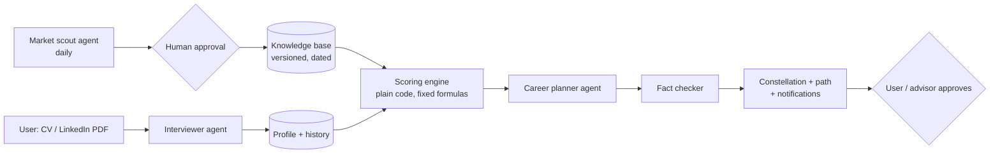

# HalaTuju: A Live Career Map That Reroutes as AI Changes Work

**SDC Hackathon 2026 · Preliminary Round · Domain 1: Aiversecity Future-Ready Workforce**
Team: _[team name]_ · Members: _[names]_ · Draft v0.1 · 22 Oct 2026

> **Status of this draft:** AI-assisted first draft for the team to rewrite in our own words. Figures marked **[verify]** must be checked against the original source before submission. All demo people, numbers and courses are sample data unless stated otherwise.

---

## 1. Summary

*HalaTuju* means "direction" in Malay. It is a live career map for workers whose jobs are being changed by AI.

You give it your CV or LinkedIn profile. It shows which of your skills AI is taking over, which jobs you can realistically move into, and a step-by-step learning path to get there. When AI or the job market changes, it **reroutes you automatically** and shows you exactly which news caused the change.

**One sentence:** *When AI changes the road, HalaTuju reroutes your career, and every change comes with its source.*

---

## 2. The problem

**Meet Priya** (sample persona). She is 36 and has worked in accounts payable at a shared-services centre in Penang for 11 years. Her centre has announced that AI agents will take over month-end close and invoice matching next year. Staff who can move into new roles within six months will be **redeployed, not retrenched**. She has about 6 hours a week to learn, and her HR team needs to know who can move where.

She has three questions, and today nothing answers them well:

1. **Which of my skills are still worth something?** Job titles hide the detail. AI rarely replaces a whole job at once; it takes over specific *tasks*. Priya can't see which of hers are affected.
2. **Where can I go from here?** Career tests and job sites suggest roles from keywords. They miss real transfers, such as her reconciliation experience being useful in carbon accounting (both trace every number back to a source document).
3. **Will the advice still be right next month?** Career assessments are one-off snapshots, and course lists go stale. AI is moving faster than any static plan.

**Scale in Malaysia:** a 2024 TalentCorp study estimated that around 620,000 jobs across 10 sectors will be significantly affected by AI, digitalisation and the green economy within a few years **[verify]**. Routine finance and admin roles are among the most exposed, while new rules such as Malaysia's National Sustainability Reporting Framework (NSRF) are creating demand for sustainability-reporting skills **[verify]**.

---

## 3. Target users

| User | Need | Role in HalaTuju |
|---|---|---|
| **Primary: mid-career workers in AI-exposed routine roles** (starting with finance and admin, e.g. accounts payable, data entry, payroll) | Know what to learn next, and keep that advice current | Builds a profile, explores jobs, follows a learning path |
| **Secondary: career advisors and HR teams** | Help many people make good, evidence-based plans | Review and approve paths; correct skill data |
| **Later: universities, TVET centres, TalentCorp / HRD Corp programmes** | Guide students and reskilling cohorts at scale | Use anonymised, aggregate views (future scope) |

We start narrow on purpose: **one sector (finance and admin) and one clear user moment** ("my centre is moving this work to AI agents, and I have six months to be redeployed"). The same engine extends to other sectors by adding data, not code.

---

## 4. Our solution: three pillars

| Pillar | What it means for the user | How it works |
|---|---|---|
| **1. Always current** | Advice reflects this week's AI and job market, not last year's | A market-scout agent searches daily for new AI capabilities and job-market signals, tied to specific tasks. A human approves each signal before it counts |
| **2. See your future** | One picture shows your skills, the skills you're missing, and the jobs you can reach | A 3D "career constellation": you at the centre, your skills on the inner ring, skills to learn on the middle ring, future jobs on the outer ring, with your path lit up |
| **3. Grows with you** | Your profile is permanent and keeps re-checking itself | Your profile keeps its history. Every time the knowledge base changes, it is re-scored and you're told what changed and why |

**The GPS idea ties them together:** your destination is a job, the route is the skills to learn, and *traffic* is AI disruption. When the road changes, you're rerouted.

---

## 5. User flow example: Priya's first week

**Step 1. Sign up (about 2 minutes).**
Priya uploads her LinkedIn profile PDF. The **Interviewer agent** reads it, notices gaps, and asks three short questions, for example: *"You mention SAP. Do you also run the weekly payment batch?"* She confirms a checklist of 10 skills and rates each from 1 to 5.

**Step 2. See where she stands.**
Her home screen shows a **Future-proof score: 60%** (the share of her skills that remain safe from AI in 2026). Three skills are flagged: *Invoice data entry* (AI has largely taken over), *Three-way matching* and *Payment runs* (at risk).

**Step 3. "Where you can go."**
The app ranks jobs that fit her today, each with a match score:
- Finance Automation Specialist: **63%** match, about 5 weeks of learning
- AI-Augmented Finance Analyst: **60%**, about 6 weeks
- ESG & Carbon Reporting Analyst: **58%**, about 6 weeks

**Step 4. GPS search.**
She types *"ESG analyst"*. The constellation focuses on that job. Two of the skills it needs she already has (*Audit trail documentation*, *Spreadsheet analysis*). Three she is missing, each with a distance in weeks. The app offers three routes:

| Route | Path | Weeks | AI risk |
|---|---|---|---|
| **Fastest** | Vendor reconciliation → GHG emissions accounting → ESG Analyst | 6 | Medium |
| **Balanced** (still good if AI moves fast) | Audit trail → Sustainability disclosure → ESG Analyst | 7 | Low |
| **Safest** | Process improvement → Supervising AI workflows → ESG Analyst | 10 | Low |

Each step shows *why* it works ("both trace every number back to a source document"), a course, its hours, whether it's free, and a reminder to ask HR about HRD Corp claims for paid courses.

**Step 5. Explore the future.**
She drags the year slider to 2030 and switches to *Fast AI adoption*. Her at-risk skills turn grey, connections through them close, and her ESG match drops from 58% to 46% if she does nothing. This makes the cost of waiting visible.

**Step 6. A human decides.**
She picks the Fastest route and taps **"Send path to my advisor."** Nothing goes into her learning plan until she or her advisor approves it.

**Step 7. Three days later: rerouted.**
The **Market scout** runs its daily search and finds that AI agents can now handle month-end reconciliation. After human approval, this becomes a dated signal: *Vendor reconciliation, AI exposure 54% → 72%, [source, date]*. HalaTuju re-scores her profile and notifies her:

> *Your Fastest route to ESG Analyst has changed. It now goes through Audit trail → Sustainability disclosure (7 weeks), because of [source].*

**Step 8. Six weeks later.**
She has finished GHG accounting basics. Her profile updates, her match for ESG Analyst rises, and her Future-proof score history shows the climb.

---

## 6. How it works

### 6.1 Architecture

**Design rule:** *agents run the workflow; the database and formulas are their tools.* Agents read, search, ask and explain. Every number on screen comes from the knowledge base through a fixed formula that we can show and explain.

### 6.2 The agents

| Agent | Job | Tools it may use |
|---|---|---|
| **Interviewer** | Turns a CV or LinkedIn PDF into a confirmed skill profile; asks follow-up questions where information is missing | Skill catalogue lookup (may only choose existing skill IDs) |
| **Job analyst** | Breaks the user's current job into tasks and checks which ones AI can already do | Task database, exposure scores |
| **Market scout** | Searches daily for new AI capabilities and job-market changes, task by task, and proposes dated signals | Web search API, arXiv API, job-posting sources, text extraction |
| **Career planner** | Ranks jobs, finds skill gaps, builds the three routes | Match and routing functions, course catalogue |
| **Fact checker** | Checks that every claim on screen links to a source record; flags or removes any that don't | Source records |

### 6.3 Knowledge base

| Table | Holds | Source |
|---|---|---|
| Jobs (today and future) | Job titles, required skills with weights | ESCO, O\*NET, MASCO 2020, plus job postings |
| Skills | Each skill broken into tasks | ESCO / O\*NET |
| Tasks | How much of each task AI can do (0–1), with source and date | ILO generative-AI exposure index; task-level exposure research; approved signals |
| Skill bridges | How much one skill carries over to another, and why | Shared tasks in ESCO / O\*NET, reviewed by the team |
| Courses | Skill → course, hours, free or paid, link | Public course catalogues |
| Signals | Dated finding → which task, which direction, how strong, evidence quote, who approved it | Market scout |
| Profile history | Dated snapshots of each user's skills and scores | User actions and re-scoring |

Every change is stored as a new **knowledge-base version**, so we can always show what changed and when.

### 6.4 The formulas

All scoring is plain code, so the same input always gives the same result.

- **Skill AI exposure** = average AI score of the skill's tasks, plus approved signals.
- **Taken over** = AI exposure is above a threshold *and* demand is falling. The threshold drops as the year moves forward, faster in the *Fast AI* scenario.
- **Match %** for a job = Σ (skill weight × your coverage) ÷ Σ skill weights.
  - *Coverage* = your level ÷ the level needed (max 100%). A skill you don't have gets partial credit if one of your skills bridges into it.
  - *Skill weight* = how often employers ask for it (share of job postings), boosted if ESCO lists it as essential.
- **Routes:** a shortest-path search over the skill-bridge network, the same kind of algorithm a GPS uses. Each road costs the weeks of learning (course hours ÷ your weekly hours), plus a penalty that depends on the route type:
  - *Fastest:* learning weeks plus "traffic" (a penalty for passing through AI-exposed skills).
  - *Safest:* mostly avoids AI-exposed skills, even if it takes longer.
  - *Balanced:* scored against the *Fast AI, 2030* scenario, so it holds up even in the worse future.
  - Skills AI has taken over are **closed roads**; no route goes through them.
- **Future-proof score** = share of your skills that are in demand and not taken over by AI, in the selected year and scenario.

### 6.5 Staying up to date: the scout pipeline

1. **Start from tasks, not headlines.** For each task in the knowledge base, the scout writes targeted searches (e.g. *"AI agent month-end reconciliation launch"*).
2. **Fetch and read** pages using established open-source tools.
3. **Remove duplicates** so one announcement isn't counted many times.
4. **Turn each finding into a signal:** which task, what kind (new AI capability / companies adopting it / hiring demand), direction, strength, an exact evidence quote, source, date.
5. **Score it:** source trust × how recent × how closely it matches the task × whether at least two independent sources agree.
6. **Human approval**, then apply it as a new knowledge-base version. Older signals count for less over time.
7. **Re-score all profiles** and notify users whose results changed.

---

## 7. How we know which skills a job needs

No one can *guarantee* what an employer will ask for. What we guarantee is that **every requirement is backed by evidence we can show, with a confidence level.**

1. **Official skill frameworks as the base.** ESCO lists the essential and optional skills for about 3,000 jobs. O\*NET rates skill importance from surveys of real workers. MASCO 2020 keeps job titles and duties true to Malaysia.
2. **What employers want now, from sources we are allowed to read.** Company careers pages (via public job-board APIs such as Greenhouse and Lever) and employers who enter their own requirements. AI extracts the skills mentioned and maps each one to an ESCO/O\*NET skill ID (it may not invent skill names). Job boards such as JobStreet and LinkedIn are link-only, because their terms forbid automated collection. Malaysian demand trends come from DOSM / OpenDOSM.
3. **Visible evidence and confidence** on every skill: *high* when the framework and postings agree, *medium* when only one source supports it, *low* when there are few postings.
4. **Measured accuracy.** We hand-check the skills extracted from a sample of postings and report the real accuracy.
5. **Human correction.** Advisors or HR can confirm or correct a job's skill list. Later, user outcomes (e.g. "got an interview") feed back in.

**The user's own skill level** is the second uncertainty. For now we use self-rating plus evidence from the CV. Short skill checks are planned next.

---

## 8. How we cover the six must-haves

| Must-have (Domain 1) | How HalaTuju delivers it | Where you see it |
|---|---|---|
| **1. Skills profile intake** | CV / LinkedIn PDF upload, Interviewer agent follow-up questions, confirm-and-rate checklist | Sign-up flow |
| **2. AI-trend signal layer (updatable, dated source)** | Daily market scout, human-approved dated signals, versioned knowledge base, "updated 3 days ago · 214 sources" | Agents panel, freshness indicator, signal notifications |
| **3. Future-role matching + skills gap** | Match % per job from evidence-weighted skills; skills you have vs. missing, with distance in weeks | "Where you can go" list, constellation |
| **4. Personalised reskilling pathway** | Shortest-path routes (Fastest / Balanced / Safest) fitted to the user's weekly hours, with courses and reasons | Path panel, step-by-step directions |
| **5. SDG mapping** | Every skill and job is tagged with the SDGs it supports, with a one-line reason (e.g. ESG Analyst → SDG 13 Climate Action: measures company emissions) | Skill and job details |
| **6. More than one future scenario** | *Moderate* vs *Fast* AI adoption, a 2026–2030 year slider, and a **Balanced** route that holds in both | Timeline controls, route options |

---

## 9. SDG alignment

| SDG | How HalaTuju contributes |
|---|---|
| **SDG 8: Decent Work and Economic Growth** (primary) | Helps workers in AI-exposed jobs move into growing roles before they are displaced |
| **SDG 4: Quality Education** (target 4.4: skills for employment) | Turns lifelong learning into a concrete, personal, up-to-date path |
| **SDG 10: Reduced Inequalities** | Reaches mid-career workers in routine roles, who are often left out of tech reskilling; prioritises free courses and HRD Corp-claimable options |
| **SDG 13: Climate Action** (through job mapping) | Shows workers realistic routes into green roles such as carbon accounting, where demand is growing |

SDG links are shown on each skill and job, with the reason, so they are part of the decision rather than decoration.

---

## 10. Humans in control and responsible AI

- **Suggest, don't decide.** No path enters a learning plan until the user or their advisor approves it.
- **Humans approve new knowledge.** The scout proposes signals; a person approves them before they affect anyone's score.
- **No invented facts.** Agents may only use skill, job and course IDs from the knowledge base. The fact checker blocks claims without a source.
- **Fairness by design.** The app never asks for or uses age, gender, race or religion.
- **Data rules.** The demo uses public, open or synthetic data only. No real personal data. Sources are credited.
- **Transparency.** Every AI model, API, dataset and tool is listed in our Tech & Tools Declaration.

---

## 11. Preliminary-round scope

| Feature | Prelim build | Later |
|---|---|---|
| Profile intake (upload + checklist) | Working | Short skill checks |
| Interviewer agent follow-up questions | Working | |
| Constellation view with routes and scenarios | Working (live demo) | |
| Match % and routing formulas | Working | |
| Job skill lists from ESCO / O\*NET + real postings | **3 jobs, one sector** | More sectors |
| Market scout | Runs on demand in the demo; scheduled daily job set up | Wider sources |
| Re-scoring + "what changed" notice | Working in-app | Email / push notifications |
| Advisor approval | Simple approve step | Advisor dashboard |
| Profile history | Stored snapshots (demo history marked as sample) | Long-term tracking |

**The most important feature that must run live:** the trend signal layer changing the route. The scout finds a dated signal, a person approves it, and the user's path visibly reroutes.

---

## 12. Tech stack and sponsor tools

| Area | Choice |
|---|---|
| Build and hosting | **Replit** (compulsory): development and live deployment |
| Code | **GitHub**, created after 19 Oct, public before submission, Apache 2.0 licence, committee added as collaborators |
| GPU work (if used) | **RunPod**: embedding model for matching posting text to skill IDs, and/or batch skill extraction (screenshot proof of Pod ID, GPU type and runtime) |
| LLM for agents | _[provider and model: to confirm, including any sponsor requirement]_ |
| Visualisation | three.js-based 3D network (3d-force-graph) |
| Data | ESCO, O\*NET, MASCO 2020, ILO exposure index, public course catalogues, public job postings |
| Search | Web search API and arXiv API for the market scout |

---

## 13. Hardest risks and fallbacks

| Risk | Fallback |
|---|---|
| **A live agent is slow or fails during the demo** | Scout and planner results are cached by knowledge-base version; the demo can replay the last approved run |
| **Trend data is noisy or wrong** | Two-source rule, human approval, evidence quotes on every signal, ageing of old signals |
| **The AI invents skills, jobs or courses** | Agents can only output IDs from the knowledge base; the fact checker blocks unsourced claims |
| **Job skill lists don't match what employers really want** | Postings-based weights, confidence labels, advisor corrections |
| **Search or LLM costs exceed free tiers** | Limit to one sector and about 15 tasks; batch the daily run |
| **Not enough time to build everything** | Prelim covers 3 jobs in one sector; the rest is clearly marked as future scope |

---

## 14. Expected impact and how we'll measure it

| Measure | Target for the prelim |
|---|---|
| Time from upload to first path | Under 3 minutes |
| Skills on any path that have a cited source | 100% |
| Accuracy of skill extraction from postings (hand-checked sample) | Reported honestly, whatever it is |
| Usability check | At least 3 non-technical testers can explain what their map means after 1 minute |

Long term: users who follow a path move into a growing role, and advisors can support more people with better evidence.

---

## 15. Roadmap

1. **Prelim (by 25 Oct):** one sector, three jobs, live rerouting demo.
2. **Finals (31 Oct – 1 Nov):** wider posting data, better route explanations, advisor view.
3. **After the hackathon:** more sectors; Malay and Chinese language support; partnerships with university career centres, TalentCorp and HRD Corp programmes; skill checks; employer-side views of local skill demand.

---

## 16. Before we submit (team checklist)

- [ ] Rewrite this draft in our own words; every member can explain every section
- [ ] Copy the content into the **official PRD template** (not in our files yet; download part 1 of the participant resources)
- [ ] Check every **[verify]** figure against its original source
- [ ] Confirm on Discord what the submit form's **"API Premium sponsor's technology"** requirement means, and add it to the plan
- [ ] Check ESCO, O\*NET, MASCO and course-data licences, and the terms of any job sites we collect postings from
- [ ] Replace sample numbers with real ones for the 3 demo jobs, or keep them clearly labelled as sample
- [ ] List all AI tools used, including for drafting and coding, in the Tech & Tools Declaration
