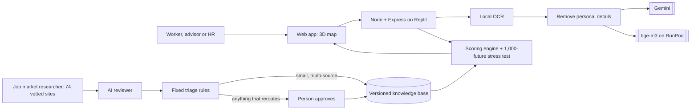

# SDC Hackathon 2026 · Phase 1: Preliminary Project Proposal (PRD draft)

> Our answers, in the section order of the official **SDC Hackathon Submission Template** (the Product Requirement Doc). Copy them into the official form, fill the _[brackets]_, check every _[verify]_ figure against its source, sign, and save the result here as a PDF. Word limits are the template's.

## 1. Team and project overview

| Field | Answer |
|---|---|
| Team name | _[team name]_ |
| Selected domain | Domain 1: Aiversecity Future-Ready Workforce |
| Selected SDG track (1–17) | **SDG 8** Decent Work and Economic Growth (targets 8.2, 8.5), with **SDG 4** target 4.4 (adults with skills for employment), and SDG 9, 12, 13 and 16 through the jobs and skills on the map |
| Project / solution name | **HalaTuju** ("direction" in Malay): a live career map that reroutes as AI changes work |
| Name (leader) | _[leader name]_ |
| Email and phone (leader) | _[as on the registration form]_ |
| University affiliation(s) | _[university]_ |
| Number of team members | _[n]_ |
| Live prototype | _[Replit deployment URL]_ |
| Code repository | https://github.com/shenenleow10521/SdcHackathon |

## 2. Executive summary and problem statement

### 2.1 The problem context *(250 words max)*

Priya (our sample persona) has processed invoices at a shared-services centre in Penang for eleven years. Her employer is handing invoice matching and month-end close to AI agents next year. Staff who move into a new role within six months are redeployed; the rest are not. She has six hours a week to learn.

She has three questions that today's tools don't answer:

1. **Which of my skills still count?** AI takes over tasks, not whole jobs, and job titles hide which tasks are affected.
2. **Where can I realistically go?** Keyword matching misses real transfers: reconciliation work carries straight into carbon accounting.
3. **Will this plan still be right next month?** Career assessments are one-off snapshots, while AI capabilities change weekly.

Her HR team has the mirror problem: who in the team can move to which open role, by when, at what training cost.

Malaysia's finance, admin and shared-services workforce sits in the occupations most exposed to generative AI (ILO Working Paper 140 places clerical support work highest _[verify: cite the exposure share]_), while new disclosure rules create demand for sustainability-reporting skills _[verify: NSRF / Bursa requirement]_. _[verify: one Malaysian headcount figure from the Domain 1 brief or MDEC/TalentCorp]_.

*Word count: 200*

### 2.2 The proposed AI solution *(300 words max)*

HalaTuju turns a CV into a living career map and keeps it current.

**Read the CV safely.** PDF, pasted text, scan or photo. Scans are read by local OCR, personal details are removed before any AI sees the text (99.4% of planted details on held-out test CVs), and Gemini plus bge-m3 embeddings (on RunPod) match what the person has done against ESCO's 13,939 skills. On 36 held-out test CVs the current job was identified 97.2% of the time.

**Show the map.** The person, their skills, skills to learn and jobs, with Fastest, Balanced and Safest routes fitted to their weekly hours, real courses and RM cost. Skills AI is taking over become closed roads. "Check any job" covers all 3,039 ESCO occupations with match %, skill gap, four AI-exposure sources (ILO, Anthropic Economic Index, GPTs-are-GPTs, our own model), O\*NET tasks with human ratings, DOSM wages and Malaysia's Critical Occupations List.

**Measure exposure ourselves.** Our model, trained on RunPod on 19,265 human-rated tasks, reaches r 0.919 on 185 occupations it never saw, and r 0.79 against the ILO index across 2,956 occupations.

**Test the plan.** Each plan is replayed in 1,000 simulated futures (AI speed, our model's measured error, study time, step length): "Your plan works in 100% of 1,000 possible futures", with the reasons it fails and what would make it sturdier.

**Keep it current, with a person in charge.** A daily Job market researcher reads 74 vetted sites, checks every quote word for word, and a second model reviews each claim. Fixed rules apply small multi-source changes; anything that would change a route goes to a person. When they approve, the route visibly reroutes, with the source attached. Every change is versioned and can be undone.

The AI reads and explains; fixed formulas set every number.

*Word count: 297*

## 3. Technical architecture and implementation plan

### 3.1 Conceptual tech stack

| Layer | Technology |
|---|---|
| Frontend | Vanilla JavaScript, 3d-force-graph (three.js) 3D map, GSAP; English and Bahasa Melayu |
| Backend | Node 22, TypeScript, Express 5; shared scoring engine (server and browser); local OCR (tesseract.js) |
| AI | Google Gemini API (gemini-3.5-flash-lite, gemini-3.1-flash-lite); BAAI/bge-m3 embeddings on RunPod Serverless; our own exposure model (bge-m3 + ridge, trained on RunPod) |
| Data | PostgreSQL (versioned knowledge base); ESCO v1.2.1, O\*NET, ILO WP140, Anthropic Economic Index, GPTs-are-GPTs, DOSM, MyCOL |
| Hosting | Replit Deployments (Reserved VM, PostgreSQL 16); GitHub Actions CI |

**Sponsor resources:** **Yes.** **RunPod**: final training of our exposure model on a GPU pod (RTX 4090) and the bge-m3 Serverless endpoint used at run time. **Replit**: hosts the live app and its database.

### 3.2 Design-thinking and deployment strategy *(200 words max)*

**Empathise.** One persona from the brief's workforce: a mid-career accounts payable clerk with a six-month redeployment window and six hours a week. Her fear is wasted effort on the wrong course, so every screen answers "what do I do this week".

**Define.** Three questions in order: which skills still count, where can I go, will the plan hold. Success: she picks a goal job, understands the route in under a minute, and knows her next step.

**Ideate.** We rejected a chatbot because its answers can't be checked. A map with routes makes AI change visible as closed roads, and a reroute shows what an approved change means for her.

**Prototype and test.** HTML prototypes on 22 Oct, then the full app. Benchmarks drove the fixes: the blind first privacy run (82.6%) forced scrubber fixes (99.4%); the first emerging-skill run (0 of 4 kept) forced a new page selection.

**Deploy.** Replit Deployments with PostgreSQL; 419 automated tests and CI on every push; labelled fallbacks when an AI service is down. Phase 2: a real-CV pilot with consent, and licensed Malaysian job-ad data.

*Word count: 181*

## 4. Preliminary environmental and SDG impact framework

| Metric category | Our response |
|---|---|
| **Target SDG sub-target(s)** | **8.5** full and productive employment and decent work for all; **8.2** productivity through technological upgrading; **4.4** increase the number of adults with relevant skills for employment. Green-job routes support **13** (climate action) and **12** (responsible production) |
| **Current problem baseline** | _[verify: share of Malaysian workers in highly AI-exposed occupations (DOSM LFS × ILO WP140)]_; _[verify: Malaysian reskilling need figure from the Domain 1 brief]_ |
| **Core measurable KPIs** | (1) Current job identified from a CV (held-out benchmark: 97.2%). (2) Personal details removed before any AI call (99.4%; blind 82.6%). (3) Share of signals reaching users that passed a quote check and a human or rule gate (100% by design, tested). (4) Time from CV to a costed, stress-tested route (about 15 s CV reading in the demo dry run). (5) Share of a pilot team with a route ready before their deadline (HR view) |
| **Phase 2 impact target** | (1) ≥ 95% on a fresh, unseen CV set. (2) ≥ 99% on a fresh set, measured blind. (3) 100%. (4) Under 1 minute end to end. (5) _[target for a pilot employer]_ |

## 5. Eligibility and readiness checklist

- [ ] All team members have completed the mandatory GenAI, Database and Cloud Deployment upskilling workshops. _[team to confirm]_
- [x] The project concept addresses a verified real-world problem mapped directly to one or more UN SDGs.
- [x] The proposed solution targets a functional, deployed application rather than a theoretical business case study.
- [ ] All fields in this template have been completed within the word limits stated. _(after filling the brackets)_

## 6. IP and originality declaration

### 6.1 Pre-existing / prior-owned work

**No.** All code, design and research were created during the SDC 2026 hackathon period (from 19 Oct 2026, 8 PM). _[team to confirm]_

### 6.2 Third-party code, datasets or models

**Yes.** All are open source or public and used under their licences, with attribution in the README and `docs/DATA_SOURCES.md`:

| Name | Type | Licence |
|---|---|---|
| Google Gemini API (gemini-3.5-flash-lite, gemini-3.1-flash-lite) | Model (API) | Gemini API terms |
| BAAI/bge-m3 | Model | MIT |
| Tesseract language data (eng, msa) via tesseract.js | Model / library | Apache-2.0 |
| ESCO v1.2.1 and the ESCO–O\*NET crosswalk | Dataset | EU reuse policy (CC BY 4.0) |
| O\*NET task statements and ratings | Dataset | CC BY 4.0 |
| "GPTs are GPTs" task labels | Dataset | MIT |
| ILO Working Paper 140 index | Dataset | CC BY 4.0 |
| Anthropic Economic Index | Dataset | CC BY (data) |
| DOSM / OpenDOSM wages | Dataset | CC BY 4.0 |
| MyCOL 2024/2025 (codes and titles only) | Dataset | Facts with citation |
| Express, zod, multer, unpdf, pg, PGlite, 3d-force-graph, GSAP, Lucide, Geist | Code | MIT / Apache-2.0 / ISC / OFL / GreenSock standard |

### 6.3 Employment-related IP conflicts

**No.** _[team to confirm that no member is bound by an agreement that could claim this work]_

## 7. Declaration

By submitting this proposal, the team leader confirms that the information provided is accurate to the best of the team's knowledge and that the project will be original work created during the SDC 2026 hackathon period.

Signature: _[leader name] (Team Leader, typed)_ Date: _[date]_
