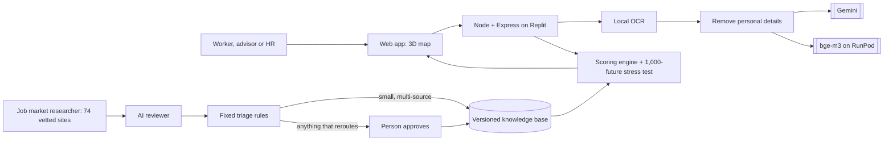

# SDC Hackathon 2026 · Phase 1: Preliminary Project Proposal

> **For the teammate filling the official form.** This file follows the official template `1. SDC Hackathon_ Submission Template.docx` field by field, in the same order and with the same labels and word limits.
>
> 1. Open a **copy** of the official .docx (the originals are in the organisers' Google Drive folder, "2. Template for docs inside GitHub Rep").
> 2. Copy each answer below into the matching box. Keep the template's own wording and layout; don't add or remove sections.
> 3. Fill every **🟨 TEAM** item. Only the team can answer these. Search this file for 🟨 to find them all.
> 4. Tick the boxes: ☒ = tick, ☐ = leave empty.
> 5. Check each word count after pasting (Word shows it at the bottom left). Limits are in the headings.
> 6. Sign, date, then **File → Save As → PDF** named **`SDC2026_TeamName_Preliminary.pdf`** (replace `TeamName`). Put it in this `submission/` folder.

**Submission deadline:** 25 October 2026 (portal closes Sun 25 Oct, 07:59:59 MYT)

---

## 1. Team & Project Overview

| Field | Answer |
|---|---|
| Team Name | 🟨 TEAM |
| Selected Domain | Domain 1: Aiversecity Future-Ready Workforce |
| Selected SDG Track (1–17) | SDG 8: Decent Work and Economic Growth (with SDG 4, target 4.4) |
| Project / Solution Name | HalaTuju: a live career map that reroutes as AI changes work |
| Name (Leader) | 🟨 TEAM |
| Email & Phone (Leader) | 🟨 TEAM (as on the registration form) |
| University Affiliation(s) | 🟨 TEAM |
| Number of Team Members | 🟨 TEAM |

---

## 2. Executive Summary & Problem Statement

### 2.1 The Problem Context *[Maximum 250 words]*

> Template asks: the specific real-world challenge, who is affected, why it matters, and the social, environmental or economic issues involved.

Priya (our sample persona) has processed invoices at a shared-services centre in Penang for eleven years. Her employer is handing invoice matching and month-end close to AI agents next year. Staff who move into a new role within six months are redeployed; the rest are not. She has six hours a week to learn.

She has three questions that today's tools don't answer:

1. **Which of my skills still count?** AI takes over tasks, not whole jobs, and job titles hide which tasks are affected.
2. **Where can I realistically go?** Keyword matching misses real transfers: reconciliation work carries straight into carbon accounting.
3. **Will this plan still be right next month?** Career assessments are one-off snapshots, while AI capabilities change weekly.

Her HR team has the mirror problem: who in the team can move to which open role, by when, at what training cost.

Malaysia's finance, admin and shared-services workforce sits in the occupations most exposed to generative AI (ILO Working Paper 140 places clerical support work highest 🟨 TEAM: add the exposure share from ILO WP140), while new disclosure rules create demand for sustainability-reporting skills 🟨 TEAM: confirm the NSRF / Bursa requirement. 🟨 TEAM: add one Malaysian headcount figure (Domain 1 brief, MDEC or TalentCorp).

*Word count: about 170 before the 🟨 figures are added, so about 80 words are left for them*

### 2.2 The Proposed AI Solution *[Maximum 300 words]*

> Template asks: how the app applies AI to the problem, **and which tools or skills from the SDC Phase 1 workshops (GenAI APIs, database architecture, cloud hosting) you use.**

HalaTuju turns a CV into a living career map and keeps it current. It uses all three Phase 1 workshop skills: a GenAI API (Google Gemini), database architecture (PostgreSQL as a versioned knowledge base) and cloud hosting (Replit Deployments).

**Read the CV safely.** PDF, pasted text, scan or photo. Scans are read by local OCR, personal details are removed before any AI sees the text (99.4% of planted details on held-out test CVs), and Gemini plus bge-m3 embeddings match what the person has done against ESCO's 13,939 skills. On 36 held-out test CVs the current job was identified 97.2% of the time.

**Show the map.** The person, their skills, skills to learn and jobs, with Fastest, Balanced and Safest routes fitted to their weekly hours, real courses and RM cost. Skills AI is taking over become closed roads. "Check any job" covers all 3,039 ESCO occupations with match %, skill gap, four AI-exposure sources, DOSM wages and Malaysia's Critical Occupations List.

**Measure exposure ourselves.** Our model, trained on RunPod on 19,265 human-rated tasks, reaches r 0.919 on 185 occupations it never saw, and r 0.79 against the ILO index across 2,956 occupations.

**Test the plan.** Each plan is replayed in 1,000 simulated futures: "Your plan works in 100% of 1,000 possible futures", with the reasons it fails and what would make it sturdier.

**Keep it current, with a person in charge.** A daily Job market researcher reads 74 vetted sites, checks every quote word for word, and a second model reviews each claim. Fixed rules apply small multi-source changes; anything that would change a route goes to a person. When they approve, the route visibly reroutes, with the source attached. Every change can be undone.

The AI reads and explains; fixed formulas set every number.

*Word count: about 295. Check it in Word after pasting; trim a clause if Word counts over 300.*

---

## 3. Technical Architecture & Implementation Plan

### 3.1 Conceptual Tech Stack

> Template asks: technologies, frameworks, APIs and databases for a deployed prototype, plus a simple system block diagram (in the box or as an appendix), plus the sponsor question below.

| Layer | Technology |
|---|---|
| Frontend | Vanilla JavaScript, 3d-force-graph (three.js) 3D map, GSAP; English and Bahasa Melayu |
| Backend | Node 22, TypeScript, Express 5; shared scoring engine (server and browser); local OCR (tesseract.js) |
| AI | Google Gemini API (gemini-3.5-flash-lite, gemini-3.1-flash-lite); BAAI/bge-m3 embeddings on RunPod Serverless; our own exposure model (bge-m3 + ridge, trained on RunPod) |
| Database and data | Replit PostgreSQL 16 (versioned knowledge base); ESCO v1.2.1, O\*NET, ILO WP140, Anthropic Economic Index, GPTs-are-GPTs, DOSM, MyCOL |
| Hosting | Replit Deployments (Reserved VM, PostgreSQL 16); GitHub Actions CI |

**System block diagram.** 🟨 TEAM: Word can't show the diagram code below. Open this file on GitHub (it draws the diagram), take a screenshot, and paste it into the box or add it as "Appendix A: System block diagram".

**Did your project utilize any official SDC sponsor-provided GenAI API or Cloud Platform? If yes, specify which one and how it is used.**

Yes.
- **RunPod:** the final training run of our AI-exposure model on a GPU pod (RTX 4090), and the bge-m3 Serverless endpoint the app calls to read CVs.
- **Replit:** hosts the live app and its PostgreSQL database; all keys are kept in Replit Secrets.

### 3.2 Design-Thinking & Deployment Strategy *[Maximum 200 words]*

**Empathise.** One persona from the brief's workforce: a mid-career accounts payable clerk with a six-month redeployment window and six hours a week. Her fear is wasted effort on the wrong course, so every screen answers "what do I do this week".

**Define.** Three questions in order: which skills still count, where can I go, will the plan hold. Success: she picks a goal job, understands the route in under a minute, and knows her next step.

**Ideate.** We rejected a chatbot because its answers can't be checked. A map with routes makes AI change visible as closed roads, and a reroute shows what an approved change means for her.

**Prototype and test.** HTML prototypes on 22 Oct, then the full app. Benchmarks drove the fixes: the blind first privacy run (82.6%) forced scrubber fixes (99.4%); the first emerging-skill run (0 of 4 kept) forced a new page selection.

**Deploy.** Replit Deployments with PostgreSQL; 419 automated tests and CI on every push; labelled fallbacks when an AI service is down. Phase 2: a real-CV pilot with consent, and licensed Malaysian job-ad data.

*Word count: 181*

---

## 4. Preliminary Environmental & SDG Impact Framework

> Template note: judges use the target, baseline and KPI **during shortlisting to score Innovation & Creativity and Feasibility of Build.** The baseline must be **a number**, the Phase 2 target must be **a percentage**, and every source must be cited. Vague or unsupported figures weaken the case for Phase 2. **This is the most important 🟨 item in this file.**

| Metric Category | Your Response |
|---|---|
| **Target SDG Sub-Target(s)** | **Target 8.5:** "By 2030, achieve full and productive employment and decent work for all women and men…". **Target 8.2:** "Achieve higher levels of economic productivity through diversification, technological upgrading and innovation…". **Target 4.4:** "By 2030, substantially increase the number of youth and adults who have relevant skills, including technical and vocational skills, for employment, decent jobs and entrepreneurship." |
| **Current Problem Baseline** | 🟨 TEAM: one number with its source, for example "X% of Malaysian workers are in occupations highly exposed to generative AI (ILO WP140 exposure index applied to DOSM Labour Force Survey employment by occupation)". Optionally a second one: a Malaysian reskilling-need figure from the Domain 1 brief. |
| **Core Measurable KPI** | (1) % of CVs where the current job is identified correctly (held-out benchmark today: 97.2%). (2) % of planted personal details removed before any AI call (99.4%; blind run 82.6%). (3) % of market signals reaching users that passed a quote check and a human or rule gate (100% by design, tested). (4) Time from CV to a costed, stress-tested route (about 15 s in the demo dry run). (5) % of a pilot team with a route ready before their redeployment deadline (HR view). |
| **Phase 2 Impact Target** | (1) ≥ 95% on a fresh, unseen CV set. (2) ≥ 99% on a fresh set, measured blind. (3) 100%. (4) Under 1 minute end to end. (5) 🟨 TEAM: a % target for a pilot employer, e.g. "≥ 80% of a pilot team". |

**Sources:** 🟨 TEAM: list the citation for each figure above, e.g. ILO Working Paper 140 (2025); DOSM Labour Force Survey; our benchmark files `eval/RESULTS.md` and `eval/EMERGING.md` in the repo.

---

## 5. Eligibility & Readiness Checklist

Tick all boxes that apply before submitting.

- ☐ All team members have completed the mandatory GenAI, Database, and Cloud Deployment upskilling workshops. 🟨 TEAM: tick only if true for every member.
- ☒ The project concept addresses a verified real-world problem mapped directly to one or more UN SDGs.
- ☒ The proposed solution targets a functional, deployed application rather than a theoretical business case study.
- ☐ All fields in this template have been completed within the word limits stated. 🟨 TEAM: tick after every 🟨 is filled and the word counts are checked.

---

## 6. IP & Originality Declaration

### 6.1 Pre-Existing / Prior-Owned Work

Does this submission include any code, design, research, or other work that any team member created or owned before the start of this hackathon?

☐ Yes ☒ No 🟨 TEAM: confirm

If yes, briefly describe what was pre-existing and which team member(s) owned it: N/A. All code, design and research were created during the SDC 2026 hackathon period (from 19 Oct 2026, 8 PM).

### 6.2 Third-Party Code, Datasets, or Models

Does your project use any third-party code libraries, open-source frameworks, public/private datasets, or pre-trained AI models that your team did not create?

☒ Yes ☐ No

If yes, list them below (open-source use is permitted provided it is declared and properly licensed/attributed):

| Name | Type (code/dataset/model) | License |
|---|---|---|
| Google Gemini API (gemini-3.5-flash-lite, gemini-3.1-flash-lite) | Model | Gemini API terms |
| BAAI/bge-m3 | Model | MIT |
| Tesseract language data (eng, msa) | Model | Apache-2.0 |
| ESCO v1.2.1 and the ESCO–O\*NET crosswalk | Dataset | EU reuse policy (CC BY 4.0) |
| O\*NET task statements and ratings | Dataset | CC BY 4.0 |
| "GPTs are GPTs" task labels | Dataset | MIT |
| ILO Working Paper 140 exposure index | Dataset | CC BY 4.0 |
| Anthropic Economic Index | Dataset | CC BY (data) |
| DOSM / OpenDOSM wages | Dataset | CC BY 4.0 |
| MyCOL 2024/2025 (codes and titles only) | Dataset | Facts, used with citation |
| Express, TypeScript, zod, multer, unpdf, tesseract.js, pg, PGlite | Code | MIT / Apache-2.0 |
| 3d-force-graph (three.js), GSAP, Lucide icons, Geist font | Code | MIT / GreenSock standard / ISC / SIL OFL 1.1 |

The full list with versions is in the Tech & Tools Declaration (`SDC2026_TeamName_TechDeclaration.pdf`), section 2.2.

### 6.3 Employment-Related IP Conflicts

Is any team member currently bound by an employment, internship, or consulting agreement under which their employer could claim ownership of work they create during this hackathon?

☐ Yes ☒ No 🟨 TEAM: confirm for every member

If yes, please describe the nature of the agreement and which member it concerns: N/A

---

## 7. Declaration

By submitting this proposal, the team leader confirms that the information provided is accurate to the best of the team's knowledge and that the project will be original work created during the SDC 2026 hackathon period.

[Signature] 🟨 TEAM: leader signs

[Date] 🟨 TEAM
